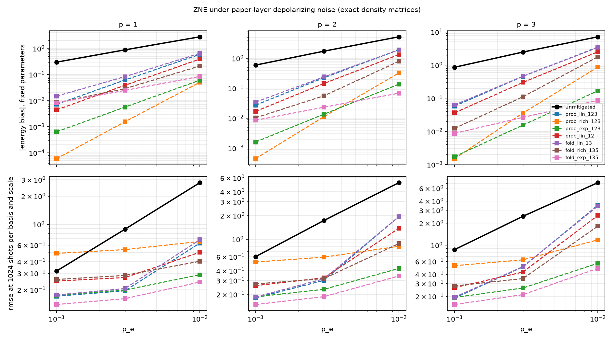
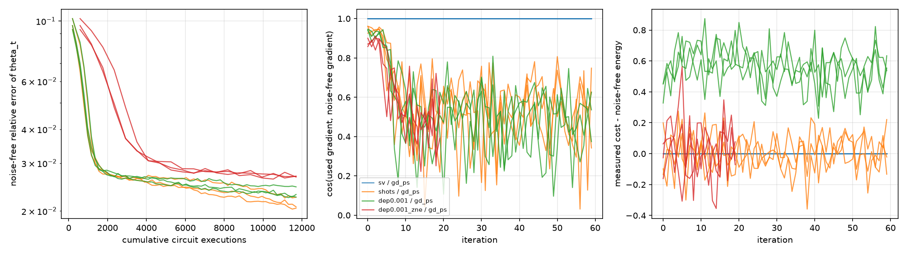

# graph_hva error mitigation: ZNE on paper-layer noise and mitigated gradient descent

Status (2026-11-17): implementation, a fixed-parameter ZNE characterisation (exact density
matrices) and a limited three-seed gradient-descent comparison on the PRB 105 2x6 rectangle are
done. Nothing here is a general statement about mitigation on hardware: the noise is the PRB 106
logical-layer model ([`graph_hva_noise.md`](graph_hva_noise.md)), not a device.

This milestone adds the error-mitigation layer the noisy `graph_hva` studies were missing, and
the data format a trajectory surrogate needs. It is the foundation of the PIDN comparison
(Liu and Wang, arXiv:2605.02066), which is developed on the separate branch
`feature/graph-hva-pidn`.

## 1. What was added

| piece | where | what it does |
|---|---|---|
| exchange-gate shift rule | `ansatz/unshare.py`, `optimizers/gradients.py` | exact parameter-shift gradient of `graph_hva` with **2 energies per exchange gate** |
| ZNE on layer noise | `noise.py` (`scale_noise_probability`, `fold_noise_layers`), `mitigation/wrappers.py`, `estimators.py` | zero-noise extrapolation for `backend.kind = "logical_noise"` by probability scaling or layer folding |
| ZNE gradient | `ParameterShift` + `zne_gradient_weights` | gradient of the *extrapolated* cost by the chain rule over the per-scale gradients |
| gradient trajectories | `optimizer.measure_current`, `track_ideal_gradient`, `trajectory.npz` | per-iteration record `(theta_t, C_noisy, C_ZNE, g per scale, g_ZNE, theta_{t+1}, cost)` |
| fixed-parameter ZNE analysis | `zne_analysis.py`, CLI `zne-analysis` / `zne-summary` | bias, variance and rmse of every ZNE method on saved parameters, exact density matrices |
| trajectory analysis | `trajectory_analysis.py`, study summaries | gradient cosine / error against the exact noise-free gradient, cost curves |
| fast trajectory kernels | `logical_noise.fast_kernels` | ~2x faster sampling (opt-in; default unchanged, see Sec. 6) |

### 1.1 Parameter shift for the exchange gate

`graph_hva` builds every exchange gate as `G(theta) = exp(-i theta/2 (XX + YY + ZZ)) =
RZZ(theta) RYY(theta) RXX(theta)`. The previous unsharing treated the three rotations as three
occurrences (shift `pi/2` each, 6 energies per gate). The generator `(XX + YY + ZZ)/2` has only
two eigenvalues, `+1/2` (triplet) and `-3/2` (singlet), a gap of 2, so every expectation value
(noisy or not, for any channel that does not depend on `theta`) is `a + b cos 2 theta + c sin 2
theta` in that angle and

    dE/dtheta = E(theta + pi/4) - E(theta - pi/4).

`unshare_parameters(..., exchange_gates=True)` (used automatically for `graph_hva`) gives one
occurrence per gate with that rule; the 2x6 rectangle at `p = 2` needs **64 energies per
gradient instead of 192**. Verified against finite differences to `1e-9` (noise-free) and on
exact noisy density matrices (`tests/unit/test_mitigation_gd.py`). The ring ansatzes keep the
historical rule.

### 1.2 ZNE on PRB 106 layer noise

Folding individual gates (the existing `gate_folding`, for compiled circuits) adds no noise in
the layer model: the noise sits at the layer boundaries, not on gates. Two amplifications act on
the noise locations themselves (`[mitigation.zne] noise_scaling`):

* **`probability`**: every location's error probability `p_e -> lambda p_e`, gates unchanged.
  Exact amplification of this model; the simulation analogue of pulse stretching, not
  something a gate-model device can do directly. Any `lambda >= 1`.
* **`layer_folding`**: every noisy layer `L` (singlet preparation, each exchange layer, each
  followed by its channels) becomes `L (L^dag L)^k` with the channels after each copy:
  `lambda = 2k + 1` times as many noise locations, same unitary. The digital variant a device
  could run; the circuit is `lambda` times deeper.

Each noise scale gets its own random stream (independent jobs). `scales` must start with 1;
`metadata.final_zne` records the per-scale energies of the final re-measurement, so the
unmitigated energy of the same shots is always available. Readout correction, symmetry
filtering and twin rescaling on `logical_noise` (with an optional readout error) are compared
with ZNE in [`graph_hva_m2_mitigation.md`](graph_hva_m2_mitigation.md).

### 1.3 Gradient of the extrapolated cost

With `optimizer.measure_current = true` a parameter-shift batch also contains the current point.
Under ZNE every row is measured at every scale `lambda`; the shift rule gives one gradient
`g_lambda` per scale and

    g_ZNE = sum_lambda w_lambda g_lambda,     w_lambda = d E_ZNE / d E_lambda (at theta_t).

For the polynomial fits `w` are the fit coefficients (identical to extrapolating each gradient
component, which is what the PIDN paper describes); for the exponential fit it is the chain rule
(`w_lambda = E_ZNE c_lambda / E_lambda`). Cost per iteration: `(2K + 1) x L` energies, i.e.
`65 x 3 = 195` energies (585 circuits) for `K = 32` gates and three scales.

### 1.4 The trajectory record (`trajectory.npz`)

Gradient-descent runs with `measure_current` save, per iteration `t` (schema in
`kagome_vqe.vqe.gradient_trajectory`):

| key | shape | meaning |
|---|---|---|
| `theta`, `theta_next` | `(T, n)` | point of the gradient, and `theta_t - lr grad_t` |
| `value`, `value_std` | `(T,)` | measured cost at `theta_t` (ZNE-extrapolated under ZNE) |
| `scales` | `(L,)` | noise scales (`[1]` without ZNE) |
| `scale_values`, `scale_stds` | `(T, L)` | `C_lambda(theta_t)`; column 0 is the raw noisy cost `C_noisy` |
| `scale_grads` | `(T, L, n)` | parameter-shift gradient at each scale |
| `zne_weights` | `(T, L)` | chain-rule weights, `grad = zne_weights @ scale_grads` |
| `grad` | `(T, n)` | the gradient the optimiser used (`g_ZNE` under ZNE) |
| `evaluations`, `circuit_executions`, `shots` | `(T,)` | cumulative cost after iteration `t` |
| `ideal_energy`, `ideal_grad` | `(T,)`, `(T, n)` | exact noise-free energy and gradient (`track_ideal_gradient`; bookkeeping only) |

This is exactly the PIDN training tuple `(theta_{0:t}, C_noisy(theta_t), C_ZNE(theta_t),
theta_{t+1}, g_ZNE(theta_t))` (paper Eq. 33), plus the per-scale raw data and a noise-free
reference no hardware experiment has.

## 2. Fixed-parameter ZNE characterisation

`configs/mitigation/graph_hva_zne_fixed.toml` (+ `_bitflip`): the noise-free L-BFGS-B optima of
the PRB 105 2x6 rectangle (`p = 1, 2`: seeds 1-3; `p = 3`: seed 1; the sources of the PRB 106
analysis), evaluated -- not optimised -- under paper-layer noise with **exact density matrices**
at every noise scale. `bias` = energy minus the noise-free energy of the same parameters; `se` =
standard error at 1024 shots per basis and scale (from the exact per-group variances); `rmse =
sqrt(bias^2 + se^2)`. Means over seeds.

Depolarising noise, `p = 2` (32 parameters, `n d = 132` locations):

| `p_e` | unmitigated bias / rmse | prob. 1,2,3 linear | prob. 1,2,3 Richardson | prob. 1,2,3 exponential | fold 1,3 linear | fold 1,3,5 exponential |
|---|---|---|---|---|---|---|
| 1e-3 | +0.590 / 0.601 | +0.027 / 0.180 | +0.0004 / 0.513 | -0.002 / 0.186 | +0.034 / 0.185 | +0.009 / **0.149** |
| 3e-3 | +1.721 / 1.726 | +0.223 / 0.301 | +0.011 / 0.593 | -0.014 / 0.232 | +0.238 / 0.315 | +0.023 / **0.187** |
| 1e-2 | +5.199 / 5.202 | +1.920 / 1.937 | +0.321 / 0.813 | -0.136 / 0.426 | +1.910 / 1.927 | +0.068 / **0.342** |

(entries: remaining bias / rmse; unmitigated `se` 0.114, 0.127, 0.158.) Bit flip at `p_e = 1e-3`
(`p = 2`) behaves the same: unmitigated +0.588, linear +0.036, exponential +0.008, folding
exponential +0.017 (rmse 0.181 / 0.186 / 0.149). `p = 1` and `p = 3` follow the same pattern
with smaller / larger bias (report: `results/<ts>-graph_hva_zne_fixed/report.md`; data:
[`data/graph_hva_zne_fixed_points.csv`](data/graph_hva_zne_fixed_points.csv)).



Reading:

* **The noisy energy decays almost exactly exponentially in `lambda`** (local depolarising noise
  on a traceless Hamiltonian: every error roughly multiplies the energy by a constant), so the
  exponential fit leaves 0.3 % (1e-3) to 2.6 % (1e-2) of the bias, slightly over-correcting;
  linear fits leave 5 % (1e-3) to 37 % (1e-2) because they ignore the curvature.
* **Variance is the price**: per energy, ZNE multiplies the standard error by ~1.6 (linear or
  exponential over 1, 2, 3), 1.3 (exponential over folds 1, 3, 5: longer lever arm) or 4.5
  (Richardson), on top of using 2-3 circuits per energy. At `p_e = 1e-3` with 1024 shots, every
  reasonable method is shot-noise limited (bias < se), and the rmse falls from 0.60 to
  0.15-0.19; at `1e-2` only the exponential fits help substantially.
* **Probability scaling and layer folding agree at small `p_e`** (same `lambda`, same first-order
  amplification; checked in `test_folding_and_probability_scaling_agree_to_first_order`).
  Folding to `lambda = 3, 5` costs 3-5 times deeper circuits (layer cost 9 versus 3 per energy).

## 3. ZNE gradient descent (limited comparison)

`configs/studies/graph_hva_zne_gd_representative.toml`, results
`results/20261116T161135Z-graph_hva_zne_gd` (12 runs, all completed; tables in
[`data/graph_hva_zne_gd_runs.csv`](data/graph_hva_zne_gd_runs.csv) and
[`data/graph_hva_zne_gd_trajectory_runs.csv`](data/graph_hva_zne_gd_trajectory_runs.csv)).

* **System:** PRB 105 2x6 rectangle, `graph_hva` `p = 2` without H0 (32 parameters, 32 exchange
  gates), `E0 = -19.910298`; `x0 = 0.1 U[0, 1)^32` from the seed (same per seed for every
  backend); seeds 1-3.
* **Optimiser:** plain gradient descent, `lr = 0.05`, exchange-gate parameter shift plus the
  current point (65 energies per iteration). The learning rate was chosen once on noise-free
  statevector descent (0.02 / 0.05 / 0.1 tried; 0.05 fastest without overshoot) and not tuned per
  backend.
* **Backends and budget:** every shot-based backend gets **11,980,800 shots** (+ a final
  re-measurement with 16384 shots per basis and scale): 60 unmitigated iterations or 20 ZNE
  iterations (3 noise scales). 1024 shots per basis (and scale).

| backend | iterations | noise-free error at it. 5 / 10 / 19 | final noise-free error (median, range) | final fidelity | mean gradient error vs noise-free (its 0-9 / 10-19) | final measured - noise-free energy |
|---|---|---|---|---|---|---|
| `sv` (no noise, exact) | 60 | 0.0326 / 0.0266 / 0.0254 | 0.0205 (0.0203-0.0210) | 0.684 | 0 / 0 | 0 |
| `shots` (`p_e = 0`) | 60 | 0.0334 / 0.0272 / 0.0258 | 0.0207 (0.0197-0.0222) | 0.689 | 0.93 / 0.99 | +0.014 |
| `dep0.001` unmitigated | 60 | 0.0343 / 0.0271 / 0.0263 | 0.0229 (0.0223-0.0245) | 0.667 | 1.02 / 1.01 | **+0.575** |
| `dep0.001_zne` (prob. 1,2,3 linear) | 20 | 0.0334 / 0.0276 / 0.0268 | 0.0265 (0.0263-0.0276) | 0.631 | 1.54 / 1.59 | **+0.002** |

(Error = `|E_ideal(theta) - E0| / |E0|` of the parameters. Gradient error = mean
`|g_used - g_ideal|`; noise-free gradient norm falls from ~2.8 at the start to ~0.2 after 10
iterations. Measured energy = the run's final re-measurement: raw for `dep0.001`,
ZNE-extrapolated for `dep0.001_zne`.)



What this shows, for this system, noise level and budget:

1. **At equal iterations the four backends are indistinguishable** (error 0.033 / 0.027 / 0.026
   at iterations 5 / 10 / 19). Local depolarising noise at `p_e = 1e-3` mainly *rescales* the
   energy (Sec. 2: nearly exponential decay in the noise strength, a bias that hardly depends
   on the parameters), so it barely changes the gradient direction, and removing the bias does
   not improve the descent.
2. **The descent is shot-noise limited after ~10 iterations.** The noise-free gradient shrinks to
   ~0.2 while the shot noise of a 32-component parameter-shift gradient at 1024 shots has norm
   ~1.0 (cosine to the noise-free gradient drops from ~0.8 to ~0.5 for every shot-based
   backend). ZNE *increases* that noise by ~1.5x (linear extrapolation over 1, 2, 3).
3. **At equal cost ZNE gradient descent is worse** (0.0265 vs 0.0229): it buys 3x fewer
   iterations with the same shots, without a better direction.
4. **ZNE does what it is for: the energy.** The measured cost of the ZNE runs is within +0.02
   of the noise-free energy along the whole trajectory (unmitigated +0.56), and the final
   re-measurement within +0.002 (unmitigated +0.575, i.e. 2.9 % of `E0`).

So, on this model: optimise with cheap unmitigated (or shots-only) gradients, and spend ZNE on
the energy estimate. This repeats, with ZNE, the transfer finding of
[`graph_hva_noisy_optimizers.md`](graph_hva_noisy_optimizers.md) (the noise bias is nearly
parameter-independent). It need not hold for noise that distorts the landscape more (compiled
hardware noise, coherent errors), at stronger `p_e`, or where gradients are larger than the shot
noise. It is also the setting in which PIDN (which reproduces ZNE gradient descent more cheaply)
is tested: a surrogate of ZNE-GD can at best match unmitigated GD in direction quality here.

Wall time per run (shared machine, single-threaded, fast kernels): ~11 min unmitigated, ~20 min
ZNE (both 11.7k circuit executions; noise-scaled circuits have more erroneous shots to
simulate).

## 4. Reproduction

```bash
# fixed-parameter ZNE (needs the noise-free optima of graph_hva_optimizer_representative and
# graph_hva_noise_reference in results/; exact density matrices, ~1 h CPU, --workers parallelises)
uv run kagome-vqe zne-analysis configs/mitigation/graph_hva_zne_fixed.toml --workers 4
uv run kagome-vqe zne-analysis configs/mitigation/graph_hva_zne_fixed_bitflip.toml

# ZNE gradient descent (12 runs, ~2 CPU-hours; one process per run as below, then summary)
uv run kagome-vqe study configs/studies/graph_hva_zne_gd_representative.toml --dry-run
uv run kagome-vqe study configs/studies/graph_hva_zne_gd_representative.toml \
    --only dep0.001_zne-gd_ps-s1 --no-summary            # creates results/<ts>-graph_hva_zne_gd
uv run kagome-vqe study configs/studies/graph_hva_zne_gd_representative.toml \
    --resume results/<ts>-graph_hva_zne_gd --only <run> --no-summary   # one per remaining run
uv run kagome-vqe study-summary results/<ts>-graph_hva_zne_gd
```

A single run, e.g. ZNE gradient descent with probability scaling:

```toml
[optimizer]
type = "gd"
gradient = "parameter_shift"
lr = 0.05
maxiter = 20
measure_current = true

[backend]
kind = "logical_noise"
shots = 1024
logical_noise = { channel = "depolarizing", probability = 1e-3, fast_kernels = true }

[mitigation]
zne = { scales = [1, 2, 3], extrapolation = "linear", noise_scaling = "probability" }
```

## 5. Limitations

* One lattice (12 sites), one depth for optimisation (`p = 2`), one noise level and channel for
  optimisation (depolarising `1e-3`), three seeds, one learning rate (not tuned per backend).
* The noise model is PRB 106's logical-layer Pauli noise. On it, ZNE works unusually well
  (nearly exponential decay); compiled hardware noise (`aer_noisy`), with coherent errors,
  crosstalk and readout error, has not been mitigated with these tools yet.
* Probability scaling is a simulation device. Layer folding is the device-realisable variant
  and costs `lambda` times deeper circuits; the GD study uses probability scaling.
* The other M2 techniques (readout, symmetry, twin) are characterised in
  [`graph_hva_m2_mitigation.md`](graph_hva_m2_mitigation.md), not inside gradient descent.

## 6. Engine note: fast kernels

`logical_noise.fast_kernels = true` applies exchange gates as `a I + b SWAP` (a weighted sum of
the state and its qubit-swapped view), rotates measurement bases with butterflies and propagates
trajectories in cache-sized chunks: ~2x faster at 12 qubits. States agree with the reference
kernels to `1e-16`, but a last-digit change of a probability can change a multinomial draw and
everything after it, so sampled outcomes are not bitwise identical. The default stays `false`,
which reproduces every earlier noisy run bit for bit (checked against the previous engine on 20
seeds); the new studies set it explicitly.
