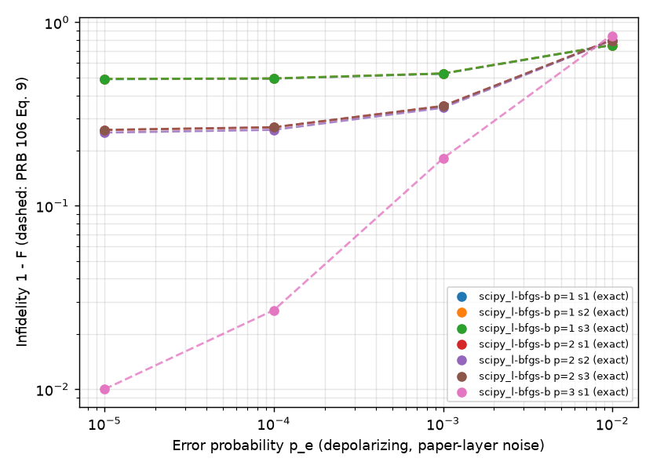
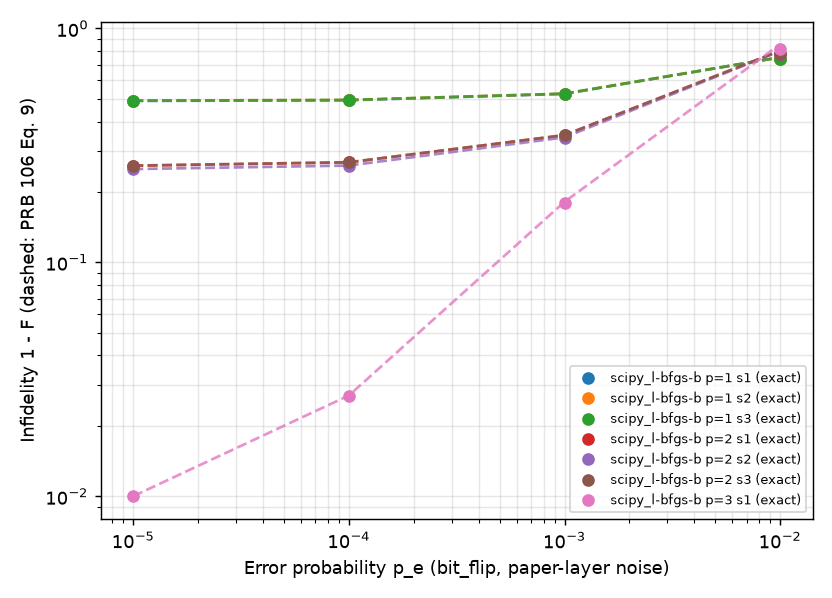
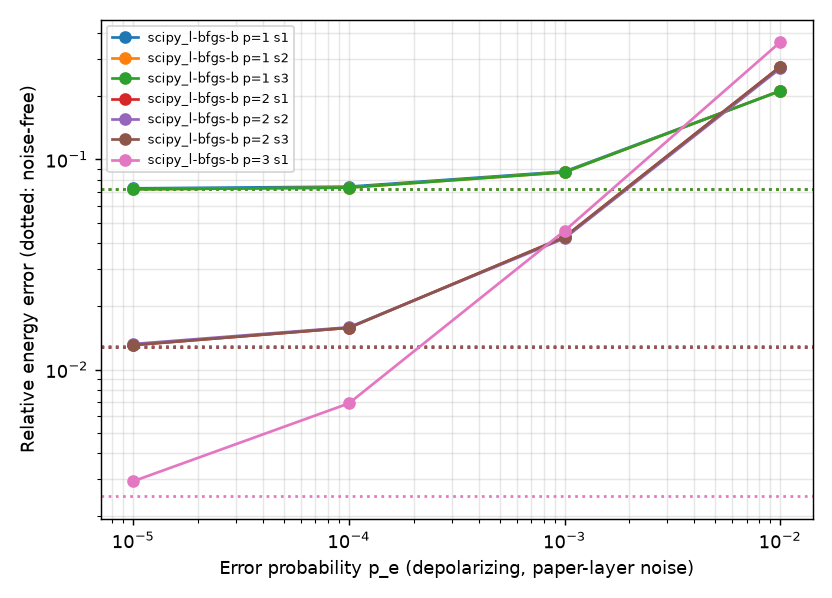

# graph_hva under physical noise: PRB 106 noise models and fixed-parameter analysis

Status (2026-11-12): noise models, both noise modes, the fixed-parameter analysis and its
validation are implemented; the PRB 106 fixed-parameter methodology has been reproduced on the
PRB 105 2x6 rectangle for `p = 1, 2, 3`. Noisy *optimisation* is a separate study,
[`graph_hva_noisy_optimizers.md`](graph_hva_noisy_optimizers.md).

Primary reference: J. Kattemölle and J. van Wezel, *Variational quantum eigensolver for the
Heisenberg antiferromagnet on the kagome lattice*, PRB **106**, 214429 (2022), Secs. II B, II D,
II E, III B and Figs. 8-10.

## 1. What PRB 106 did, and what this document reproduces

PRB 106 optimises the HVA **without noise** (BFGS with exact gradients, many random starts near
zero) and then evaluates the **fixed** optimal parameters under local noise (Sec. II E: "we
only consider previously obtained, noiseless, locally optimal parameters for noisy
simulation"). Its findings (Sec. III B):

* depolarising and bit-flip noise have no significant difference in effect (a bit-flip channel
  twirled over SU(2) is the depolarising channel with the same `p_e`);
* the noisy infidelity agrees with the estimate of Eq. 9, `F ~ (1 - p_e)^(n d) F_0`, which
  assumes that any error makes the state orthogonal to the ground state;
* error rates of `1e-4 ... 1e-5` would be needed to get below the first excited state for
  18-20 sites.

PRB 106 does **not** study optimisation under noise, and says nothing about which optimiser
performs best on noisy hardware. That question is new to this project and is treated in
[`graph_hva_noisy_optimizers.md`](graph_hva_noisy_optimizers.md).

| item | status here |
|---|---|
| channels of Eqs. 7-8 and the "paper-layer" placement | reproduced exactly (Sec. 2) |
| fixed-parameter noisy energy and fidelity, trajectory estimator with 95 % bootstrap CIs, shot rule "1024 erroneous trajectories" | reproduced (Sec. 4) |
| Eq. 9 versus simulation | reproduced on the 2x6 rectangle, `p = 1, 2, 3` (Sec. 5) |
| depolarising versus bit flip | reproduced (Sec. 5) |
| the paper's systems (KVQE-G/K on 18/20 sites, CVQE rings), Figs. 8-10 themselves | **not** reproduced: different lattice (PRB 105 2x6 rectangle, 12 sites), our own L-BFGS-B optima, `p <= 3` |
| exact density matrices next to the trajectory estimator | new (possible at 12 qubits) |
| compiled hardware noise (fake-backend model on the routed circuit) | new, kept separate (Sec. 3) |

## 2. Noise model and placement (paper-layer noise)

Per qubit `q` and noise location, with error probability `p_e`:

```text
depolarising (Eq. 7):  rho -> (1 - p_e) rho + p_e/3 (X rho X + Y rho Y + Z rho Z)
bit flip     (Eq. 8):  rho -> (1 - p_e) rho + p_e X rho X
```

`p_e` is the paper's parameter. Qiskit's `depolarizing_error(lam)` is the same depolarising
channel with `lam = 4 p_e / 3` (checked in the tests). `p_e` is a **logical model parameter**:
it is not an IBM gate error rate and should not be compared with device calibration data.

Placement (Sec. II D): the channel acts on **every qubit** after the singlet preparation and
after **every layer of exchange (HEIS) gates**. With `|c|` layers per cycle and `p` cycles
there are `d = |c| p + 1` locations per qubit and `n d` in total. In this code base:

* `GraphHVAnsatz.build(mark_noise_locations=True)` puts a labelled barrier after the singlet
  preparation and after every layer of its schedule (the H0 block, when enabled, is one more
  layer per cycle), so the locations come from the same logical schedule that builds the
  circuit, for any lattice; `GraphHVAnsatz.noise_layers` is `d`;
* `noise.layer_noise_circuit` replaces each barrier by a `PauliChannel` on every qubit;
* the circuit is **not routed, not transpiled and has no readout error**
  (`backend.kind = "logical_noise"`; validation rejects geometric mappings, legacy ansatzes and
  mitigation with it).

For the 2x6 rectangle (`prb105` schedule, 5 layers): `d = 5 p + 1`, `n d = 72, 132, 192` for
`p = 1, 2, 3`.

Configuration:

```toml
[backend]
kind = "logical_noise"
shots = 1024                 # per measurement basis, as for every shot-based backend
final_shots = 16384
[backend.logical_noise]
channel = "depolarizing"     # or "bit_flip"
probability = 1e-3           # p_e
placement = "paper_layers"   # the only placement implemented
engine = "trajectories"      # or "aer"
```

### Simulation engines

* **Trajectories** (default, `noise.PauliTrajectorySimulator`): every shot draws its own Pauli
  errors (the stochastic reading of the channel, as in PRB 106 Sec. II E), then one projective
  measurement in one of the three measurement bases. Shots without an error share the
  noise-free state; only erroneous shots are simulated, starting from the cached noise-free
  state at their first error. At `p_e = 1e-3` and `p = 2`, 12 % of the shots carry an error and
  one energy (3 x 1024 shots) takes about 0.13 s on one core.
* **Aer** (`engine = "aer"`): the same circuit with Aer quantum errors, sampled by Aer
  (density matrices up to 12 qubits). Several times slower; kept for cross-checks.
* **Exact** (`noise.exact_noisy_state`): Aer's density-matrix simulation of the same circuit,
  for fixed-parameter analysis (`Tr(H rho)`, `Tr(P_GS rho)`).

Validation (in `tests/unit/test_noise.py`): channel algebra (Kraus completeness, Bloch-vector
contraction `1 - 4p/3` for depolarising, `x` kept and `y, z` contracted by `1 - 2p` for bit
flip, equality with Qiskit/Aer channels); exact noise positions (after the singlets, then one
block per schedule layer, H0 included); zero noise reproduces the statevector state, energy and
density matrix; trajectory energies and fidelities agree with the exact density matrix within
bootstrap CIs; sampled histograms follow `diag(rho)`; the Aer engine agrees with the trajectory
engine.

## 3. Compiled hardware noise: a separate mode

`backend.kind = "aer_noisy"` (unchanged) compiles the circuit to a fake backend's native gates
first, including routing SWAPs, and applies that backend's noise model (gate errors,
T1/T2, readout errors) to the compiled circuit. It answers a different question ("what would
this device do?") and its numbers are **never mixed** into the paper-layer tables: result files
record `metadata.noise.mode = "paper_layers"` or `"compiled_hardware"`, and the
fixed-parameter analysis reports hardware comparisons in a separate table.

## 4. Fixed-parameter analysis

`kagome-vqe noise-analysis CONFIG` (`kagome_vqe.noise_analysis`) loads saved runs, takes their
optimised parameters with `load_optimal_params` (checked against the ansatz) and **does not
re-optimise**. For each run and each `(channel, p_e)` it records:

| quantity | how |
|---|---|
| `E_ideal`, `F0` | noise-free energy and ground-space fidelity of the parameters |
| `E exact`, `F exact` | `Tr(H rho)`, `Tr(P_GS rho)` from the exact density matrix (12 qubits) |
| `E traj`, `F traj` and 95 % CIs | PRB 106 estimator: mean over `N` trajectories of the exact energy and fidelity of each trajectory, percentile bootstrap |
| `N` | PRB 106 rule: on average 1024 trajectories with at least one error, `N = 1024 / (1 - (1 - p_e)^(n d))` |
| measured energy (optional) | 1024 shots per basis, every shot a trajectory plus a measurement, with its standard error |
| `Eq. 9` | `(1 - p_e)^(n d) F0`, and the ratio of simulated to estimated infidelity |
| bias | `E noisy - E_ideal` |

The ground space can be degenerate; fidelities are always `Tr(P_GS rho)` with `P_GS` the
projector on the whole (numerically) degenerate ground space.

Output: `results/<timestamp>-<name>/` with `analysis.toml`, `environment.json`,
`sources.json`, `points.csv/.json`, `report.md` and `figures/` (infidelity and energy error
versus `p_e`, Eq. 9 drawn as dashed lines); `kagome-vqe noise-summary DIR` regenerates the report
and figures from `points.csv`.

## 5. Results: PRB 106 fixed-parameter analysis on the 2x6 rectangle

Configuration [`configs/noise/graph_hva_noise_fixed_prb106.toml`](../../configs/noise/graph_hva_noise_fixed_prb106.toml);
output `results/20261112T045452Z-graph_hva_noise_fixed_prb106/` (local); all 56 points in
[`data/graph_hva_noise_fixed_prb106_points.csv`](data/graph_hva_noise_fixed_prb106_points.csv).
Sources: noise-free L-BFGS-B optima, `p = 1, 2` seeds 1-3 from the noise-free optimiser study
(3000 statevector evaluations, budget-stopped), `p = 3` seed 1 from
`graph_hva_noise_reference.toml` (10,000 evaluations; one run). `E0 = -19.910298`, first
excited level `E1 = -19.144059` (relative gap 3.85 %).

Exact (density-matrix) values, mean over seeds; depolarising channel (bit flip in the next table):

| p | n d | `p_e` | E_ideal rel. err | E noisy rel. err | E noisy | F0 | F noisy | Eq. 9 F |
|---|---|---|---|---|---|---|---|---|
| 1 | 72 | 1e-5 | 7.21e-2 | 7.23e-2 | -18.471 | 0.5096 | 0.5092 | 0.5092 |
| 1 | 72 | 1e-4 | 7.21e-2 | 7.36e-2 | -18.444 | 0.5096 | 0.5059 | 0.5059 |
| 1 | 72 | 1e-3 | 7.21e-2 | 8.70e-2 | -18.178 | 0.5096 | 0.4742 | 0.4741 |
| 1 | 72 | 1e-2 | 7.21e-2 | 2.12e-1 | -15.698 | 0.5096 | 0.2507 | 0.2471 |
| 2 | 132 | 1e-5 | 1.28e-2 | 1.31e-2 | -19.649 | 0.7448 | 0.7438 | 0.7438 |
| 2 | 132 | 1e-4 | 1.28e-2 | 1.58e-2 | -19.595 | 0.7448 | 0.7350 | 0.7350 |
| 2 | 132 | 1e-3 | 1.28e-2 | 4.25e-2 | -19.065 | 0.7448 | 0.6529 | 0.6526 |
| 2 | 132 | 1e-2 | 1.28e-2 | 2.74e-1 | -14.456 | 0.7448 | 0.2058 | 0.1976 |
| 3 | 192 | 1e-5 | 2.50e-3 | 2.94e-3 | -19.852 | 0.9919 | 0.9900 | 0.9900 |
| 3 | 192 | 1e-4 | 2.50e-3 | 6.90e-3 | -19.773 | 0.9919 | 0.9730 | 0.9730 |
| 3 | 192 | 1e-3 | 2.50e-3 | 4.57e-2 | -19.001 | 0.9919 | 0.8192 | 0.8185 |
| 3 | 192 | 1e-2 | 2.50e-3 | 3.61e-1 | -12.725 | 0.9919 | 0.1565 | 0.1440 |

Bit flip, same parameters (exact energy; fidelities differ from the depolarising ones by at
most 0.024, at `p_e = 1e-2`):

| p | `p_e` = 1e-5 | 1e-4 | 1e-3 | 1e-2 |
|---|---|---|---|---|
| 1 | -18.471 | -18.444 | -18.179 | -15.789 |
| 2 | -19.649 | -19.595 | -19.067 | -14.687 |
| 3 | -19.852 | -19.773 | -19.007 | -13.166 |





### Observations (what the data show)

* **Eq. 9 holds closely.** Simulated infidelity over the Eq. 9 estimate is 0.999-1.000 for
  `p_e <= 1e-4`, 0.990-1.000 at `1e-3` and 0.957-0.995 at `1e-2` (all 56 points). Below 1 means
  slightly *higher* fidelity than Eq. 9 predicts: some errors (e.g. a Pauli acting on a singlet,
  or late errors that commute with the state) do not take the state fully out of the ground
  space, the effect PRB 106's approximation neglects. The deviation grows with `p_e` and `p`.
* **Depolarising and bit flip act alike**, as PRB 106 found: energies agree to 0.006 for
  `p_e <= 1e-3` and differ by up to 0.44 (bit flip slightly less harmful) at `1e-2`.
* **The paper's estimator is consistent with the exact values:** the exact fidelity lies inside
  the 95 % bootstrap CI of the trajectory mean in 54/56 points and the exact energy in 55/56
  (about what 95 % intervals should give). Trajectory counts followed the paper's rule
  (1,198 to 1,422,728 trajectories, about 1024 with an error). The hardware-like measured energy
  (1024 shots per basis, standard error about 0.12) agrees with the exact noisy energy within
  3.3 standard errors in all 56 points.
* **Depth versus noise.** Without noise, `p = 3` is far better (`F0 = 0.992`, error 2.5e-3).
  At `p_e = 1e-3`, its noisy energy (-19.001) is already *worse* than that of `p = 2` (-19.065),
  and at `1e-2` the ordering is fully reversed (`p = 1` best). Extra layers add `n = 12`
  locations each and only pay off for small `p_e`.
* **Below the first excited level** (`E < E1 = -19.144`) requires `p_e` around `1e-4` or lower
  for `p = 2, 3` on this 12-site patch (at `1e-3` all depths stay above `E1`). PRB 106 quotes
  `1e-4 ... 1e-5` for its 18- and 20-site systems; our smaller system needs less, consistent
  with Eq. 9's dependence on `n d`.
* **Energy bias** (noisy minus noise-free energy) at `p = 2`: +0.06 (1e-4), +0.59 (1e-3),
  +5.2 (1e-2). At `p_e = 1e-3` the noise bias (3 % of `|E0|`) is already larger than the
  ansatz error of the `p = 2` optimum (1.3 %).

### Interpretation (hypotheses, not established)

* Because Eq. 9 is accurate here, `F ~ (1 - p_e)^(n d) F0` can be used to budget error rates for
  larger patches, as PRB 106 does; whether the agreement persists for 18-20 sites with larger
  `p` has not been checked here.
* For a given `p_e` there is an optimal depth; on this patch it is `p <= 2` at `p_e = 1e-3`.
  This argues for choosing `p` under the expected noise, not from noise-free data.

## 6. Compiled hardware noise (separate mode)

One illustration, not a study:
[`configs/noise/graph_hva_noise_hardware_example.toml`](../../configs/noise/graph_hva_noise_hardware_example.toml)
evaluates the seed-1 `p = 2` noise-free optimum on `aer_noisy:FakeGuadalupeV2` (16 qubits,
heavy hex, generic SABRE routing, the fake backend's gate, T1/T2 and readout errors; 4096 shots
per basis, two repeats). Compiled circuit: 144 CX (logical circuit: 102), CX depth 58.

| mode | noise | E (mean) | rel. err | noise-free E of the same parameters |
|---|---|---|---|---|
| paper layers | depolarising `p_e = 1e-3` (exact) | -19.065 | 4.2e-2 | -19.656 |
| compiled hardware | FakeGuadalupeV2 model | -9.815 +- 0.06 (spread of 2 repeats) | 5.07e-1 | -19.656 |

The device model is far harsher than the paper-layer model at `p_e = 1e-3`: about half the
energy is lost, comparable to the 29 % error of the legacy ansatz on the same fake device in M0
(`legacy_m0_m1_m2.md`), with a deeper circuit here. The two numbers answer different questions
and are not interchangeable; mitigation (M2) would be evaluated against the hardware mode.

## 7. Reproduction

```bash
# noise-free reference optima: p = 1, 2 come from the optimiser study, p = 3 (one run, ~3 min):
uv run kagome-vqe study configs/studies/graph_hva_optimizer_representative.toml --only -sv-lbfgsb
uv run kagome-vqe study configs/studies/graph_hva_noise_reference.toml --only s1
# smoke (~40 s) and the PRB 106 analysis (~8 min on 4 threads)
uv run kagome-vqe noise-analysis configs/noise/graph_hva_noise_fixed_smoke.toml
uv run kagome-vqe noise-analysis configs/noise/graph_hva_noise_fixed_prb106.toml --dry-run
uv run kagome-vqe noise-analysis configs/noise/graph_hva_noise_fixed_prb106.toml
# regenerate report and figures from points.csv
uv run kagome-vqe noise-summary results/<timestamp>-graph_hva_noise_fixed_prb106
```

```python
# one point by hand
from kagome_vqe.noise import layer_noise_circuit, exact_noisy_state, PauliTrajectorySimulator
from kagome_vqe.results import load_run, load_optimal_params

run = load_run(run_dir)
ansatz = run.config.ansatz.build(run.config.lattice.build())
circuit = layer_noise_circuit(ansatz, "depolarizing", 1e-3)
rho = exact_noisy_state(circuit, load_optimal_params(run_dir))
```

## 8. Limitations and next steps

* One 12-site lattice (the PRB 105 2x6 rectangle), not the paper's 18/20-site systems; `p <= 3`;
  `p = 3` has a single seed. Optima are L-BFGS-B runs stopped by a 3000/10,000-evaluation budget,
  not the paper's many-restart global search.
* Paper-layer noise has no readout error, no idle noise and no gate-dependent rates; it is a
  model, not a device. `p_e` is not an IBM error rate.
* Exact density matrices stop at 12 qubits; larger patches need the trajectory estimator alone.
* Next: the same analysis on the 20-site KVQE patch (trajectories only), the effect of H0, and
  then mitigation applied to the *same* saved parameters (readout correction, symmetry
  post-selection, ZNE, twin rescaling) so that mitigated and unmitigated noisy energies are
  compared at identical `theta`.
