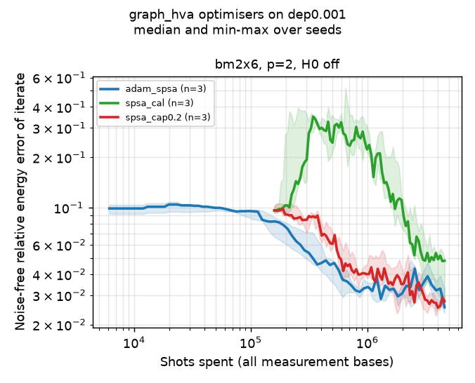
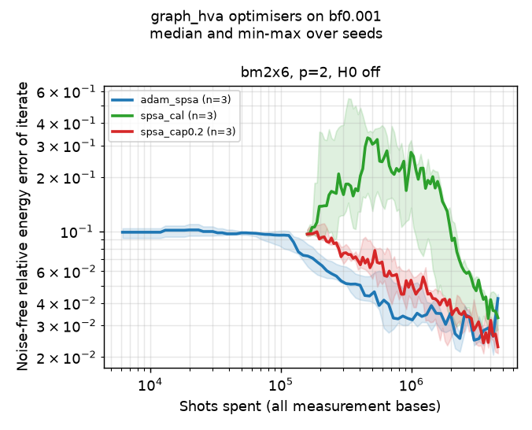
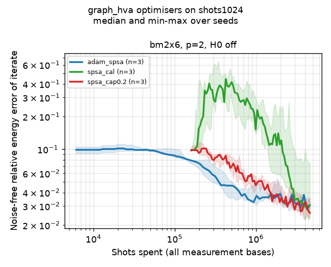
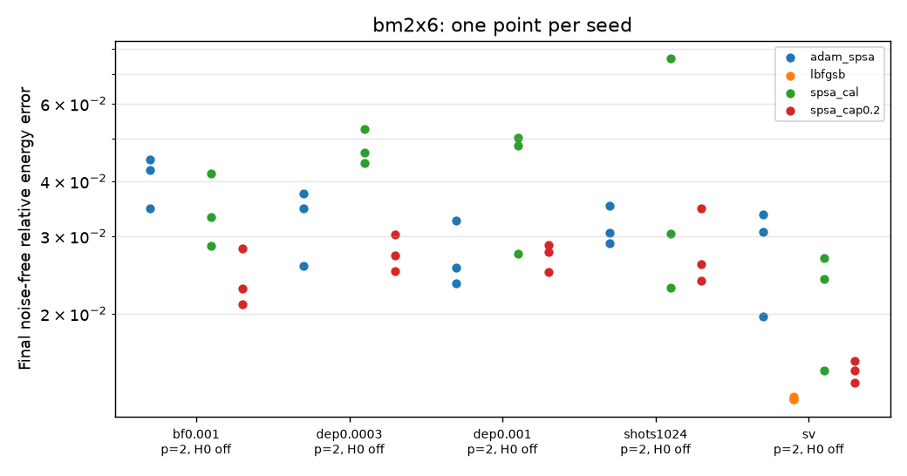

# graph_hva noisy optimisation: calibrated SPSA versus ADAM + SPSA gradient

Status (2026-11-12): smoke profile, a seed-101 step-control pilot and a **limited**
representative comparison (PRB 105 2x6 rectangle, `p = 2`, three seeds) are done; the full
research profile is configured and costed but **not run**. Nothing here is a general ranking
of optimisers.

This study is **new**: PRB 106 optimises without noise and only evaluates fixed parameters
under noise ([`graph_hva_noise.md`](graph_hva_noise.md)); it does not study optimisation under
noise and makes no claim about which optimiser works best on noisy hardware.

## 1. Questions

The noise-free optimiser study ([`graph_hva_optimizers.md`](graph_hva_optimizers.md)) found,
on three seeds: L-BFGS-B best without noise at `p = 2`; calibrated SPSA cheap per gradient but
with a large early excursion; ADAM with the SPSA gradient stable under shot noise. Here:

1. Do those observations survive physical gate noise (PRB 106 paper-layer depolarising and
   bit-flip noise), at equal shot budgets?
2. Does SPSA's early instability get worse under noise, and does optional step control fix it?
3. Does optimising under noise give better parameters than transferring noise-free optima?

The optimiser minimises the *noisy* energy `E_noisy(theta)`. Lower noisy energy need not mean a
better state, so the **noise-free quality of the parameters** (`E_ideal(theta_final)`, ground
space fidelity) is measured separately from the noisy energy.

## 2. Set-up

* **System:** PRB 105 2x6 rectangle (`kagome_bm_rectangle` 2x6, open, 12 sites, 16 bonds,
  default dimer covering, `prb105` schedule: 5 layers), `H = sum (XX + YY + ZZ)`,
  `E0 = -19.910298`. `graph_hva`, one parameter per gate, `p = 2` (32 parameters), H0 off.
* **Initial point:** `x0 = 0.1 U[0, 1)^32` from the seed; identical for every optimiser and
  backend of a seed. Seeds 1, 2, 3; seed 101 only for pilots.
* **Backends** (one budget for every shot-based backend):

| label | backend | noise | budget |
|---|---|---|---|
| `sv` | statevector | none, exact energies | 3000 energies |
| `shots1024` | `aer_ideal`, 1024 shots per basis | sampling only | 4,608,000 shots |
| `dep0.0003` | `logical_noise`, 1024 shots per basis | depolarising `p_e = 3e-4`, paper layers (`n d = 132`) | 4,608,000 shots |
| `dep0.001` | `logical_noise`, 1024 shots per basis | depolarising `p_e = 1e-3` | 4,608,000 shots |
| `bf0.001` | `logical_noise`, 1024 shots per basis | bit flip `p_e = 1e-3` | 4,608,000 shots |

  4,608,000 shots = 1500 energies x 1024 shots x 3 measurement bases. Every run adds one
  re-measurement of its final parameters with 16384 shots per basis; that is the reported
  measured energy. Probability that a shot is error-free: 0.961 (`3e-4`), 0.876 (`1e-3`).

* **Optimisers:**

| label | optimiser | gradient actually used | settings |
|---|---|---|---|
| `spsa_cal` | calibrated SPSA, as in the noise-free study | built-in two-point SPSA estimate | `c = 0.1`, first step `0.2`, 25 calibration probes (50 energies), Spall gains `alpha = 0.602`, `gamma = 0.101`, `A = 0.1 maxiter` |
| `spsa_cap0.2` | the same plus **step control** | same | every update rescaled to norm `<= 0.2` (`max_step_norm`) |
| `adam_spsa` | ADAM | simultaneous perturbation, `c = 0.1`, 2 energies per iteration | `lr = 0.02`, `beta1 = 0.9`, `beta2 = 0.99` |
| `lbfgsb` | L-BFGS-B, statevector only | scipy finite differences on exact energies | noise-free reference |

  `maxiter` of the fixed-cost optimisers is fitted so calibration + iterations + final energy
  use the budget exactly (`fit_maxiter_to_budget`). Hyperparameters are not tuned per noise
  level: `c`, the first step and `lr` come from the noise-free study's seed-101 pilot; the cap
  from this study's seed-101 pilot (Sec. 3).

* **Recorded per run:** every energy (trace), the noise-free energy and step norm after every
  iteration (`ideal_trace.csv`), the parameters after every iteration (`iterates.npy`), the
  calibrated gains, step statistics, noise model and placement, evaluations, circuit executions,
  shots, calibration overhead, timings and termination reason (`result.json`).

## 3. Step-control pilot (seed 101)

[`configs/studies/graph_hva_noise_opt_pilot.toml`](../../configs/studies/graph_hva_noise_opt_pilot.toml),
`p = 2`, statevector (3000 energies) and depolarising `p_e = 1e-3` (4,608,000 shots); table
in [`data/graph_hva_noise_pilot_runs.csv`](data/graph_hva_noise_pilot_runs.csv). One seed:
used only to pick the cap, never in the comparison.

| backend | optimizer | measured rel. err | noise-free rel. err | peak noise-free rel. err | largest step |
|---|---|---|---|---|---|
| sv | spsa_cal (no control) | 1.24e-2 | 1.24e-2 | 3.09e-1 | 1.211 |
| sv | spsa, cap 0.2 | 1.64e-2 | 1.64e-2 | 1.04e-1 (= start) | 0.200 |
| sv | spsa, cap 0.1 | 1.45e-2 | 1.45e-2 | 1.04e-1 (= start) | 0.100 |
| sv | adam_spsa | 2.14e-2 | 2.14e-2 | 1.04e-1 (= start) | 0.113 |
| dep 1e-3 | spsa_cal (no control) | 4.85e-2 | 2.19e-2 | 1.15e-1 | 0.718 |
| dep 1e-3 | spsa, cap 0.2 | 4.54e-2 | 1.87e-2 | 1.04e-1 (= start) | 0.200 |
| dep 1e-3 | spsa, cap 0.1 | 4.74e-2 | 1.91e-2 | 1.04e-1 (= start) | 0.100 |
| dep 1e-3 | adam_spsa | 5.71e-2 | 2.89e-2 | 1.04e-1 (= start) | 0.113 |

Both caps remove the excursion. The cap 0.2 was chosen because it equals the calibrated first
step (no new scale is introduced) and it was best under noise on this seed. Without noise the
uncapped run ended lower on this seed, so the cap is not free; Sec. 4 shows how it behaves on
other seeds.

## 4. Representative comparison (seeds 1-3, `p = 2`)

[`configs/studies/graph_hva_noise_opt_representative.toml`](../../configs/studies/graph_hva_noise_opt_representative.toml),
48 runs, all completed; output `results/20261112T035114Z-graph_hva_noise_repr/` (local);
tables in [`data/graph_hva_noise_repr_runs.csv`](data/graph_hva_noise_repr_runs.csv) and
[`..._groups.csv`](data/graph_hva_noise_repr_groups.csv).

**Noise-free quality of the final parameters** (`|E_ideal(theta_final) - E0| / |E0|`), median
over seeds [min, max]:

| backend | spsa_cal | spsa_cap0.2 | adam_spsa | lbfgsb |
|---|---|---|---|---|
| sv (3000 exact energies) | 2.40e-2 [1.49e-2, 2.67e-2] | 1.48e-2 [1.39e-2, 1.56e-2] | 3.07e-2 [1.97e-2, 3.36e-2] | 1.28e-2 [1.28e-2, 1.29e-2] |
| shots1024 (sampling only) | 3.04e-2 [2.29e-2, 7.61e-2] | 2.60e-2 [2.37e-2, 3.47e-2] | 3.06e-2 [2.90e-2, 3.52e-2] | - |
| dep 3e-4 | 4.64e-2 [4.39e-2, 5.26e-2] | 2.72e-2 [2.49e-2, 3.03e-2] | 3.46e-2 [2.57e-2, 3.74e-2] | - |
| dep 1e-3 | 4.81e-2 [2.73e-2, 5.01e-2] | 2.76e-2 [2.49e-2, 2.86e-2] | 2.54e-2 [2.34e-2, 3.25e-2] | - |
| bf 1e-3 | 3.31e-2 [2.85e-2, 4.17e-2] | 2.28e-2 [2.10e-2, 2.81e-2] | 4.23e-2 [3.46e-2, 4.48e-2] | - |

**Measured energy** (re-measured on the same noisy backend, 16384 shots per basis; includes the
noise bias), median relative error, and the **peak** noise-free error along the run (start:
about 0.10):

| backend | measured: spsa_cal / cap0.2 / adam | peak: spsa_cal / cap0.2 / adam | largest step: spsa_cal / cap0.2 / adam |
|---|---|---|---|
| sv | 2.40e-2 / 1.48e-2 / 3.07e-2 | 0.716 / 0.096 / 0.102 | 2.77 / 0.20 / 0.11 |
| shots1024 | 3.07e-2 / 2.49e-2 / 3.04e-2 | 0.444 / 0.102 / 0.102 | 3.01 / 0.20 / 0.11 |
| dep 3e-4 | 5.70e-2 / 3.61e-2 / 4.42e-2 | 0.346 / 0.099 / 0.104 | 2.25 / 0.20 / 0.11 |
| dep 1e-3 | 7.95e-2 / 5.44e-2 / 5.41e-2 | 0.466 / 0.098 / 0.104 | 1.96 / 0.20 / 0.11 |
| bf 1e-3 | 6.06e-2 / 5.21e-2 / 6.79e-2 | 0.366 / 0.100 / 0.102 | 2.31 / 0.20 / 0.11 |

(peak values are medians over seeds; the worst single uncapped-SPSA run peaks at 0.79 without
noise, 0.55-0.65 with noise.)

**Resources** (identical by construction for every shot-based run): 1499 energies (SPSA: 50
of them calibration), +1 re-measurement; 4500 circuit executions (1500 energies x 3 bases);
4,654,080 shots (4,604,928 for 1499 energies + 49,152 re-measurement); `maxiter` was fitted to
the budget, so every shot-based run ended by the optimiser with 1499 of the 1500 affordable
energies. Noise-free runs: 2999-3000 exact
energies (L-BFGS-B budget-stopped). Optimiser wall time per run (shared machine, 4-13
concurrent processes, so only indicative): 40-46 s (sv), about 175 s (shots1024), 140 s
(dep 3e-4), 410-455 s (`p_e = 1e-3`); single-process cost of one energy at `p_e = 1e-3` is
about 0.13 s for the trajectory engine.






### Smoke profile

[`graph_hva_noise_opt_smoke.toml`](../../configs/studies/graph_hva_noise_opt_smoke.toml): `p = 1`,
seed 1, 200 energies, strong noise `p_e = 1e-2` (`n d = 72`, 51 % of shots carry an error).
All 6 runs completed with complete artefacts (noise metadata, iterates, budgets: 165,120 shots
each). Measured errors 0.22-0.25 against noise-free errors 0.077-0.12: at this noise level the
measured energy says little about the parameters.

## 5. Transfer of noise-free optima versus optimisation under noise

[`configs/noise/graph_hva_noise_transfer.toml`](../../configs/noise/graph_hva_noise_transfer.toml):
the final parameters of every representative run, evaluated **exactly** (density matrix, no
shot noise) under paper-layer noise; noise-optimised runs only at their own noise. Mean
relative error of the exact noisy energy over seeds (table:
[`data/graph_hva_noise_transfer_points.csv`](data/graph_hva_noise_transfer_points.csv)):

| evaluated under | optimised under | spsa_cal | spsa_cap0.2 | adam_spsa | lbfgsb |
|---|---|---|---|---|---|
| dep 3e-4 | noise-free sv (3000 exact energies) | 3.11e-2 | 2.34e-2 | 3.64e-2 | 2.18e-2 |
| dep 3e-4 | shots only (same shot budget) | 5.18e-2 | 3.67e-2 | 4.02e-2 | - |
| dep 3e-4 | dep 3e-4 (same noise) | 5.67e-2 | 3.63e-2 | 4.11e-2 | - |
| dep 1e-3 | noise-free sv | 5.25e-2 | 4.32e-2 | 5.58e-2 | 4.25e-2 |
| dep 1e-3 | shots only | 7.17e-2 | 5.63e-2 | 5.99e-2 | - |
| dep 1e-3 | dep 1e-3 | 7.22e-2 | 5.49e-2 | 5.52e-2 | - |
| bf 1e-3 | noise-free sv | 5.23e-2 | 4.31e-2 | 5.57e-2 | 4.23e-2 |
| bf 1e-3 | shots only | 7.15e-2 | 5.62e-2 | 5.97e-2 | - |
| bf 1e-3 | bf 1e-3 | 6.39e-2 | 5.32e-2 | 6.77e-2 | - |

The cleanest comparison is "shots only" against "same noise": identical optimiser, budget,
shots and seeds; only the gate noise during optimisation differs. The differences
(-0.008 ... +0.008 in relative error) are within the seed-to-seed spread (typically 0.005-0.03). The noise-free
runs are better still, but they had twice the energies and no sampling noise, so that row
measures the budget as much as the noise.

## 6. Observations (what the data show)

* **Under noise the optimiser minimises a biased objective, but the bias barely depends on the
  parameters.** The exact noisy energy minus the noise-free energy is almost the same for every
  set of final parameters at a given noise model (over all 48-66 parameter sets per noise model: +0.164 to +0.192, mean +0.174, at
  `dep 3e-4`; +0.54 to +0.63, mean +0.57, at `1e-3`, both channels), so the noisy landscape is close to the noise-free one shifted up.
  Consequently the parameters found under noise are about as good, noise-free, as those found
  with sampling noise only.
* **Re-optimising under noise did not beat transferring parameters** optimised without gate
  noise at the same budget (Sec. 5), on three seeds, at `p_e <= 1e-3`.
* **Calibrated SPSA's early excursion persists under noise but does not get worse:** peak
  noise-free error 0.35-0.47 (median; worst run 0.65) with noise against 0.72 (median) without;
  its largest steps reach 2-3 rad. It ends worst or near-worst in every noisy condition
  (noise-free error 3.3e-2 to 4.8e-2).
* **The step-norm cap removes the excursion in every run** (peak = starting error) and gives the
  best or joint-best noise-free quality in every shot-based condition (median 2.3e-2 to
  2.8e-2), with the smallest seed spread. Without noise it is close to L-BFGS-B (1.48e-2 vs
  1.28e-2).
* **ADAM + SPSA gradient** stays stable everywhere (no excursion) and is level with the capped
  SPSA at `dep 1e-3` (2.54e-2 vs 2.76e-2 median), behind it at `dep 3e-4` and clearly behind
  under bit flip (4.23e-2 vs 2.28e-2). With equal energies, its updates (lr 0.02, step norm
  about 0.11) are smaller than the capped SPSA's (0.2), which may explain the slower progress in
  some conditions.
* **No run reaches the 1 % success threshold**; at `p = 2` the ansatz itself limits the error to
  about 1.3 % (L-BFGS-B). Measured energies under `p_e = 1e-3` sit about 3 % above the noise-free
  values of the same parameters, so the measured energy cannot rank optimisers that differ by
  less than that without many more shots or mitigation.

## 7. Interpretation (hypotheses, not established)

* On this problem the role of the optimiser under noise is mostly to cope with **sampling**
  noise; gate noise mainly adds a nearly parameter-independent offset (consistent with Eq. 9's
  picture of errors removing weight from the ground space). If that holds more generally,
  parameters can be optimised under cheaper conditions and transferred, and error mitigation
  matters more than noise-aware optimisation. Larger `p_e`, coherent or non-uniform noise could
  change this.
* Bounding SPSA's step is the decisive fix for its instability; whether the cap should scale
  with `p`, the number of parameters or the calibrated gain is open.
* The ADAM-vs-SPSA ranking depends on the channel here (bit flip vs depolarising); with three
  seeds this may be noise in the comparison itself.

## 8. Full research profile (configured, not run)

[`configs/studies/graph_hva_noise_opt_full.toml`](../../configs/studies/graph_hva_noise_opt_full.toml):
`p = 2, 3`, H0 off and on, seeds 1-5, backends sv (10,000 energies), shots1024, depolarising
`p_e = 1e-4, 3e-4, 1e-3`, bit flip `1e-3` (9,216,000 shots each), optimisers spsa_cal,
spsa_cap0.2, adam_spsa and L-BFGS-B (sv). 380 runs, 1.7 M energies, 2.76 G shots. The timed dry
run (single process, measured on the shared machine while other jobs ran, so an upper bound)
estimates **68 CPU-hours**; per `p` and backend (hours): `p = 2`: bf 7.0, dep 1e-3 8.1,
dep 3e-4 1.9, dep 1e-4 0.7, shots 1.7, sv 1.7; `p = 3`: bf 17.2, dep 1e-3 15.9, dep 3e-4 3.5,
dep 1e-4 1.2, shots 2.0, sv 2.4. Run it in bounded, resumable chunks, several processes with
disjoint `--only` filters and `--no-summary`, then `study-summary`.

## 9. Reproduction

```bash
uv run kagome-vqe study configs/studies/graph_hva_noise_opt_smoke.toml            # ~2 min
uv run kagome-vqe study configs/studies/graph_hva_noise_opt_pilot.toml            # ~20 min (1 process)
uv run kagome-vqe study configs/studies/graph_hva_noise_opt_representative.toml --dry-run
# representative: ~2 h in one process; used here: 4-6 single-threaded processes per round,
# each with a disjoint filter, e.g.
uv run kagome-vqe study configs/studies/graph_hva_noise_opt_representative.toml \
    --resume results/<timestamp>-graph_hva_noise_repr --only dep0.001-adam_spsa --max-runs 1 --no-summary
uv run kagome-vqe study-summary results/<timestamp>-graph_hva_noise_repr
uv run kagome-vqe noise-analysis configs/noise/graph_hva_noise_transfer.toml       # ~8 min
```

Six representative runs were interrupted in development (13 concurrent processes exceeded the
per-command time limit); their directories are kept, marked `running` or `interrupted`, and the
manifest records the retries. Only completed runs enter the summary.

## 10. Limitations

* Three seeds, one lattice, `p = 2`, H0 off, two noise levels per channel; hyperparameters from
  single pilot seeds; L-BFGS-B only without noise (no noisy finite differences).
* Paper-layer noise is a model: no readout error, no idle or crosstalk noise, uniform `p_e`.
  The compiled-hardware mode (`aer_noisy`) was not used for optimisation.
* Wall times were measured on a shared machine with varying load; compare evaluations and shots,
  not seconds.
* No error mitigation (by design of this milestone).

## 11. Recommended next experiments before error mitigation

1. Run the full profile (at least the `p = 2` and `p = 3`, H0-off cells of every backend) to
   test the transfer finding and the cap with five seeds.
2. Add a stronger noise level (`p_e = 3e-3`) where the noise bias might become parameter
   dependent, and a small `aer_noisy` fixed-parameter comparison to see how the compiled
   circuit's noise compares with the paper-layer model.
3. Then start mitigation on the **saved** parameters (`load_optimal_params`): fixed-parameter
   noisy energies with and without readout correction, symmetry post-selection, ZNE and twin
   rescaling, at identical `theta`.
