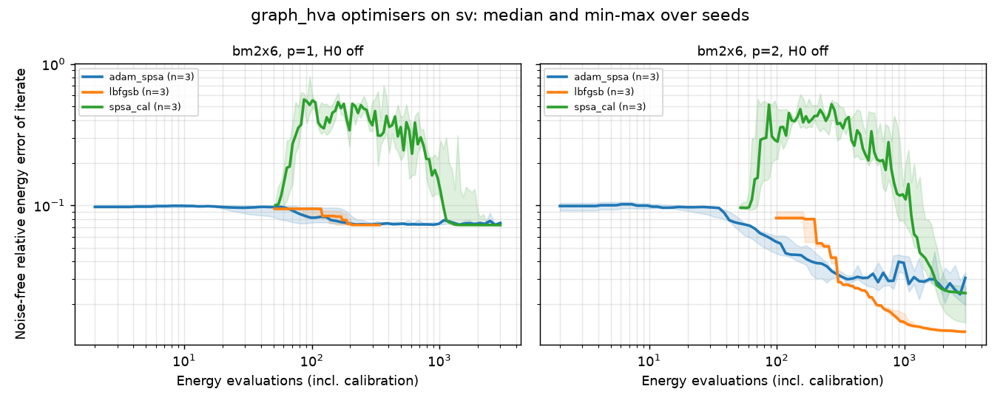
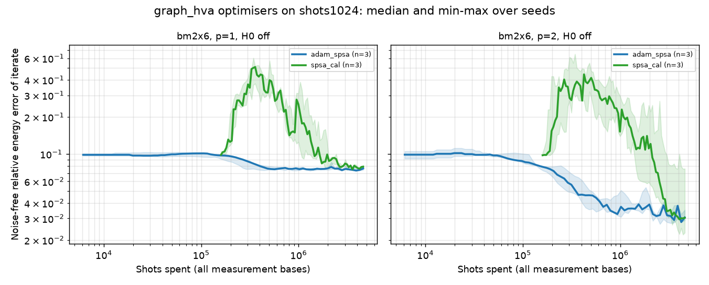
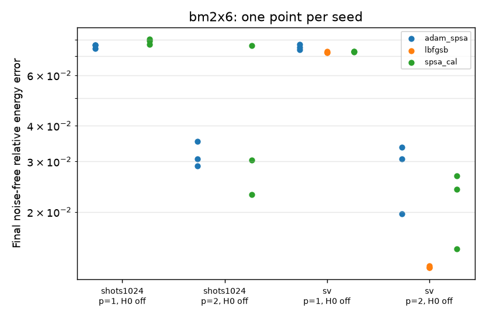

# graph_hva optimiser study: L-BFGS-B, calibrated SPSA, ADAM + SPSA gradient

Status (2026-11-11): infrastructure, smoke profile, hyperparameter pilot and a **limited**
representative comparison are done; the full research profile is configured and costed but
**not yet run**. Nothing below is a general ranking of optimisers.

## 1. Question

The legacy ring HVA has two shared parameters; the graph HVA with one parameter per gate has
`N_theta = p * N_b` (plus `p` with H0): 16, 32, 48 parameters for `p = 1, 2, 3` on the
2x6 rectangle. The M1 result "use plain SPSA for HVA" was obtained with two parameters and
does not transfer automatically (see [`legacy_m0_m1_m2.md`](legacy_m0_m1_m2.md)). Here we ask:

> Which optimiser gives the best balance of final parameter quality, energy evaluations,
> measurement shots and reliability across seeds for the OPG graph HVA?

Two conditions are separated:

* **Experiment A, noiseless** (`statevector`): intrinsic optimisation behaviour.
* **Experiment B, finite shots** (`aer_ideal`): measurement sampling noise only. This is
  *not* hardware noise: no gate, decoherence or readout errors, no mitigation, no ZNE, no
  twin rescaling. Physical noise is a later study.

## 2. System and conventions

* **Primary lattice:** the PRB 105 2x6 rectangle (`kagome_bm_rectangle`, 2 x 6): 12 sites,
  20 bonds, open boundaries; default dimer covering; `prb105` schedule. Exact ground energy
  `E0 = -19.910298`.
* **Control:** the open 12-site star (`kagome_unit_cell`, 18 bonds, `E0 = -18`). Its ground
  state is a dimer product, i.e. the ansatz's reference state, so it is a regression check,
  not an optimiser benchmark.
* **Not included:** the 12-site torus (harder low-energy structure; support unchanged).
* **Hamiltonian:** `H = sum over bonds of (XX + YY + ZZ)` (Pauli normalisation, `= 4 sum S.S`)
  for every run; references from exact diagonalisation.
* **Ansatz:** `graph_hva`, one parameter per gate, H0 off in the main comparison (so every
  optimiser optimises the identical circuit), on as a secondary arm in the full profile.
* **Initial point:** `x0` uniform in `[0, 0.1)` from the seed (`vqe.initial_point`): the
  same vector for every optimiser of a seed. Small angles keep the start near the dimer state.

## 3. Optimisers

All are the existing implementations; only configuration was added (see
[`../architecture.md`](../architecture.md)). The gradient actually used is recorded in each
run's `result.json` (`metadata.optimizer.gradient`).

| label | implementation | energies per iteration | settings |
|---|---|---|---|
| `lbfgsb` | scipy L-BFGS-B (`ScipyOptimizer`), 2-point finite differences, `eps = 1e-8` | `n + 1` per gradient plus line search | `maxiter` and `maxfun` effectively unlimited: the budget stops it |
| `spsa_cal` | `Spsa(calibrate=True)`: Spall gains `a / (k + A)^0.602`, `c / k^0.101`, `A = 0.1 maxiter`; `a` calibrated from 25 gradient probes (50 energies, counted) so the first step has norm `target_magnitude` | 2 | `c = 0.1`, `target_magnitude = 0.2` |
| `spsa_cal_default` | as `spsa_cal` with the library default `target_magnitude = 2 pi / 10` | 2 | full profile only, sensitivity arm |
| `adam_spsa` | `Adam` with the `SimultaneousPerturbation` gradient estimator (not ADAM's default forward difference) | 2 | `lr = 0.02`, `c = 0.1`, `beta1 = 0.9`, `beta2 = 0.99` |
| `lbfgsb_fd0.1` | L-BFGS-B with `eps = 0.1` | `n + 1` + line search | full profile, finite shots only; diagnostic |

For SPSA and ADAM + SPSA, `maxiter` is derived from the budget (`fit_maxiter_to_budget`) so
that calibration, iterations and the final evaluation use exactly the budget; their gain
schedules are therefore planned for the evaluations they actually get.

## 4. Fairness and resource accounting

* **Equal budgets, not equal iterations.** Each backend has one budget, identical for every
  optimiser: `max_evaluations` (statevector) or `max_shots` (finite shots). It is enforced on
  every energy request, calibration included; a refused batch ends the run at its last
  completed iterate (`termination = budget`).
* **What is counted.** `evaluations` = all energies the optimiser requested (calibration
  separately listed). `total shots` = evaluations x shots x 3 measurement bases, plus the one
  re-measurement of the final parameters with 16384 shots per basis (the same for all).
  `optimiser time` excludes the classical noise-free tracking done for the plots.
* **Parameter quality.** The headline metric is `E_ideal(theta_final)`: the exact
  statevector energy of the parameters the optimiser returned, its relative error
  `|E_ideal - E0| / |E0|`, and the ground-space fidelity. For finite-shot runs this separates
  the quality of the learned parameters from the shot noise of their measured energy.
* **Success:** relative error of `E_ideal(theta_final)` below 1 %.

## 5. Hyperparameter pilot (seed 101)

`configs/studies/graph_hva_optimizer_pilot.toml`: 2x6, `p = 2`, no H0 (32 parameters),
statevector, 3000 evaluations, **one seed (101) that no comparison profile uses**.

| optimiser | setting | noise-free rel. error | fidelity |
|---|---|---|---|
| calibrated SPSA | `target_magnitude = 2 pi / 10` (library default) | 2.14e-01 | 0.395 |
| calibrated SPSA | `target_magnitude = 0.2` | 1.24e-02 | 0.786 |
| calibrated SPSA | `target_magnitude = 0.05` | 2.32e-02 | 0.659 |
| ADAM + SPSA gradient | `lr = 0.005` | 2.16e-02 | 0.668 |
| ADAM + SPSA gradient | `lr = 0.02` | 2.14e-02 | 0.662 |
| ADAM + SPSA gradient | `lr = 0.05` | 6.99e-02 | 0.548 |

Study directory: `results/20261111T131836Z-graph_hva_opt_pilot` (local, not in git).

Calibrated SPSA with the library default first step (`2 pi / 10`) moved the iterate far away
from the near-optimal dimer start and did not recover in the first smoke run (from -17.97 to
-9.71); that default was designed for random initial points. `target_magnitude = 0.2` and ADAM
`lr = 0.02` were chosen for the comparisons. This is one seed on one configuration: it rules
out clearly bad settings, it does not tune.

## 6. Smoke profile

`configs/studies/graph_hva_optimizer_smoke.toml`: 2x6, `p = 1`, no H0, seed 1; statevector
with 300 evaluations (all three optimisers), and `aer_ideal` with 256 shots per basis and
153,600 shots (= 200 evaluations; SPSA and ADAM + SPSA). It checks configuration, execution,
budgets, persistence, reloading and plotting; its numbers are not a comparison.

Run on 2026-11-11 (`results/20261111T140105Z-graph_hva_opt_smoke`, 5 completed runs, each a
complete results directory with `config.toml`, `result.json`, `trace.csv`, `params.npy`,
`ideal_trace.csv`, `environment.json`, `run.log`, `status.json`):

| backend | optimiser | noise-free rel. error | measured final E | fidelity | evaluations (calibration) | iterations | total shots | stop |
|---|---|---|---|---|---|---|---|---|
| shots256 | adam_spsa | 7.49e-02 | -18.38184 | 0.5012 | 199 (0) | 99 | 165,120 | optimiser |
| shots256 | spsa_cal | 9.10e-02 | -18.06641 | 0.4926 | 199 (50) | 74 | 165,120 | optimiser |
| sv | adam_spsa | 7.33e-02 | -18.45073 | 0.5054 | 299 (0) | 149 | 0 | optimiser |
| sv | lbfgsb | 7.26e-02 | -18.46410 | 0.5106 | 300 (0) | 13 | 0 | budget |
| sv | spsa_cal | 8.22e-02 | -18.27363 | 0.5141 | 299 (50) | 124 | 0 | optimiser |

Accounting check: 199 evaluations x 256 shots x 3 bases = 152,832 <= 153,600, plus the
re-measurement 4096 x 3 = 12,288, gives the 165,120 total shots; the fitted `maxiter` values
(124 for SPSA: `(300 - 50 - 1) / 2`; 149 for ADAM + SPSA) used the budgets exactly. An earlier
smoke run with the library-default SPSA first step (`results/20261111T131720Z-...smoke`)
ended at -9.71 (51 % error) from a -17.97 start, which prompted the pilot.

## 7. Limited representative comparison

`configs/studies/graph_hva_optimizer_representative.toml`, run on 2026-11-11
(`results/20261111T132627Z-graph_hva_opt_repr`, 30/30 runs completed, about 34 minutes on
8 threads): 2x6 rectangle, no H0, `p = 1` (16 parameters) and `p = 2` (32), **seeds 1, 2,
3**. Experiment A: statevector, 3000 evaluations per run. Experiment B: `aer_ideal`, 1024
shots per basis, 4,608,000 shots per run (1500 evaluations) plus the 16384-shot
re-measurement.

Aggregated over the three seeds (noise-free values of the final parameters):

| p | backend | optimiser | n_theta | median rel. error | best / worst | mean E ± std | mean fidelity ± std | evaluations | total shots | optimiser time (s) | success (< 1 %) | budget stops |
|---|---|---|---|---|---|---|---|---|---|---|---|---|
| 1 | shots1024 | adam_spsa | 16 | 7.63e-02 | 7.43e-02 / 7.66e-02 | -18.402 ± 0.024 | 0.509 ± 0.020 | 1499 | 4,654,080 | 82.3 | 0/3 | 0 |
| 1 | shots1024 | spsa_cal | 16 | 7.90e-02 | 7.70e-02 / 8.03e-02 | -18.342 ± 0.033 | 0.504 ± 0.021 | 1499 | 4,654,080 | 84.8 | 0/3 | 0 |
| 1 | sv | adam_spsa | 16 | 7.50e-02 | 7.36e-02 / 7.68e-02 | -18.414 ± 0.031 | 0.515 ± 0.016 | 2999 | 0 | 18.4 | 0/3 | 0 |
| 1 | sv | lbfgsb | 16 | 7.19e-02 | 7.19e-02 / 7.26e-02 | -18.474 ± 0.009 | 0.510 ± 0.001 | 1224 | 0 | 11.0 | 0/3 | 0 |
| 1 | sv | spsa_cal | 16 | 7.25e-02 | 7.24e-02 / 7.26e-02 | -18.467 ± 0.002 | 0.511 ± 0.001 | 2999 | 0 | 19.0 | 0/3 | 0 |
| 2 | shots1024 | adam_spsa | 32 | 3.06e-02 | 2.90e-02 / 3.52e-02 | -19.282 ± 0.064 | 0.694 ± 0.038 | 1499 | 4,654,080 | 90.8 | 0/3 | 0 |
| 2 | shots1024 | spsa_cal | 32 | 3.04e-02 | 2.29e-02 / 7.61e-02 | -19.052 ± 0.573 | 0.658 ± 0.100 | 1499 | 4,654,080 | 91.1 | 0/3 | 0 |
| 2 | sv | adam_spsa | 32 | 3.07e-02 | 1.97e-02 / 3.36e-02 | -19.353 ± 0.145 | 0.710 ± 0.038 | 2999 | 0 | 31.0 | 0/3 | 0 |
| 2 | sv | lbfgsb | 32 | 1.28e-02 | 1.28e-02 / 1.29e-02 | -19.655 ± 0.002 | 0.745 ± 0.005 | 3000 | 0 | 37.5 | 0/3 | 3 |
| 2 | sv | spsa_cal | 32 | 2.40e-02 | 1.49e-02 / 2.67e-02 | -19.475 ± 0.124 | 0.738 ± 0.084 | 2999 | 0 | 31.3 | 0/3 | 0 |

`E0 = -19.910`. Per-run values, all figures and the full configuration are in the study's
`summary/report.md`; the figures below are copies of its generated files.





### Observations (what the data show)

1. **p = 1 is limited by the ansatz, not the optimiser.** Every optimiser, with and without
   shot noise, ends at 7.2e-2 to 8.0e-2 with fidelity about 0.51; the earlier unrestricted
   L-BFGS-B baseline reached 7.19e-2. L-BFGS-B stopped on its own convergence test after
   340 to 1666 evaluations.
2. **p = 2, noiseless, 3000 evaluations:** L-BFGS-B reached 1.28e-2 on all three seeds (spread
   below 1e-4; stopped by the budget; the unrestricted baseline reached 1.26e-2 after about
   8000 evaluations). Calibrated SPSA: median 2.4e-2 (1.5e-2 to 2.7e-2). ADAM + SPSA: median
   3.1e-2 (2.0e-2 to 3.4e-2).
3. **p = 2, 1024 shots, 4.65 M shots:** calibrated SPSA and ADAM + SPSA have the same median
   (3.0e-2 and 3.1e-2). SPSA's seeds spread from 2.3e-2 to 7.6e-2 (seed 2 ended near the
   p = 1 level); ADAM + SPSA's from 2.9e-2 to 3.5e-2. Both are close to their own noiseless
   results at twice the evaluations.
4. **Calibrated SPSA makes a large early excursion.** In all 12 calibrated-SPSA runs the
   noise-free error of the iterate rose from its starting value of about 0.1 to a peak of
   0.32 to 0.84 within the first 92 to 264 evaluations, and fell back below the starting value
   only after 338 to 1962 evaluations (first figure, green). No ADAM + SPSA run rose above
   0.112. The saved trajectories show why, for
   seed 1: SPSA's step is proportional to the measured directional derivative; calibration
   at the near-stationary dimer start measured `|dE|/2c` of about 1 to 2, within 12
   iterations it was 5 to 6 and the step norm had grown from 0.1 to 0.7 to 1.3 rad. ADAM's
   normalised steps stayed at or below 0.11 rad and shrank monotonically. Hence at budgets
   below about 1000 evaluations (about 3 M shots here) ADAM + SPSA's iterates are better.
5. **Success rate is uninformative at p <= 2:** no run, by any optimiser, reached the 1 %
   threshold, because the ansatz cannot at this depth (best 1.26e-2 at p = 2). The full
   profile's `p = 3` (baseline best 1.65e-3) is where it can discriminate.
6. **Time is dominated by energy evaluations.** Optimiser time per evaluation: statevector
   about 6 ms (`p = 1`) and 10 ms (`p = 2`) for the SPSA-type methods, 9 to 13 ms for
   L-BFGS-B (its own bookkeeping); 1024-shot `aer_ideal` 55 to 61 ms for both SPSA-type
   methods. Differences in optimiser time therefore follow evaluation counts.

### Interpretation (hypotheses, not established)

* Without shot noise, finite-difference gradients are exact and L-BFGS-B's curvature model
  pays off: at `p = 2` it was about twice as close to the ground state as the SPSA-type
  methods at equal evaluations. Its `n + 1` evaluations per gradient grow with `N_theta`,
  so this advantage may shrink at larger `p` or lattices; this was not tested.
* Under shot noise the two SPSA-type methods reached similar medians at this budget; ADAM +
  SPSA looked more consistent across seeds, but three seeds cannot establish that, and the
  SPSA outlier may be a consequence of the excursion in observation 4.
* The excursion suggests calibrating where the gradient is representative, clipping or
  blocking SPSA steps, or a larger stability constant `A`; none of these was tested.

## 8. Full research profile (configured, not run)

`configs/studies/graph_hva_optimizer_full.toml`: 280 runs.

* 2x6 rectangle, `p = 1, 2, 3`, H0 off and on, **seeds 1-5**: statevector (`lbfgsb`,
  `spsa_cal`, `spsa_cal_default`, `adam_spsa`; 10,000 evaluations each) and `aer_ideal` with
  1024 shots (`spsa_cal`, `adam_spsa`, diagnostic `lbfgsb_fd0.1`; 15,360,000 shots each).
* Star control, `p = 1`, same optimisers and seeds.

`--dry-run` on 2026-11-11 (8 threads, timing 5 probe evaluations per configuration) estimates
**about 17 hours sequentially as an upper bound**: 2x6 statevector 5.4 h, 2x6 finite shots
7.7 h, star control 3.8 h; 2.2 million evaluations and 1.84 billion shots in total. The
estimate assumes every run spends its full budget; L-BFGS-B often converges earlier; the
noise-free tracking for the figures adds classical time on top.

Recommended way to run it: in two-hour chunks with `--time-limit 120` and `--resume`, one
experiment at a time (`--only sv`, then `--only shots1024`), with `OMP_NUM_THREADS` set and
nothing else on the machine if wall times are to be compared. Check `--dry-run` first after
any change; consider `--only bm2x6` to skip the control once it has passed for one seed.

## 9. Reproduction

```bash
# smoke (~1 min) and pilot (~3 min)
uv run kagome-vqe study configs/studies/graph_hva_optimizer_smoke.toml
uv run kagome-vqe study configs/studies/graph_hva_optimizer_pilot.toml

# limited comparison (~25 min on 8 cores); interruptible, continue with --resume
uv run kagome-vqe study configs/studies/graph_hva_optimizer_representative.toml

# full profile: estimate first, then run in bounded chunks
uv run kagome-vqe study configs/studies/graph_hva_optimizer_full.toml --dry-run
uv run kagome-vqe study configs/studies/graph_hva_optimizer_full.toml --time-limit 120
uv run kagome-vqe study configs/studies/graph_hva_optimizer_full.toml \
    --resume results/<timestamp>-graph_hva_opt_full --time-limit 120   # repeat until done

# regenerate tables/figures; inspect or reuse a run
uv run kagome-vqe study-summary results/<timestamp>-<study>
uv run kagome-vqe replay results/<study>/runs/<run>
uv run kagome-vqe params results/<study>/runs/<run> --out theta.npy
```

`benchmarks/graph_hva_optimizer_study.py <profile> [options]` is a shortcut for the same
commands. Set `OMP_NUM_THREADS` when running several studies at once; wall times in a
report are only comparable within one machine and load.

## 10. Limitations and follow-ups

* **Small evidence base.** Three seeds, one 12-site lattice, `p <= 2`, one shot count, one
  budget per backend. Differences between optimisers here are not tested for significance,
  and nothing is implied for larger kagome systems.
* **Hyperparameters** come from a one-seed pilot on one configuration (`p = 2`, statevector)
  and are reused for finite shots and other `p`; they are not tuned per condition. The SPSA
  perturbation `c = 0.1` is shared by both SPSA-type methods.
* **L-BFGS-B was not run with finite shots** in the limited comparison; the full profile has a
  diagnostic arm (`eps = 0.1`).
* **Finite-shot noise only.** No gate, decoherence or readout noise and no mitigation; physical
  noise is a separate, later study (M2 for `graph_hva`), which can start from the saved
  optimised parameters (`kagome-vqe params`).
* **H0 on** was not part of the limited comparison.
* **Wall times** depend on machine load; they are comparable within a study only.
* Follow-ups: run the full profile; test SPSA step control (observation 4); add parameter-shift
  gradients (`2K` energies) once `N_theta` makes their cost comparable; repeat on a second
  lattice (e.g. the PRB 106 20-site patch) before drawing general conclusions.
