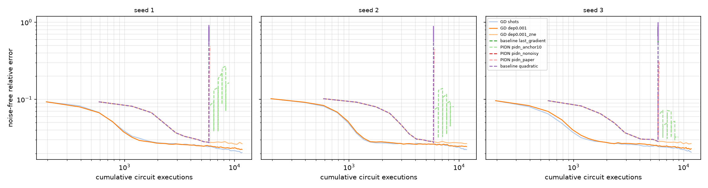
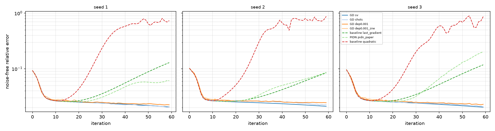

# PIDN on the kagome HVA: a physics-informed surrogate of ZNE gradient descent

Status (2026-11-17): implementation and a limited three-seed comparison on the PRB 105 2x6
rectangle (`graph_hva`, `p = 2`, PRB 106 depolarising layer noise `p_e = 1e-3`). This is a
first test of the method on this problem, not a verdict on it.

Reference: J. Liu and X. Wang, "Accelerating noisy variational quantum algorithms with
physics-informed denoising networks", arXiv:2605.02066 (2026) -- "the paper" below. The
mitigation layer it builds on (ZNE, parameter-shift gradient descent, trajectory records) is
documented in [`graph_hva_mitigation.md`](graph_hva_mitigation.md).

## 1. The method in one paragraph

ZNE-mitigated gradient descent is expensive: every iteration measures the cost and a
parameter-shift gradient at several noise scales (here `(2K + 1) x 3 = 195` energies, 585
circuits). PIDN runs that for `T_init` iterations (Stage I), trains a network
`F(theta_{0:t}, C_noisy(theta_t)) -> (C_hat(theta_t), theta_hat_{t+1})` on the records
(Stage II) with

    L = L_data + beta L_phys,
    L_data = mean |C_hat - C_ZNE|^2 + |theta_hat_{t+1} - theta_{t+1}|^2,
    L_phys = mean |grad_theta C_hat(theta_t) - g_ZNE(theta_t)|^2,

and then steps with `theta_{t+1} = theta_t - eta grad_theta C_hat` (Stage III), measuring only
the noisy cost (one energy, 3 circuits) per step. The paper reports 4-6x fewer circuit
executions than ZNE gradient descent for the same final quality on QAOA and small molecules.

## 2. What the paper leaves open, and what is used here

The paper fixes the structure only qualitatively (Sec. III B): a feed-forward branch on the
noisy cost, a "small GRU" on the parameter history, fusion, two heads, Adam. Everything below
is a choice; every one is a configuration field (`kagome_vqe.pidn.model.PidnModelConfig`,
`kagome_vqe.pidn.training.PidnTrainingConfig`, `PidnStage3Config`), and the important ones are
ablated in Sec. 5.

| item | paper | default here | why |
|---|---|---|---|
| activation | not given | `tanh` | `L_phys` is trained through the *input gradient*; with ReLU that gradient is piecewise constant in `theta` and its weight derivative has no curvature information (ablation `pidn_relu`) |
| parameter encoding | raw `theta` (implied) | `raw`: `(theta - theta_0)/s`, one global scale | per-parameter z-scoring explodes on parameters that barely moved in Stage I; `fourier` `(cos 2 theta, sin 2 theta)` is the exact single-parameter structure (gap-2 generator) and is bounded off the training region (ablation `pidn_fourier`) |
| recurrent input | `theta_{0:t}` (+ noisy costs) | window of 8 steps: features of `theta_k`, the step `theta_k - theta_{k-1}`, `C_noisy(theta_k)` | steps rather than positions carry the descent direction; a window keeps Stage III inputs like the training inputs |
| GRU width | "small" | 32 | 10 training steps of 32 parameters: hundreds of numbers, not thousands |
| noisy-cost branch | feed-forward | 1 -> 16, `tanh` | (ablation `pidn_nonoisy`: no noisy input at all) |
| direct path | not mentioned | `theta_t` features also enter the trunk | the value head is then an explicit function of the current point; its gradient need not pass only through the recurrent cell |
| trunk | not given | 2 x 64, `tanh` | |
| next-step head | predicts `theta_{t+1}` | predicts the increment `theta_{t+1} - theta_t` | identical loss value, but the increment is ~1 % of `theta`: predicting `theta_{t+1}` itself would be badly conditioned |
| loss scales | raw sum | each term divided by its target's scale | value (`O(0.1)` here), step (`O(1e-4)`) and gradient (`O(1)`) terms differ by orders of magnitude; normalised, `beta = 1` means "as important as the data" |
| `beta` | not given (ablation: 0 vs on) | 1 | (ablation `pidn_nophys`: `beta = 0`) |
| size | "small" | GRU 32, noisy branch 16, trunk 64x64 (21k weights) | ablation `pidn_small`: GRU 8, noisy 8, trunk 32 (4.5k weights) |
| optimiser, epochs | Adam | AdamW, lr 3e-3, weight decay 1e-4, 2000 full-batch epochs on all Stage I steps, grad-norm clip 1 | the paper reports fitting the training trajectory (cosine ~0.995 to the ZNE gradients) |
| generalisation check | not given | none by default; ablation `pidn_earlystop`: last 20 % of Stage I held out, early stopping, refit | forward-in-time hold-out is the right question, but with two shot-noise-dominated held-out gradients it selects 3-5 epochs (an untrained network; found in a trial run), so it is an ablation |
| ensemble | not given | 3 networks, averaged | the member spread is recorded as an uncertainty signal |
| Stage III update | `-eta grad C_hat` (Eq. 38) | same (ablation `pidn_stephead`: use the step head) | |
| trust region, re-anchoring | not used (re-training listed as future work) | off (variants `pidn_trust`, `pidn_anchor10`) | |

The network is implemented on a small numpy reverse-mode autodiff engine
(`kagome_vqe.pidn.autodiff`) whose backward rules are themselves differentiable, so
`grad_theta C_hat` and its weight derivative ("double backprop") are exact. It is checked
against finite differences to second order (`tests/unit/test_pidn.py`); one training epoch at
the size used here (32 parameters, window 8, GRU 32, trunk 64x64, 8 steps) takes ~7 ms.
No deep-learning framework is needed (installing one was not possible in this environment); a
PyTorch back-end would be a drop-in replacement of `PidnNetwork`.

## 3. Two structural points worth knowing before the results

**What the noisy input can and cannot do.** Eq. 38 differentiates `F` with respect to `theta`
*holding the measured `C_noisy(theta_t)` fixed* (the total derivative would need
`grad C_noisy`, the very gradient PIDN avoids measuring). Along a training trajectory the value
target changes by `dC_ZNE = g_ZNE . dtheta`, which `L_phys` attributes entirely to the explicit
`theta`-dependence; any sensitivity of `C_hat` to its noisy input then has to be cancelled
(`d C_hat / d C_noisy . dC_noisy ~ 0`). So the noisy cost can modulate the predicted gradient
(e.g. "where on the descent we are") but cannot itself supply gradient information. The
ablation `pidn_nonoisy` tests whether it helps at all; without it, Stage III needs **no quantum
evaluation**, and the method is a pure classical extrapolation of the ZNE trajectory.

**How much the training data can determine.** Stage I gives `T_init` points of a trajectory in
a 32-dimensional parameter space, each with a value and a 32-component gradient. Ten steps are
330 numbers, all along one curve. They determine the gradient field *near that curve*; a
network has no information about directions the trajectory has not explored. The non-neural
baselines make this explicit: `quadratic` fits `C = c + g.d + d.H.d/2` (561 unknowns, ridge
regularised) to the same values and gradients -- a learned quasi-Newton model -- and
`last_gradient` simply keeps stepping along the last ZNE gradient. If PIDN does not beat these,
the network adds nothing beyond local extrapolation.

## 4. Set-up

* **Stage I sources:** the three ZNE gradient-descent runs of
  `configs/studies/graph_hva_zne_gd_representative.toml` (`dep0.001_zne`, seeds 1-3): parameter
  shift with the exchange-gate rule, ZNE by probability scaling `lambda = 1, 2, 3` with a linear
  fit, `lr = 0.05`, 1024 shots per basis and scale, 20 iterations. PIDN takes the first
  `T_init = 10` iterations (5 and 15 in two variants) and is charged their recorded circuit
  executions and shots.
* **Stage III:** to 60 iterations in total, on the same backend with fresh randomness; one noisy
  energy (3 circuits x 1024 shots) per step when the model uses the noisy input.
* **Baselines (same study, same seeds, same initial point):** ZNE gradient descent (20
  iterations), unmitigated parameter-shift gradient descent (60 iterations, same shot budget
  as the 20 ZNE iterations), noise-free gradient descent and shots-only gradient descent (60).
* **Metrics:** noise-free relative energy error of the parameters (exact, classical) against
  cumulative circuit executions; the final ZNE-measured energy (16384 shots per basis and
  scale) as the paper reports it; the cosine between the surrogate gradient and the exact
  noise-free gradient at every Stage III point; the paper's speed-up (executions ZNE gradient
  descent needs to reach its own final error, divided by PIDN's).

## 5. Results

Results: `results/20261116T165446Z-graph_hva_pidn` (15 variants x 3 seeds, all completed) and
`results/20261116T165446Z-graph_hva_pidn_clean` (noise-free Stage I, 6 variants x 3 seeds);
tables in [`data/graph_hva_pidn_runs.csv`](data/graph_hva_pidn_runs.csv),
[`data/graph_hva_pidn_clean_runs.csv`](data/graph_hva_pidn_clean_runs.csv),
[`data/graph_hva_pidn_open_loop.csv`](data/graph_hva_pidn_open_loop.csv).

**Short version: on this problem PIDN does not reproduce the paper's gains.** With realistic
(shot-noise-limited) ZNE data no surrogate continues the descent: every variant makes the
parameters worse from its first surrogate step. With *noise-free* Stage I data the network does
continue the descent for 10-15 iterations, then drifts away. The reasons are measurable and
listed below; none is a bug in a single architectural choice.

### 5.1 Closed loop with ZNE data (the PIDN workflow)

Noise-free relative error of the parameters, median over seeds 1-3 (worst seed). Error at
`t_init = 10` is 0.0276 for every variant (it is the ZNE run itself).

| method | circuit executions | final error | mean cos(surrogate grad, noise-free grad), Stage III |
|---|---|---|---|
| GD, noise-free (reference) | 0 | 0.0205 (0.0210) | 1 |
| GD, unmitigated `dep0.001`, 60 it. | 11,700 | **0.0229** (0.0245) | 0.48 (used gradient, it. >= 10) |
| GD, ZNE, 20 it. (= Stage I source) | 11,700 | 0.0265 (0.0276) | 0.48 |
| PIDN `pidn_paper` | 6,000 | 0.449 (0.493) | -0.43 |
| `pidn_nophys` (beta = 0) | 6,000 | 0.586 (0.638) | -0.40 |
| `pidn_earlystop` | 6,000 | 0.046 (0.055) | -0.44 |
| `pidn_fourier` | 6,000 | 0.602 (0.725) | -0.24 |
| `pidn_nonoisy` (no noisy input; Stage III free) | 5,850 | 0.233 (0.332) | -0.26 |
| `pidn_nogru` | 6,000 | 0.271 (0.281) | -0.40 |
| `pidn_small` (4.5k weights) | 6,000 | 0.270 (0.352) | -0.28 |
| `pidn_relu` | 6,000 | 0.645 (0.680) | -0.34 |
| `pidn_stephead` (step-head update) | 6,000 | 0.683 (0.693) | -0.17 |
| `pidn_trust` (cap 1.5 x Stage I step) | 6,000 | 0.449 (0.493) | -0.43 |
| `pidn_t5` / `pidn_t15` | 3,090 / 8,910 | 0.216 / 0.373 | -0.58 / -0.26 |
| `pidn_anchor10` (ZNE gradient every 10 steps) | 8,925 | 0.042 (0.061) | -0.16 |
| baseline `last_gradient` | 5,850 | 0.635 (0.783) | -0.39 |
| baseline `quadratic` | 5,850 | 0.677 (0.745) | -0.12 |



* Every surrogate is worse than at `t_init` after its first one to four surrogate steps
  (iteration 11 in 41 of the 45 runs; 12-14 in two; `pidn_t5` at 6-11).
  The paper's speed-up (executions for ZNE gradient descent to reach its own final error /
  executions the method needs) is reached in **one of 45 runs** (`pidn_anchor10`, seed 3,
  1.25); no un-anchored variant ends at or below the ZNE error.
* `pidn_trust` is identical to `pidn_paper`: the surrogate's steps (median 0.038) are already
  smaller than the cap (1.5 x the Stage I median 0.121). The failure is the *direction*, not the
  step size. (`pidn_earlystop` stays closest because its almost untrained networks take even
  smaller steps, not because they point the right way.)
* With anchors the run alternates between real ZNE steps and surrogate drift (saw-tooth in the
  figure); right after retraining on the anchor, the surrogate gradient is *anti*-correlated with
  the measured ZNE gradient (mean cosine -0.31).
* The final ZNE-measured energies follow the noise-free ones (e.g. `pidn_paper` -10.9 vs
  noise-free -11.0; `pidn_anchor10` -19.04 vs -19.08): the parameters really are worse; it is not
  a measurement artefact.

### 5.2 Why: what the Stage I data can determine

**Open-loop test** (`kagome_vqe.pidn.diagnostics`, `benchmarks/pidn_extrapolation_check.py`):
train on the first 10 recorded iterations, then predict the gradient at the *recorded* later
points, so the surrogate's own feedback plays no role. Cosine with the exact noise-free gradient,
mean over seeds:

| Stage I data | variant | 1-5 steps ahead | 6-20 | > 20 |
|---|---|---|---|---|
| noise-free | `pidn_paper` | **0.97** | 0.72 | 0.44 |
| noise-free | `pidn_nophys` | 0.10 | 0.01 | -0.07 |
| noise-free | `pidn_fourier` / `pidn_small` | 0.94 / 0.93 | 0.63 / 0.56 | 0.53 / 0.12 |
| noise-free | `last_gradient` | 0.93 | 0.63 | 0.45 |
| noise-free | `quadratic` | 0.66 | 0.49 | 0.50 |
| ZNE (1024 shots) | `pidn_paper` | 0.14 | 0.03 | - |
| ZNE | `pidn_fourier` / `pidn_small` | 0.18 / 0.08 | 0.06 / 0.00 | - |
| ZNE | `last_gradient` / `quadratic` | -0.01 / 0.23 | -0.04 / 0.10 | - |
| ZNE | *the measured ZNE gradient itself* | 0.48 | 0.48 | - |

1. **The physics loss is essential** (the paper's ablation, reproduced): without it the network
   fits the values but its gradient is unrelated to the true one (cosine ~0).
2. **With exact data the network extrapolates well for a few steps**, a little better than
   "keep the last gradient" (0.97 vs 0.93), and the advantage disappears after ~5 steps.
3. **With the ZNE data actually available, nothing can be learned.** After the first ~5
   iterations the noise-free gradient has norm ~0.2-1, the shot noise of a 32-component
   ZNE gradient at 1024 shots per basis and scale ~1.5 (Sec. 3 of
   [`graph_hva_mitigation.md`](graph_hva_mitigation.md)). The network (21k weights, 330 target
   numbers) fits the noisy targets to a physics loss of ~1e-10: it memorises the noise. The
   paper's "cosine ~0.995 during the training phase" is this kind of fit and says nothing about
   prediction. Smaller networks, Fourier features, early stopping and ensembles do not change
   the picture (cosine <= 0.18 even one step ahead).

### 5.3 Closed loop with noise-free Stage I data (upper bound)

| method | error at `t_init` (median) | best error in Stage III (best seed) | final error, median (worst) | first iteration worse than `t_init` |
|---|---|---|---|---|
| GD noise-free (reference) | 0.0266 | - | 0.0205 (0.0210) | - |
| `pidn_paper` (= `pidn_trust`) | 0.0266 | **0.0254** | 0.090 (0.210) | 22-25 |
| `last_gradient` | 0.0266 | 0.0257 | 0.123 (0.134) | 20-22 |
| `pidn_fourier` | 0.0266 | 0.0257 | 0.648 (0.663) | 18-19 |
| `pidn_nophys` | 0.0266 | 0.0265 | 0.526 (0.581) | 11 |
| `quadratic` | 0.0266 | 0.0263 | 0.793 (0.823) | 11-13 |



Even with perfect training data, PIDN improves the parameters for ~10-15 surrogate steps and
then drifts uphill; the closed loop compounds the open-loop horizon of Sec. 5.2.

### 5.4 Reading against the paper

The paper reports 4-6x fewer circuit executions than ZNE gradient descent on QAOA (3-regular,
SK, TFIM) and UCCSD molecules. Here, on a 32-parameter HVA with PRB 106 layer noise:

* the comparison it targets is unfavourable from the start: ZNE gradient descent is *not
  better* than unmitigated gradient descent for optimisation on this noise model
  ([`graph_hva_mitigation.md`](graph_hva_mitigation.md), Sec. 3), so a surrogate of it can at
  best match cheap unmitigated descent;
* Stage I gradients are shot-noise dominated after a few iterations at 1024 shots; the paper's
  cases (fewer parameters for QAOA, ~10^8-10^9 total executions) are likely at much higher
  signal-to-noise per gradient. The paper's own Table VII shows the same mechanism: its
  trajectory-continuation cosine collapses as the landscape becomes noisy;
* the surrogate continues a trajectory, it does not learn the landscape: in 32 dimensions ten
  points along one curve determine the gradient field only near that curve, and the
  continuation leaves it.

What would have to change for PIDN to help here (next experiments, not done): many more shots
per Stage I gradient (or averaging over a longer Stage I), so that the training targets have
signal-to-noise > 1; regular re-anchoring with a *fallback* (use the measured gradient whenever
the surrogate disagrees with it) rather than continued surrogate steps; fewer parameters (per-layer
sharing, 10 instead of 32); and a stronger, noisier hardware model where ZNE actually changes the
descent direction.

## 6. Reproduction

```bash
# 1. Stage I data and the baselines (see graph_hva_mitigation.md)
uv run kagome-vqe study configs/studies/graph_hva_zne_gd_representative.toml ...
# 2. PIDN and the ablations (13 variants x 3 seeds)
uv run kagome-vqe pidn configs/pidn/graph_hva_pidn_representative.toml --dry-run
uv run kagome-vqe pidn configs/pidn/graph_hva_pidn_representative.toml --only pidn_paper- --no-summary
uv run kagome-vqe pidn configs/pidn/graph_hva_pidn_representative.toml --resume results/<ts>-graph_hva_pidn \
    --only <variant>- --no-summary     # one process per variant
uv run kagome-vqe pidn-summary results/<ts>-graph_hva_pidn
# 3. Upper bound with noise-free Stage I data (6 variants x 3 seeds, no circuit cost)
uv run kagome-vqe pidn configs/pidn/graph_hva_pidn_clean_limit.toml
# 4. Open-loop extrapolation test (no quantum evaluations)
uv run python benchmarks/pidn_extrapolation_check.py configs/pidn/graph_hva_pidn_representative.toml \
    results/<ts>-graph_hva_zne_gd/runs/*-sv-gd_ps-s[123] \
    --only pidn_paper pidn_nophys pidn_fourier pidn_small quadratic last_gradient
```

Cost on the shared machine (single-threaded processes): the 45 noisy-data runs took ~35 min
on five processes (~2-3 min per run: training 3-30 s, Stage III with noisy energies and
noise-free diagnostics, final ZNE re-measurement with 16384 shots per basis and scale);
the anchored variant ~5 min per run; the clean study ~2.5 min per run.

## 7. Limitations

* One lattice, one depth, one noise level and channel, three seeds, Stage I from one ZNE
  configuration (probability scaling, linear fit), one learning rate.
* The noise model is the PRB 106 logical-layer model, on which ZNE works unusually well and the
  noisy landscape is close to a uniformly contracted copy of the noise-free one. The paper's
  motivating picture -- noise flattening the landscape and making it rough -- is mostly
  shot noise here.
* Hyper-parameters are reasoned defaults, not tuned; the ablations change one thing at a time.
