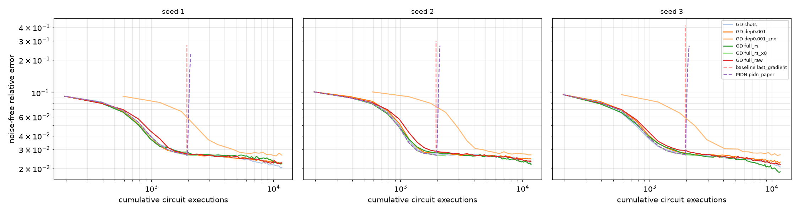
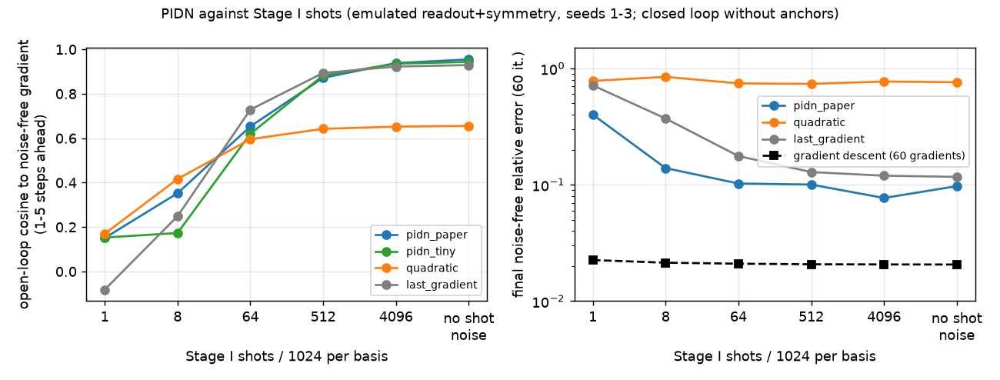

# Can M2-style error mitigation stop PIDN from learning noise?

Status (2026-11-17): three-seed study on the PRB 105 2x6 rectangle (`graph_hva`, `p = 2`, 32
parameters) under PRB 106 depolarising layer noise `p_e = 1e-3` plus a readout error `q = 0.02`.
Branch `feature/graph-hva-pidn-m2` (PIDN, [`graph_hva_pidn.md`](graph_hva_pidn.md), merged with
the M2 comparison, [`graph_hva_m2_mitigation.md`](graph_hva_m2_mitigation.md)).

## 1. Question and answer

PIDN failed because its network fits the noise in the Stage I gradients
([`graph_hva_pidn.md`](graph_hva_pidn.md), Sec. 5). The M2 techniques -- readout correction,
symmetry filtering, ZNE, twin rescaling -- make the measured *costs* accurate (Sec. 2 of the M2
document: readout + symmetry, bias <= 0.4 % at no extra variance). Does feeding PIDN mitigated
data fix it?

**No.** Mitigation removes bias; PIDN is limited by variance, and by what variance does to the
*parameter path* of Stage I. Concretely, on this problem:

1. Every M2 stack leaves the gradient noise unchanged (readout + symmetry, twin) or larger (ZNE);
   only more shots reduce it.
2. Even with *exact* targets, a surrogate trained on a noisy Stage I path cannot predict the
   next gradients: noisy steps knock the parameters off the descent path, and the true gradient
   at the next point is then dominated by curvature times a random displacement.
3. With a Stage I run through readout + symmetry at 8x the shots (a much smoother path), PIDN
   still fails in closed loop. With an M2-measured gradient every 5 steps it is as good as, but
   no better than, plain gradient descent with the same number of measured gradients.
4. **More shots alone** (emulated up to 4096x) make the open-loop prediction good (cosine 0.87 at
   512x) but not the closed loop: even with noise-free Stage I data PIDN without anchors ends at
   8-10 % error against 2.1 % for plain gradient descent at 1x (Sec. 3.5).
5. **The network does memorise the noise, but it is not too large:** every size from 1,089 to
   20,961 weights (and weight decay, short training, an 8-member ensemble) reproduces the noisy
   targets exactly; smaller networks extrapolate worse, not better (Sec. 3.6).
6. **The paper's Gaussian smoothing** is a landscape diagnostic; by it this landscape is already
   smooth (`R_LF` 0.99), yet PIDN fails. Smoothing the targets with a Gaussian kernel does not
   help (Sec. 3.7).

## 2. Experiments

All under the "full" noise model of the M2 table (depolarising `1e-3` + readout `0.02`), 1024
shots per basis unless noted, seeds 1-3, `t_init = 10`, 60 iterations in total.

| step | config | what varies | results |
|---|---|---|---|
| A. relabelled Stage I | `configs/pidn/graph_hva_pidn_m2_relabel.toml`, `kagome-vqe pidn-relabel` | the Stage I *targets* (cost and parameter-shift gradient at the 10 recorded points of the ZNE runs) through 6 pipelines; the path is fixed | `results/20261116T183018Z-graph_hva_pidn_m2_relabel` |
| B. control | `benchmarks/pidn_exact_targets_control.py` | exact noise-free targets on the same recorded noisy paths | [`data/graph_hva_pidn_exact_targets_control.csv`](data/graph_hva_pidn_exact_targets_control.csv) |
| C. real M2 Stage I | `configs/studies/graph_hva_m2_gd.toml` | gradient descent run through the pipeline (so the path reflects it): unmitigated and readout + symmetry, 60 iterations; readout + symmetry at 8x shots, 12 iterations | `results/20261116T194536Z-graph_hva_m2_gd` |
| D. PIDN closed loop | `configs/pidn/graph_hva_pidn_m2.toml` (on A), `graph_hva_pidn_m2_path_rs.toml`, `graph_hva_pidn_m2_path_rs_x8.toml` (on C) | `pidn_paper`, `pidn_small`, `pidn_anchor5` (a measured gradient through the same pipeline every 5 steps, then retraining), `last_gradient` | `results/20261116T185211Z-graph_hva_pidn_m2`; on C (rerun after the fix below) `results/20261117T021043Z-graph_hva_pidn_m2_path_rs`, `...T024148Z-..._path_rs_x8` |
| E. shots | `benchmarks/pidn_shot_scaling.py`, `configs/pidn/graph_hva_pidn_shot_scaling.toml` | emulated Stage I at 1x-4096x shots and without shot noise; moving-average paths | `results/20261117T020649Z-graph_hva_pidn_shot_scaling`, `...T024052Z-..._shot_scaling_closed` |
| F. capacity | `configs/pidn/graph_hva_pidn_capacity.toml` | network size and regularisation, open loop, memorisation test | as E (`summary/`) |
| G. Gaussian smoothing | `benchmarks/pidn_landscape_spectrum.py`; `smooth_targets` in E | landscape metrics of the paper; kernel-smoothed targets | `results/20261117T020802Z-graph_hva_pidn_landscape` |

Pipelines of A: `raw` (none), `rs` (readout + symmetry), `rst` (+ twin), `rzne` (readout + ZNE,
probability scaling 1, 2, 3, exponential), `rs_x4`, `rs_x8` (readout + symmetry with 4096 / 8192
shots per basis). A 16x pipeline was started first and did not finish inside the 40-minute
per-process cap; it was replaced by 8x (the `relabel.toml` stored in the results directory still
lists it).

## 3. Results

### 3.1 What mitigation does to the Stage I targets (A, C)

Over the 10 Stage I points, means over seeds. `cos` / `cos late`: cosine of the measured gradient
with the exact noise-free gradient (all points / last 5); `|g - g_ideal|`: gradient error norm;
`SNR late`: noise-free gradient norm / gradient error over the last 5 points; cost error:
measured cost minus noise-free energy.

| pipeline | Stage I circuits (shots per basis) | cos | cos late | abs(g - g_ideal) | SNR late | cost error |
|---|---|---|---|---|---|---|
| none | 1,950 (1024) | 0.79 | 0.68 | 1.13 | 1.1 | **+1.99** |
| readout + symmetry | 1,950 (1024) | 0.80 | 0.70 | 1.19 | 1.1 | +0.02 |
| readout + symmetry + twin | 1,950 (1024) | 0.82 | 0.74 | 1.16 | 1.1 | -0.06 |
| readout + ZNE | 5,850 (1024) | 0.65 | 0.54 | 1.98 | 0.65 | -0.02 |
| readout + symmetry, 4x shots | 1,950 (4096) | 0.93 | 0.88 | 0.61 | 2.0 | +0.00 |
| readout + symmetry, 8x shots | 1,950 (8192) | 0.96 | 0.94 | 0.43 | 2.9 | +0.04 |
| *(C) readout + symmetry, own path* | 1,950 (1024) | 0.76 | 0.63 | 1.21 | 0.85 | +0.01 |
| *(C) readout + symmetry 8x, own path* | 1,950 (8192) | 0.90 | 0.82 | 0.43 | 1.8 | +0.05 |

Mitigation fixes the cost (+1.99 -> +0.02) and leaves the gradient error where it was; ZNE
makes it worse; shots reduce it as `1/sqrt(shots)`.

### 3.2 The surrogate cannot predict along a noisy path, even from exact targets (A, B)

Open loop: trained on the 10 points, scored on the next 1-5 recorded points; cosine of the
predicted gradient with the exact noise-free gradient, mean over seeds.

| Stage I data | `pidn_paper` | `pidn_small` | `quadratic` | `last_gradient` |
|---|---|---|---|---|
| noise-free run (smooth path), exact targets | **0.97** | 0.93 | 0.66 | 0.93 |
| ZNE run's noisy path, **exact** targets (B) | 0.27 | 0.32 | 0.37 | 0.13 |
| same path, targets from: none / readout + symmetry | 0.22 / 0.20 | 0.25 / 0.21 | 0.28 / 0.25 | 0.08 / 0.05 |
| same path, readout + symmetry + twin / readout + ZNE | 0.26 / 0.12 | 0.19 / 0.11 | 0.25 / 0.17 | 0.08 / -0.01 |
| same path, readout + symmetry 4x / 8x | 0.24 / 0.25 | 0.24 / 0.24 | 0.31 / 0.32 | 0.05 / 0.10 |
| (C) readout + symmetry 8x, own path (1-2 steps) | 0.25 | 0.15 | 0.56 | 0.22 |

Along the noisy paths the noise-free gradient has norm 0.7-1.0 and consecutive gradients have
cosine 0.1-0.4; along the noise-free path the gradient has norm ~0.2 and consecutive cosine
0.996 (control B output). Every noisy step moves the parameters off the valley floor in a random
direction; the gradient there is mostly curvature times that displacement, which no amount of
history predicts. Better targets on the same path do not help (0.20-0.26 for every pipeline,
0.27 even when exact); a smoother path (8x shots) helps a little (quadratic 0.56).

### 3.3 Closed loop (D)

Noise-free relative error of the parameters; median over seeds (worst). Error when the
surrogate takes over: 0.0274-0.0276 (A, C 1x) and 0.0265 (C 8x). `cos`: mean cosine of the
surrogate gradient with the noise-free gradient during the surrogate phase.

| Stage I | variant | circuits (shots) | final error | cos |
|---|---|---|---|---|
| A: none / readout+symmetry / +twin / readout+ZNE | `pidn_paper` | 2,100 / 2,100 / 2,100 / 6,000 | 0.55 / 0.41 / 0.44 / 0.42 | -0.37 / -0.34 / -0.47 / -0.31 |
| A: readout+symmetry 4x / 8x | `pidn_paper` | 2,100 (8.6M / 17M) | 0.31 / 0.44 | -0.44 / -0.56 |
| A: all pipelines | `pidn_small` | 2,100-6,000 | 0.22-0.54 | -0.29 to -0.35 |
| A: all pipelines | `last_gradient` | 1,950-5,850 | 0.50-0.81 | -0.29 to -0.54 |
| C: readout+symmetry, own path | `pidn_paper` / `pidn_small` / `last_gradient` | 2,100 | 0.39 / 0.22 / 0.79 | -0.46 / -0.34 / -0.40 |
| C: readout+symmetry 8x, own path | `pidn_paper` / `pidn_small` / `last_gradient` | 2,100 (17M) | 0.28 / 0.20 / 0.31 | -0.46 / -0.33 / -0.62 |
| A: none / readout+symmetry / +twin / 4x / readout+ZNE | `pidn_anchor5` | 4,050 (11,850 ZNE) | 0.024 / 0.026 / 0.026 / 0.023 / 0.027 | 0.03-0.21 |
| C: readout+symmetry / 8x, own path | `pidn_anchor5` | 4,050 (4.2M / 33M) | **0.0251 / 0.0230** | 0.01 / 0.06 |
| *gradient descent, readout+symmetry, after 20 / 60 measured gradients* | - | 3,900 / 11,700 | 0.0263 / 0.0216 | - |
| *gradient descent, unmitigated, after 20 / 60* | - | 3,900 / 11,700 | 0.0259 / 0.0219 | - |



**Correction (2026-11-17).** The first version of the C rows had a mismatch in PIDN's noisy
input: Stage I recorded the readout + symmetry cost (the run's own value), while Stage III
measured the *unmitigated* cost, ~10 % higher -- far outside the training range. Stage III now
measures `C_noisy` with the estimator that produced the Stage I column
(`kagome_vqe.pidn.workflow.noisy_input_mitigation`: the run's stack; the inner counts-level stack
for ZNE runs; unmitigated for relabelled runs, so A and the original PIDN study were not
affected). The C rows above are the reruns; the conclusions did not change (before: 0.26 / 0.25
on the 1x path, 0.36 / 0.22 at 8x, anchored 0.0264 / 0.0231); the figures are from the reruns.

* Without anchors every run is worse than at hand-over within one to five surrogate steps
  (relabelled data: iteration 11 in 48 of the 54 runs, 12-13 in the rest; own path, reruns:
  iterations 10-14, median 11). The surrogate gradient is *anti*-correlated with the true one in closed loop (-0.3 to
  -0.6) although it was weakly positive open loop (0.1-0.3): stepping along `-grad C_hat` moves
  the parameters exactly where the surrogate's errors point downhill, the classic failure of
  optimising against a learned model.
* With a measured gradient every 5 steps (`pidn_anchor5`) the error stays at 0.023-0.027 --
  the error gradient descent reaches with the same 20 measured gradients (0.026). At the anchors
  the retrained surrogate agrees with the measured gradient only at cosine ~0. The surrogate
  steps in between add nothing; the anchored 8x run costs 33M shots for 0.0230, unanchored
  gradient descent reaches 0.0216 with 12M.
* With noise-free Stage I data (the clean limit of [`graph_hva_pidn.md`](graph_hva_pidn.md),
  Sec. 5.3) the same network continues the descent for 10-15 steps. Between that and the 8x
  pipeline (gradient SNR ~3, consecutive-gradient cosine ~0.8) lies more than an order of
  magnitude in shots.

### 3.4 Gradient descent with M2 mitigation (C)

| 60 iterations, 11,700 circuits | final noise-free error (median, max) | final fidelity | final measured energy (noise-free) |
|---|---|---|---|
| unmitigated | 0.0219 (0.0233) | 0.671 | -17.42 (-19.47): bias +2.05 |
| readout + symmetry | 0.0216 (0.0221) | 0.678 | -19.45 (-19.48): bias +0.03 |

As with ZNE ([`graph_hva_mitigation.md`](graph_hva_mitigation.md), Sec. 3): mitigation does
not change how well gradient descent optimises (the readout damping rescales every gradient by
`(1 - 2q)^2`, the direction is unchanged), but it makes the reported energy right -- here at no
extra circuit cost (only 32,768 calibration shots).

### 3.5 Can more shots alone fix it? (E)

Real readout + symmetry runs beyond 8x are too slow (an 8x run takes ~25 min for 12 iterations),
so larger budgets are **emulated** (`benchmarks/pidn_shot_scaling.py`,
`results/20261117T020649Z-graph_hva_pidn_shot_scaling`): gradient descent on the exact
noise-free gradient times the measured residual damping (`c = 0.993`) plus independent Gaussian
noise per component, calibrated on the real 1x runs (noise norm 1.23 per gradient, per
component 0.18-0.27), scaled by `1/sqrt(k)` for `k` times 1024 shots per basis. PIDN's noisy
input is measured for real (readout + symmetry, 1024 shots) at every point. **Checks:** the real
8x runs have `sigma_8 / sigma_1 = 0.351` (`1/sqrt(8) = 0.354`), and emulated `k = 1, 8`
reproduce the real paths (target cosine 0.771 / 0.911 against 0.763 / 0.900; consecutive-gradient
cosine 0.59 / 0.79 against 0.61 / 0.79; open-loop PIDN cosine 0.15 against 0.14 at 1x).

| Stage I shots | target cos | consecutive cos along the continuation | open loop `pidn_paper` 1-5 / 6-20 steps ahead | open loop `last_gradient` 1-5 | closed loop `pidn_paper` final error (first worse iteration) | Stage I shots |
|---|---|---|---|---|---|---|
| 1x | 0.77 | 0.11 | 0.15 / 0.01 | -0.08 | 0.40 (11) | 2.0M |
| 8x | 0.91 | 0.41 | 0.35 / 0.22 | 0.25 | 0.14 (15) | 16M |
| 64x | 0.98 | 0.84 | 0.65 / 0.40 | 0.73 | 0.10 (16) | 128M |
| 512x | 0.997 | 0.97 | 0.87 / 0.62 | 0.89 | 0.10 (20) | 1.0G |
| 4096x | 1.000 | 0.99 | 0.94 / 0.68 | 0.92 | 0.077 (23) | 8.2G |
| no shot noise | 1 | 1.00 | 0.95 / 0.68 | 0.93 | 0.097 (23) | - |
| *gradient descent, 60 measured gradients, any k* | | | | | *0.021-0.023* | 12M at 1x |

(Means over seeds 1-3; closed loop without anchors, 50 surrogate steps; error at hand-over
0.027-0.028. Data: [`data/graph_hva_pidn_shot_scaling_targets.csv`](data/graph_hva_pidn_shot_scaling_targets.csv),
[`..._openloop.csv`](data/graph_hva_pidn_shot_scaling_openloop.csv),
[`..._closed.csv`](data/graph_hva_pidn_shot_scaling_closed.csv); closed loop:
`configs/pidn/graph_hva_pidn_shot_scaling.toml`, `results/20261117T024052Z-graph_hva_pidn_shot_scaling_closed`.)



* **More shots do fix the open-loop prediction, slowly:** the cosine one to five steps ahead
  reaches 0.87 at 512x, close to the noise-free 0.95. The limiting quantity is the path, not
  the targets: at 64x the targets are already at 0.98 but consecutive true gradients along the
  path are still only 0.84 alike.
* **They do not make PIDN competitive.** Even with noise-free Stage I data the unanchored closed
  loop ends at 8-10 % error (it improves for ~13 steps, then drifts; surrogate cosine in Stage
  III -0.16 to -0.45), against 2.1 % for gradient descent with 60 measured gradients -- at 1x
  shots, which is 80x fewer than a 512x Stage I alone. On this problem the clean-path predictor
  is also barely better than "reuse the last gradient" (0.95 vs 0.93 one to five steps ahead).
* **Smoothing the path instead** (Stage I steps along a bias-corrected moving average of the
  gradients, `beta = 0.9`; `k1_ema0.9`, `k8_ema0.9`) makes Stage I smoother (consecutive cosine
  0.82 instead of 0.59) but the momentum path turns later and the open-loop cosine 6-20 steps
  ahead becomes negative (-0.1 to -0.2); not a remedy.

### 3.6 Is the network too large -- does it overfit? (F)

`configs/pidn/graph_hva_pidn_capacity.toml`, open loop on every emulated and real path:
`pidn_paper` (20,961 weights per member, ensemble of 3), `pidn_small` (4,457), `pidn_tiny`
(1,089: no recurrent or noisy branch, one hidden layer of 16), `pidn_wd` (weight decay 1e-2),
`pidn_ens8` (8 members), `pidn_short` (200 epochs instead of 2000), against `quadratic` (ridge)
and `last_gradient`. The memorisation test fits on the 10 Stage I points and compares the
fitted gradients there with the measured targets and with the noise-free gradients.

| Stage I | targets vs noise-free | every network: fit vs targets / fit vs noise-free | quadratic: fit vs targets / vs noise-free |
|---|---|---|---|
| real 1x | 0.763 | 0.990-1.000 / 0.760-0.763 | 0.859 / 0.814 |
| real 8x | 0.900 | 0.990-1.000 / 0.900-0.911 | 0.869 / 0.921 |
| emulated 64x | 0.982 | 0.994-1.000 / 0.982-0.987 | 0.925 / 0.935 |

* **Yes, every network memorises its training gradients** -- fitted gradients reproduce the
  noisy targets (cosine 0.99-1.00) and agree with the noise-free gradient exactly as well as the
  targets themselves do (0.763 at 1x): no denoising at all, at any size from 1,089 to 20,961
  weights, with strong weight decay, with short training or with 8 members.
* **But a smaller network does not help:** open loop 1-5 steps ahead at 8x: `pidn_paper` 0.35,
  `pidn_small` 0.29, `pidn_tiny` 0.17; `pidn_wd` / `pidn_ens8` / `pidn_short` 0.36. With 10
  points in 32 dimensions any smooth model can match all gradients, and the physics loss
  (`grad C_hat = g` at the training points) demands exactly that; capacity only changes how the
  model extrapolates, and the larger models extrapolate slightly better. The ridge-regularised
  quadratic does not interpolate and denoises a little (0.763 -> 0.814 at 1x) but extrapolates
  worse on clean paths (0.66 vs 0.95) and fails in closed loop (0.74-0.85 error at every k).
  The failure is in the data (signal-to-noise and the path), not in an oversized network.

### 3.7 The paper's Gaussian smoothing (G)

Liu and Wang use Gaussian smoothing as a **diagnostic** of the loss landscape (their Eqs. 39-42:
contrast `Delta E_smooth` and `sigma_smooth` of `G_sigma * E` on a 2-D slice, and the
low-frequency power ratio `R_LF`), not as a step of PIDN; they find PIDN tracks the optimisation
when `R_LF` is high (0.976 for their ZNE landscapes) and fails as it drops (their VQE examples
at noise `1e-3`: `R_LF` 0.51-0.61, PIDN cosine 0.003-0.012). Measured here
(`benchmarks/pidn_landscape_spectrum.py`, `results/20261117T020802Z-graph_hva_pidn_landscape`; slices
through `theta_10` of the readout + symmetry run, three random parameter pairs, 24x24 grid over
one period, `K_low` = the support of the noise-free slice's spectrum, `sigma` = one grid step):

| slice | R_LF | Delta E_smooth | noise std per point |
|---|---|---|---|
| noise-free | 1.000 | 6.49 | 0 |
| unmitigated, 1024 shots | 0.987 | 5.91 | 0.155 |
| readout + symmetry, 1024 | 0.988 | 6.54 | 0.168 |
| readout + ZNE, 1024 | 0.972 | 6.69 | 0.262 |
| readout + symmetry, 8192 | 0.998 | 6.49 | 0.062 |

* Gate noise flattens the landscape (-9 % contrast) and mitigation restores it (readout +
  symmetry, ZNE), as in the paper; ZNE lowers `R_LF` by adding shot noise.
* **By the paper's criterion this landscape is already "smooth"** (`R_LF` 0.99 at 1x, above the
  paper's ZNE value), yet PIDN fails. A full-period slice measures the global signal-to-noise
  (signal std 1.8 against noise 0.16); PIDN needs the *local* gradient along the path, whose
  noise-free norm is 1.6 in Stage I (0.28 per component) against a measured noise of 1.23 (0.22
  per component), and smaller near the optimum. So `R_LF` is not predictive here.
* **Gaussian smoothing as a remedy** -- kernel regression of the Stage I targets over the Stage
  I points in parameter space, width by leave-one-out on the measured targets (no noise-free
  information): it *lowers* the target quality on ordinary paths (cosine to the noise-free
  gradient 0.771 -> 0.679 at 1x, 0.911 -> 0.888 at 8x: neighbouring points have different true
  gradients, consecutive cosine 0.6-0.8) and raises it only on already smooth paths (moving
  average: 0.886 -> 0.939; real 8x: 0.900 -> 0.905). Open loop: 1x 0.15 -> 0.05, 8x 0.35 ->
  0.42. Not a fix.

## 4. Conclusions

* **M2 mitigation does not prevent PIDN from learning noise.** It removes the bias of the costs
  (the value head now learns the right energies) but not the shot noise of the gradients, and
  PIDN's gradient field is what drives Stage III. ZNE makes the gradient noise worse.
* **The binding constraint is the signal-to-noise of the whole Stage I trajectory**, not only
  of its targets: noisy steps make the true gradient along the path unpredictable from its
  history. The open-loop prediction becomes good only at ~512x the shots (a Stage I of ~1G
  shots, 80x a whole 60-iteration gradient descent), and even then the closed loop drifts
  after ~13 surrogate steps and ends 4-5x worse than gradient descent.
* **It is not an oversized network:** every network size memorises the Stage I gradients
  exactly (the physics loss asks for it), and smaller networks extrapolate worse.
* **Gaussian smoothing** (the paper's landscape diagnostic) rates this landscape as smooth, so
  it does not explain the failure; smoothing the targets does not fix it.
* **What M2 mitigation is for, here:** the energy you report. Readout + symmetry is the stack of
  choice on this noise model (bias <= 0.4 %, no extra variance, no extra circuits); optimise
  with unmitigated or readout + symmetry gradients, report the readout + symmetry (or ZNE)
  energy.

Tested and not sufficient: more shots (Sec. 3.5), a momentum-smoothed Stage I path (3.5),
smaller or regularised networks and ensembles (3.6), Gaussian-smoothed targets (3.7). Not done:
fewer parameters (per-layer sharing, 10 instead of 32, so each gradient is cheaper to measure
precisely); anchors with a fallback rule (use the measured gradient when the surrogate disagrees
with it, which here means always); a surrogate with an explicit local Hessian model fitted to
more than one trajectory.

## 5. Reproduction

```bash
uv run kagome-vqe pidn-relabel configs/pidn/graph_hva_pidn_m2_relabel.toml          # A (one process per pipeline/seed)
uv run python benchmarks/pidn_target_quality.py results/<ts>-graph_hva_pidn_m2_relabel \
    configs/pidn/graph_hva_pidn_representative.toml --only pidn_paper pidn_small quadratic last_gradient \
    --reference "zne_original=results/<ts>-graph_hva_zne_gd/runs/*dep0.001_zne-gd_ps-s*" \
                "noise_free=results/<ts>-graph_hva_zne_gd/runs/*-sv-gd_ps-s*"
uv run python benchmarks/pidn_exact_targets_control.py configs/pidn/graph_hva_pidn_representative.toml \
    results/<ts>-graph_hva_zne_gd/runs/*dep0.001_zne-gd_ps-s* results/<ts>-graph_hva_m2_gd/runs/*full_rs-gd_ps60-s* \
    --only pidn_paper pidn_small quadratic last_gradient                                # B
uv run kagome-vqe study configs/studies/graph_hva_m2_gd.toml --only <run> --no-summary  # C
uv run kagome-vqe pidn configs/pidn/graph_hva_pidn_m2.toml                               # D on A
uv run kagome-vqe pidn configs/pidn/graph_hva_pidn_m2_path_rs.toml                       # D on C
uv run kagome-vqe pidn configs/pidn/graph_hva_pidn_m2_path_rs_x8.toml
# E, F: emulated Stage I (one process per label), open loop, closed loop
uv run python benchmarks/pidn_shot_scaling.py generate --out results/<ts>-graph_hva_pidn_shot_scaling --only k8
uv run python benchmarks/pidn_shot_scaling.py openloop results/<ts>-graph_hva_pidn_shot_scaling \
    configs/pidn/graph_hva_pidn_capacity.toml --real --only k8
uv run python benchmarks/pidn_shot_scaling.py report results/<ts>-graph_hva_pidn_shot_scaling
uv run kagome-vqe pidn configs/pidn/graph_hva_pidn_shot_scaling.toml --only -k8-s
uv run python benchmarks/pidn_shot_scaling.py closed results/<ts>-graph_hva_pidn_shot_scaling \
    results/<ts>-graph_hva_pidn_shot_scaling_closed
# G: landscape slices (one process per pipeline and pair), then the metrics
uv run python benchmarks/pidn_landscape_spectrum.py measure results/<ts>-graph_hva_pidn_landscape \
    --pipelines rs --pairs 0
uv run python benchmarks/pidn_landscape_spectrum.py report results/<ts>-graph_hva_pidn_landscape
```

Cost on the shared machine (single-threaded processes, 40-minute cap each): A ~1.5-17 min per
(pipeline, seed); C ~13 min per 60-iteration run, ~25 min per 8x run; D ~2-3 min per run, ~15
min for an anchored 8x run. Not completed and omitted: the anchored runs on the relabelled 8x
data (`pidn_anchor5-rs_x8`, expensive and superseded by C).

## 6. Limitations

One lattice, depth, noise level and readout error; three seeds; one learning rate; the relabelled
experiments hold the ZNE run's path fixed (by design, and confounded by it, which is why C was
added); the readout error is symmetric and uncorrelated. Beyond 8x the Stage I data are
emulated (Gaussian gradient noise calibrated on, and checked against, the real 1x and 8x runs;
gate-noise effects beyond a uniform damping are not modelled). The landscape metrics use three
random parameter pairs and our choice of `K_low` and `sigma` (the paper gives neither).
