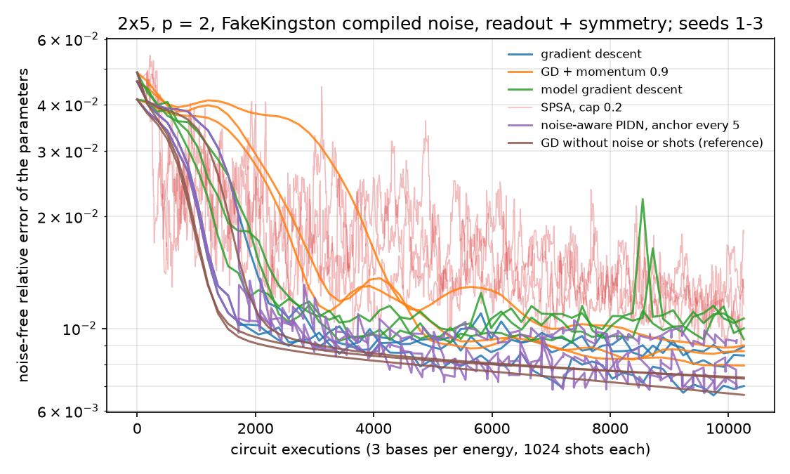

# Does PIDN have a niche here? Noise direction, parameter sharing, online surrogates

Status (2026-11-17): tests A, B and C done; branch `feature/graph-hva-pidn-next` (from
`feature/graph-hva-pidn-m2`, local only). Previous documents:
[`graph_hva_pidn.md`](graph_hva_pidn.md), [`graph_hva_pidn_m2.md`](graph_hva_pidn_m2.md),
[`graph_hva_m2_mitigation.md`](graph_hva_m2_mitigation.md),
[`graph_hva_mitigation.md`](graph_hva_mitigation.md),
[`graph_hva_noisy_optimizers.md`](graph_hva_noisy_optimizers.md).

## 1. Starting point and questions

PIDN (arXiv:2605.02066) failed on the PRB 105 2x6 rectangle (`graph_hva`, `p = 2`, 32
parameters) under PRB 106 depolarising layer noise `p_e = 1e-3`, for three established reasons
(not repeated here): (1) the Stage I gradient SNR drops below 1 after ~10 iterations; (2) a
surrogate fitted to one trajectory drifts once it leaves it; (3) on that noise model the bias is
nearly parameter-independent, so ZNE does not change the descent direction and a surrogate of
ZNE-GD cannot beat plain GD. Anchoring every 5 steps equals GD with the same measured gradients.

* **A.** Is (3) a property of the layer model only? On *compiled hardware noise* (fake-device
  noise models after routing), does the noise turn the gradient, and can mitigation turn it back?
* **B.** Does per-layer parameter sharing (32 -> 10 angles) raise the gradient SNR enough for
  PIDN's open loop?
* **C.** Under the noise model chosen in A, does an online noise-aware surrogate (model gradient
  descent; PIDN with a noise-aware loss) or another optimiser beat plain GD at equal shots?

## 2. Answer

1. **A: compiled noise does turn the gradient, the layer model does not.** Exact cosines between
   the noisy and the noise-free gradient at gradient-descent iterates 10-60 (at the start all
   models are at >= 0.96): >= 0.997 for the PRB 106 layer model, 0.95-0.98 for FakeNighthawk with
   the paper's PRB 105 mapping, 0.92-0.97 on FakeKingston's best hexagon, 0.62-0.84 on its median
   hexagon, 0.17-0.61 on FakeGuadalupeV2.
   The readout + symmetry estimator (the M2 stack) restores most of it (Kingston best 0.92 ->
   0.98, median 0.62 -> 0.89) and exact quadratic ZNE the rest on the moderate models (0.99-0.997);
   on Guadalupe nothing does. By the plan's rule compiled noise is the model for further work.
2. **B: per-layer sharing is not the fix.** 32 -> 10 angles raises the late Stage I SNR 2.6x and
   PIDN's open-loop cosine from 0.14 to 0.31 (below the 0.8 needed for a closed loop), and costs
   expressibility: the shared ansatz's optimum (2.27 % at `p = 2`) is worse than what per-gate
   gradient descent reaches under noise (2.07 %).
3. **C: nothing beats plain gradient descent at equal shots** under FakeKingston compiled noise
   (2x5, readout + symmetry). Median noise-free error after 10,263 circuits: GD 0.84 %, momentum
   0.87 %, MGD 1.00 %, SPSA 1.29 %, noise-aware PIDN 0.70 % (seeds: 0.69 / 0.93 / 0.70 against GD's
   0.70 / 0.84 / 0.89, i.e. one better, one worse, one equal); GD *without* noise or shots reaches
   0.73 %, and 0.53 % with four times as many steps. With the M2 stack the noise leaves the
   gradient at cosine 0.99 on this instance, so there is little for any noise-aware method to
   win, and PIDN's surrogate gradients are uncorrelated with the measured ones (cosine -0.02 to
   -0.11 at the 46 anchors per run).

## 3. A: does noise change the gradient direction?

### 3.1 Method

`benchmarks/noise_direction.py`. For every point and noise model, from **exact** expectation
values (Aer density matrices, no shots):

* `g_ideal`: noise-free exchange shift-rule gradient; `g_noisy`: gradient of the exact noisy
  energy by central finite differences (`h = 1e-3`; checked against the shift rule on the
  noise-free compiled circuit, max deviation <= 8e-7);
* three noisy estimators: gate noise only (= perfect readout correction), unmitigated (device
  readout error applied analytically per qubit), readout + symmetry (the M2 stack: per-qubit
  inverse, then the `n/2` sector filter; needs full distributions, computed at the seed-1
  iterate 10 of every model);
* `cos(g, g_ideal)`, the damping `E_noisy / E_ideal`, the bias `E_noisy - E_ideal`.

Noise models (all 12 active qubits, so the density matrix fits in 268 MB):

| label | device / noise | mapping | two-qubit gates (`p = 2`) |
|---|---|---|---|
| `layer` | PRB 106 depolarising `p_e = 1e-3` after every layer, readout `q = 0.02` | logical (control) | 32 exchange |
| `nighthawk_prb105` | FakeNighthawk (square lattice) | PRB 105 square-grid embedding, `paper_exact` | 122 CZ |
| `guadalupe_ring` | FakeGuadalupeV2 | main M2's 12-qubit ring, SABRE within it | 190 CX |
| `kingston_ring` | FakeKingston (Heron r2) | best hexagon (lowest mean CZ error), SABRE within it | 190 CZ |
| `kingston_median` | FakeKingston | median hexagon (rank 10 of 19 by CZ error), GD iterates 10 only | 190 CZ |

Unrestricted generic routing used 13 (Guadalupe) and 14 (Kingston) qubits, 4x and 16x larger
density matrices; the ring restriction costs more SWAPs. Main's M2 used FakeGuadalupeV2 only;
Kingston was added as the current device.

Points: the iterates 0, 10, 60 of the seed-1 readout + symmetry gradient-descent run and the
iterate 10 of seeds 2 and 3 (`configs/studies/graph_hva_m2_gd.toml`, PRB 106 noise), where the
noise-free gradient has norm 0.6-2.8; and the noise-free L-BFGS-B optima of `p = 2`, seeds 1-3
(there the noise-free gradient is ~0, so the cosine is not a direction test; Sec. 3.4).

### 3.2 Results: GD points

Over the five GD points per model (data:
[`data/graph_hva_pidn_next_direction.csv`](data/graph_hva_pidn_next_direction.csv)):

| model | min / median `cos`, gate noise | min `cos`, unmitigated | damping `E_n / E_i` (sd) |
|---|---|---|---|
| layer | 0.997 / 0.998 | 0.997 | 0.971 (0.0002) |
| Nighthawk, PRB 105 mapping | 0.951 / 0.970 | 0.954 | 0.897 (0.001) |
| Kingston, best hexagon | 0.916 / 0.967 | 0.824 | 0.874 (0.001) |
| Kingston, median hexagon (3 points) | 0.620 / 0.824 | 0.635 | 0.787 (0.001) |
| Guadalupe ring | 0.174 / 0.570 | 0.192 | 0.415 (0.003) |

At the seed-1 iterate 10 (the most turned point of most models), all three estimators:

| model | gate noise | unmitigated | **readout + symmetry** | bias: gate / readout + symmetry |
|---|---|---|---|---|
| layer | 0.997 | 0.997 | 0.998 | +0.57 / +0.04 |
| Nighthawk | 0.951 | 0.954 | 0.982 | +2.02 / +0.42 |
| Kingston, best | 0.916 | 0.824 | 0.980 | +2.45 / +0.55 |
| Kingston, median | 0.620 | 0.635 | 0.890 | +4.13 / +1.18 |
| Guadalupe | 0.174 | 0.192 | 0.353 | +11.35 / +6.31 |

### 3.3 ZNE on compiled noise (exact)

Two-qubit gates folded (`G -> G (G^dag G)^k`, factors 1, 3, 5); Richardson extrapolation of the
energies and of every gradient component (linear least squares and the exact quadratic), gate
noise only:

| model, point | `cos` x1 / x3 / x5 | linear ZNE | quadratic ZNE | `|g - g_ideal| / |g_ideal|`: x1 -> quadratic |
|---|---|---|---|---|
| Nighthawk, s1 it 10 | 0.951 / 0.778 / 0.626 | 0.981 | 0.997 | 0.31 -> 0.08 |
| Kingston best, s1 it 10 | 0.916 / 0.650 / 0.436 | 0.958 | 0.989 | 0.40 -> 0.15 |
| Kingston best, s2 it 10 | 0.967 / 0.861 / 0.755 | 0.983 | 0.995 | 0.26 -> 0.10 |
| Kingston best, s3 it 10 | 0.972 / 0.863 / 0.742 | 0.986 | 0.997 | 0.25 -> 0.09 |
| Guadalupe, s1 it 10 | 0.174 / -0.086 / -0.108 | 0.159 | 0.243 | 1.23 -> 1.48 |

The price: at equal shots per circuit the extrapolated value has `sum w^2` = 1.29 (linear) and
5.2 (quadratic) times the variance of one scale, and every gradient costs 3 scales with 1 + 3 + 5
= 9x the two-qubit gates.

### 3.4 Noise-free optima

At the noise-free L-BFGS-B optima (`p = 2`, seeds 1-3) the noise-free gradient is 0.013-0.030
(the optimiser stopped on its budget), so the cosine carries no direction information (it ranges
from -0.29 to 0.53). The informative number is the *noise-induced* gradient there, the force that
pulls a noisy optimiser away from the noise-free optimum:

| model | noisy gradient norm at the optima | damping |
|---|---|---|
| layer | 0.08-0.10 | 0.970 |
| Nighthawk | 0.24-0.29 | 0.895 |
| Kingston, best hexagon | 0.35-0.40 | 0.868 |
| Guadalupe | 0.96-1.10 | 0.40 |

For comparison, the noise-free gradient along the GD path is 0.6-1.0 after 10 iterations. The
`p = 1` and `p = 3` optima and the ZNE folds at iterates 0 and 60 were dropped for time (they are
listed in the plan of `noise_direction.py` and can be run the same way).

### 3.5 What the data show / interpretation

**Data.** On the PRB 106 layer model the noisy gradient is the noise-free gradient times 0.97
(cosine >= 0.997 everywhere). On every compiled model the damping is equally constant (sd 0.1 %
of its value), yet the gradient turns: cosines 0.92-0.97 on Kingston's best hexagon, 0.62-0.84 on
its median one, 0.17-0.61 on Guadalupe. The exact readout + symmetry estimator recovers most of it
on the moderate models (0.92 -> 0.98, 0.62 -> 0.89), and exact quadratic ZNE recovers the rest
(0.99-0.997) on Nighthawk and Kingston's best hexagon; on Guadalupe neither works.

**Interpretation.** Compiled noise is not a global depolarising channel: errors sit on the
routed two-qubit gates, differ per qubit, and include amplitude damping, so the bias has a small
parameter-*dependent* part. It is small in energy (the damping varies by 0.1 %) but not small
compared with the gradient near convergence (norm 0.5-1), which is why the direction changes
late in a run and not at the start (cosine 0.999 at iterate 0 everywhere except Guadalupe).
Much of that part breaks the particle-number symmetry and is removed by the M2 symmetry filter.

**Decision (rule of the plan).** The cosine drops below 0.95 on compiled noise, so mitigation
*can* improve the descent direction there: compiled hardware noise (FakeKingston) is the model
for further PIDN work. With readout + symmetry already in the stack, the remaining room is small
on a well-calibrated part of the chip (0.98) and moderate on an average one (0.89).

## 4. B: per-layer parameter sharing

`parameterization = "per_layer"` (already in `graph_hva`): one angle per exchange layer and
cycle of the PRB 105 schedule (5 layers), 10 parameters at `p = 2`. New tests:
`test_per_layer_parameter_map_groups_the_gates_of_each_layer_and_cycle` (2x6, the occurrence map
equals `(cycle, layer)`, the shared circuit equals the per-gate circuit at the expanded angles,
`contract` sums the occurrence gradients) and
`test_shift_rule_under_sharing_is_exact_with_layer_noise` (exact density matrices).

**Note.** A shared angle's shift-rule gradient still needs two energies per *gate occurrence*:
64 energies per gradient at `p = 2`, as without sharing. Sharing changes the dimension, not the
circuits per gradient. (An earlier summary claimed the opposite; that was wrong.)

### 4.1 Expressibility (noise-free L-BFGS-B, seeds 1-3; all seeds within 1e-3)

`configs/studies/graph_hva_per_layer_reference.toml`; per gate: `graph_hva_optimizer_representative`
(`p = 2`, 3000 energies) and `graph_hva_noise_reference` (`p = 3`, 10,000 energies, seeds 2-3
added in this work).

| `p` | per gate: parameters, rel. error, fidelity | per layer: parameters, rel. error, fidelity |
|---|---|---|
| 2 | 32, 1.28 %, 0.74 | 10, 2.27 %, 0.67 |
| 3 | 48, 0.25 %, 0.99 | 15, 1.69 %, 0.71 |
| 4 | - | 20, 1.42 %, 0.74-0.75 |

### 4.2 Gradient SNR and PIDN open loop (`p = 2`, PRB 106 `1e-3` + readout 0.02, readout + symmetry, 1024 shots)

`configs/studies/graph_hva_per_layer_gd.toml` (gradient descent, `lr = 0.02`: the largest
Hessian eigenvalue at `x0` is 81 with sharing against 30 per gate, so the per-gate `lr = 0.05`
would diverge), `benchmarks/pidn_per_layer_openloop.py` (the open-loop test of
`graph_hva_pidn_m2.md` Sec. 3.5, recomputed with the same code for both ansatzes).

| Stage I | late SNR (it. 5-9) | target cos | `pidn_paper` 1-5 ahead | `quadratic` | `last_gradient` | GD final error (60 it.) |
|---|---|---|---|---|---|---|
| per gate (32) | 0.85 | 0.76 | 0.14 | 0.24 | 0.16 | 2.07 % |
| per layer (10) | 2.2 | 0.92 | **0.31** | 0.52 | 0.25 | 2.32-2.37 % |
| per layer, no shot noise | - | 1 | 0.94 | 0.71 | 0.90 | - |

**Data.** Sharing raises the late Stage I SNR 2.6x and the target cosine from 0.76 to 0.92;
PIDN's open-loop cosine doubles (0.14 -> 0.31) but stays far below the 0.8 the plan required for a
closed loop, which was therefore not run. Gradient descent with sharing ends at 2.32-2.37 %
(without noise 2.28-2.30 %), close to the shared ansatz's own optimum (2.27 %) and above per-gate
GD under the same noise (2.07 %).

**Interpretation.** Summing ~3 correlated gate gradients per angle improves the SNR as
expected, but the path is still noisy enough that 10 points do not determine the next gradients;
and the expressibility loss (the optimum 2.27 % vs 1.28 %) is larger than anything a better
optimiser could gain at `p = 2`. Sharing is not a route to a PIDN niche here.

## 5. C: optimisers at equal shots under compiled noise

### 5.1 Set-up

Exact simulation of FakeKingston on the 12-qubit 2x6 problem costs 10-25 s per energy (a
60-iteration gradient descent: about a day), so C uses the **2x5 rectangle** (10 qubits,
`graph_hva`, `p = 2`, 28 per-gate parameters, PRB 105 schedule), routed on the 10-qubit path of
FakeKingston's best hexagon with the fewest CZ (166). `benchmarks/pidn_next_optimizers.py`:

* **Estimator.** Per energy: the exact density matrix under the device noise model, the outcome
  distribution in each of the three uniform bases, the device's per-qubit readout flips, 1024
  shots per basis sampled from it, then readout correction and symmetry filtering (the M2
  estimator). Statistically identical to sampling the circuit, at one 10-qubit density matrix
  per energy (~0.8 s). Not modelled: the finite readout calibration.
* **Budget**, identical for every method: 3,421 energies (= 60 parameter-shift iterations with
  the current point, plus the final energy) = 10,263 circuit executions x 1024 shots. Same seeds
  and initial points (`0.1 U[0, 1)^28`).
* **Methods.** `gd`: parameter-shift gradient descent, `lr = 0.06` (`lr lambda_max(x0) = 1.5`, as
  for the 2x6 runs). `gdm`: heavy-ball momentum 0.9, `lr = 0.006` (same terminal step). `mgd`:
  model gradient descent (Sung et al. 2020; `kagome_vqe.optimizers.mgd`): 57 new energies per
  iteration in a ball of radius `delta`, all samples in the ball refitted by a least-squares
  quadratic every step; `delta` from a seed-101 pilot (0.1: 3.5 %, 0.3: 1.13 %, **0.5: 0.90 %**;
  the trend had not saturated at 0.5). `spsa`: calibrated SPSA, first step and step cap 0.2,
  `c = 0.1`. `pidn`: noise-aware PIDN (`PidnTrainingConfig(noise_aware=True)`: physics loss
  weighted by `1 / sigma^2` from the parameter-shift shot variance, training stopped at
  chi-square 1), the paper-sized network, Stage I = the first 10 `gd` iterations, then surrogate
  steps with a measured gradient every 5 steps, until the budget is spent (244 steps, 46 anchors).
  `gd_exact`: the `gd` steps on exact noise-free energies (reference, no noise or shots).
* **Direction check on this instance** (as in A, exact): at the `gd` seed-1 iterates.

### 5.2 Results



Noise-free relative error of the parameters (data:
[`data/graph_hva_pidn_next_optimizers_runs.csv`](data/graph_hva_pidn_next_optimizers_runs.csv),
[`..._curves.csv`](data/graph_hva_pidn_next_optimizers_curves.csv)); median over seeds at a
fraction of the budget, and per seed at the end:

| method | 10 % | 25 % | 50 % | 100 % (median) | seeds 1 / 2 / 3 | final readout + symmetry energy (rel. err) |
|---|---|---|---|---|---|---|
| GD without noise or shots (reference) | 1.73 % | 0.90 % | 0.82 % | 0.73 % | 0.66 / 0.74 / 0.73 | -15.09 to -15.11 (3.2-3.3 %) |
| **gradient descent** | 2.17 % | 0.92 % | 0.88 % | **0.84 %** | 0.70 / 0.84 / 0.89 | -15.07 to -15.11 (3.2-3.5 %) |
| GD + momentum 0.9 | 3.94 % | 2.07 % | 0.99 % | 0.87 % | 0.87 / 0.79 / 0.90 | -15.06 to -15.14 (3.0-3.5 %) |
| model gradient descent | 3.07 % | 1.20 % | 0.95 % | 1.00 % | 1.06 / 0.93 / 1.00 | -15.07 to -15.15 (2.9-3.5 %) |
| SPSA, cap 0.2 | 2.38 % | 1.24 % | 1.36 % | 1.29 % | 1.29 / 1.16 / 1.80 | -14.93 to -15.08 (3.4-4.4 %) |
| noise-aware PIDN, anchor every 5 | 2.17 % | 1.06 % | 0.93 % | 0.70 % | 0.69 / 0.93 / 0.70 | -15.11 to -15.12 (3.2 %) |

`E0 = -15.6107`. Final energies: 16384 shots per basis, standard error 0.028. Noise-free GD with
240 instead of 60 steps reaches 0.52-0.53 %.

Exact gradient direction on this instance (`gd` seed 1; data:
[`data/graph_hva_pidn_next_2x5_direction.csv`](data/graph_hva_pidn_next_2x5_direction.csv)):

| iterate | gate noise | unmitigated | readout + symmetry | shift rule vs exact noisy gradient |
|---|---|---|---|---|
| 0 | 0.999 | 0.999 | 1.000 | 1.000 |
| 10 | 0.958 | 0.948 | 0.989 | 1.000 |
| 30 | 0.936 | 0.930 | 0.985 | 1.000 |
| 60 | 0.951 | 0.935 | 0.990 | 1.000 |
| 10, quadratic ZNE (folds 1, 3, 5) | 0.993 | - | 0.999 | - |

(The exchange shift rule, derived for noise-free gates, remains exact for the compiled noisy
circuit: cosine 1.000 with the finite-difference gradient of the exact noisy energy.)

### 5.3 What the data show / interpretation

**Data.** All methods end within 0.7-1.3 %; gradient descent is within 0.1 points of the
noise-free reference on two seeds and 0.16 on the third. Momentum, MGD and SPSA are worse at
every budget fraction. Noise-aware PIDN matches GD (one seed better by 0.19 points, one worse by
0.09, one equal), its 188 surrogate steps are uncorrelated with the measured gradient at the
anchors, and Stage II stops at the noise floor after 13-15 epochs. The final readout + symmetry
energies of all methods lie within -15.06 to -15.15 (about +-1.5 standard errors) apart from
SPSA's worst seed (-14.93); their ~3 % error is the estimator's bias (exact: +0.37, 2.4 %) plus
the parameter error.

**Interpretation.** On this instance gradient descent is limited by its step budget (60 steps
reach 0.73 % even without noise; 240 reach 0.53 %), not by noise: with readout + symmetry the
gradient direction is at cosine 0.99 and the shot noise is small compared with the gradient in
the first ~20 iterations, when most of the progress is made. Methods that average gradients
(momentum) or fit a model (MGD) pay for it with slower early progress; SPSA pays with variance.
PIDN's surrogate does not predict the gradient (cosine ~0 at the anchors); its in-between steps
are cheap random perturbations whose net effect is nil, so PIDN behaves like GD with the 56
measured gradients it pays for. The one seed where it is better is within the seed-to-seed
spread of GD itself (0.70-0.89 %).

## 6. Verdict

PIDN has no niche on this problem under any of the noise models tested. On the PRB 106 layer
model there is nothing to gain: the noise only rescales the gradient. Compiled hardware noise
(FakeKingston, FakeNighthawk, FakeGuadalupeV2) does turn the gradient, so in principle a
mitigated gradient, and a cheap surrogate of it, could descend better than plain gradient
descent. In practice, readout correction and symmetry filtering, which cost nothing, already
remove most of that error on usable qubits (cosine 0.98-0.99). The remainder is recovered only
by ZNE at five times the variance and nine times the gate count. And the step budget, not the
noise, limits gradient descent at equal shots. In the equal-shot test under FakeKingston noise
(2x5), no method beat gradient descent: momentum, model gradient descent, SPSA and a noise-aware
PIDN all ended at or above it. PIDN's surrogate gradients were uncorrelated with the measured
ones. The only regime where the direction error is large after mitigation is poorly calibrated
qubits (Kingston's median hexagon, 0.89) or an old device (Guadalupe, 0.35). There the bias is
so large that neither readout + symmetry nor ZNE restores the direction. A surrogate of a
mitigated gradient cannot then learn something the mitigation itself does not measure. A niche
would need an instance where gradient descent is noise-limited rather than step-limited and the
mitigated gradient is still accurate: deeper circuits at small error rates, which this machine
cannot simulate exactly at 12 qubits.

## 7. Reproduction

```bash
# A (one process per (model, point), resumable; DEADLINE=<epoch s> stops between chunks)
uv run python benchmarks/noise_direction.py plan
uv run python benchmarks/noise_direction.py run kingston_ring gd_p2_s1_it10 [--fold 3|5] [--rs]
uv run python benchmarks/noise_direction.py report
# B
uv run kagome-vqe study configs/studies/graph_hva_per_layer_reference.toml
uv run kagome-vqe study configs/studies/graph_hva_per_layer_gd.toml   # one process per run
uv run python benchmarks/pidn_per_layer_openloop.py
uv run kagome-vqe study configs/studies/graph_hva_noise_reference.toml --resume <dir> --only s2
# C
uv run python benchmarks/pidn_next_optimizers.py plan
uv run python benchmarks/pidn_next_optimizers.py run gd 1        # gdm, mgd, spsa, pidn; seeds 1-3
uv run python benchmarks/pidn_next_optimizers.py run mgd 101 --radius 0.3 --tag mgd_pilot_r0.3_s101
uv run python benchmarks/pidn_next_optimizers.py direction it10 [--fold 3|5]
uv run python benchmarks/pidn_next_optimizers.py report
```

## 8. Limitations and corrections

* **C is on 2x5, not 2x6.** Exact compiled-noise simulation of the 12-qubit problem was too
  slow for 15+ optimisation runs. The 2x5 instance has a smaller gradient-noise problem than
  2x6 (gradient descent is close to its noise-free reference), which favours plain gradient
  descent; on 2x6 the late Stage I SNR was below 1. The direction test (A) is on 2x6.
* Fake-backend noise models: gate errors, T1/T2 relaxation during gates and readout, no
  crosstalk, leakage or idle relaxation (no scheduled delays); the hexagon/ring restriction
  adds SWAPs compared with unrestricted routing. The cosines depend on which qubits are used
  (Kingston best vs median hexagon), so they are examples, not device constants.
* Readout + symmetry columns of A were computed for the seed-1 iterate 10 only (they need full
  distributions: ~50 min per point).
* One seed-101 pilot each for the MGD radius (0.1, 0.3, 0.5; not saturated) and no tuning of the
  other methods' hyperparameters beyond the rules stated; three seeds per method.
* PIDN: the paper-sized network only (the capacity study of `graph_hva_pidn_m2.md` found no size
  that helps); the anchor gradients' variances are taken as the Stage I mean.
* **Correction during this work.** The FakeKingston hexagon was first chosen from
  `rustworkx.cycle_basis`, which returns different cycles in different processes, so jobs
  compiled onto different hexagons and orientations and resumed jobs mixed two circuits (one
  cached gradient was off by a factor of ~50). All Kingston results of A and all C runs were
  recomputed after making the choice canonical and adding a circuit fingerprint to every cache
  file; the affected caches are kept in
  `results/quarantine_nondeterministic_ring_20261117/` and are not used. The earlier interim
  figure of cosine 0.77 for "Kingston" came from a different (5th-best) hexagon; the median
  hexagon (0.62-0.84) shows the same effect reproducibly.
* Aer, when idle qubits are truncated, reads the wrong qubits for `save_expectation_value` on a
  subset of the active qubits; the scripts compact circuit and noise model to the active qubits
  (checked against the full device model to all digits).
