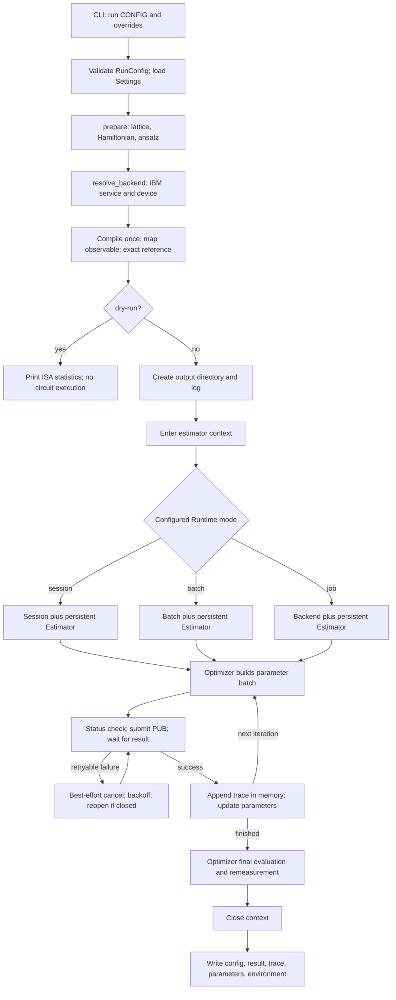

# IBM Quantum Runtime integration audit

Audit date: 2026-10-16. Repository revision: `273c8e682f07492fd96af38f8724d28f3ec0c904`.

Scope: source and CLI entry points, all shipped configurations, tests, dependency declarations and lockfile, notebook inventory, documentation/report/slide sources, local results, and reachable Git history. This was a read-only implementation audit; this report is the sole repository change. No IBM service connection, cloud dry run, or QPU submission was made. Dependencies and branches were not changed.

Paths are repository-relative. Shortened implementation references such as `estimators.py`, `vqe.py`, `config.py`, `optimizers/...` and `mitigation/...` are relative to `src/kagome_vqe/`; full test, config, documentation and installed-SDK paths are given separately. Line ranges identify evidence in the audited revision.

**Comparison limitation:** `kagome-vqe.ipynb` and `references/` are absent. The only notebook in this checkout and all reachable Git histories is `notebooks/demo.ipynb`, a package demonstration using statevector and Aer. `README.md:378–381` describes a from-scratch rewrite and says the original notebook/helper modules are locally ignored. The non-shallow history starts with package rebuild `d4a05ac`; it does not contain those originals. Consequently, exact original behavior, including the implementations of `CustomVQE` and `RetryEstimator`, cannot be verified. Statements about the original below are explicitly unverified, not inferred from modern class names or README claims.

## Section 1 — Executive summary

**This repository implements materially more than IBM Estimator job submission. Its default IBM VQE path uses a real `Session` object, a persistent estimator, batched optimizer probes, and a circuit/observable pair compiled once before optimization.** The session surrounds the complete optimizer and final remeasurement. However, recovery, persistence, optional mitigation paths, and hardware validation are insufficient for an unqualified claim of reliable hardware readiness.

| Question | Answer and supporting evidence |
|---|---|
| 1. Is it currently hardware-ready? | **Hardware-compatible, with meaningful Session optimization; not yet reliably hardware-ready.** An executable hardware path exists, but interrupted runs lose structured progress, retry cancellation is best effort, session lifecycle has gaps, and no actual hardware validation was found. See Sections 3–5. |
| 2. Does it implement genuine IBM Runtime Session mode? | **Yes.** `RuntimeSession._open_mode()` constructs `Session(backend=self._backend, max_time=self._cfg.max_time)` in `src/kagome_vqe/estimators.py:399–420`; the estimator receives that object as `mode`. This is executed when the CLI loads the shipped IBM configuration. |
| 3. Is Session mode used throughout VQE optimization? | **Yes on the normal, unmitigated Session path.** `run_vqe()` keeps `optimizer.minimize(...)` and final remeasurement within one estimator context (`src/kagome_vqe/vqe.py:480–520`). Closed-session recovery replaces the session; local ZNE creates multiple sessions; explicitly selecting Job or Batch mode changes scheduling. |
| 4. Does it retain the notebook's retry mechanism? | **A functional retry replacement exists; exact retention is unverified.** There is no current `RetryEstimator` class. `RuntimeSession.run()` retries selected exceptions, waits with exponential backoff, attempts cancellation, and can reopen a closed session (`estimators.py:448–524`). Original equivalence cannot be established without the notebook/helper source. |
| 5. Is classical–quantum interaction optimized for low latency? | **Partially and substantively.** Sessions, batched SPSA/gradient probes, estimator reuse, and one-time compilation reduce avoidable overhead. Optimization still runs on the user's machine with synchronous submit/wait calls. Per-job status requests, ideal-state simulation, retries, SciPy scalar calls, and multiple ZNE sessions add overhead. No measured hardware speedup is available. |
| 6. Can it execute a complete VQE on real IBM hardware? | **The complete executable path is implemented, conditional on credentials, instance entitlement, backend availability and resource limits.** Full cloud execution is unverified. The same VQE path completes in local Runtime mode; that does not validate remote scheduling, plan access, or hardware mitigation. |

**Was the original Runtime acceleration retained?** The central Session scheduling mechanism described in the task **is present in executable current code**, together with persistent primitives and batching. It would be incorrect to report that Session support is missing. Whether this faithfully preserves every mechanism in the specific original notebook remains **unable to verify**.

## Section 2 — Feature comparison table

Status uses the requested preservation categories. Because the original is unavailable, “Unable to verify” applies to historical equivalence even where the current implementation is conclusively present or absent.

| Feature | Original notebook | Current repository | Status | Evidence |
|---|---|---|---|---|
| CustomVQE | Named in the audit request; source unavailable | Rewritten orchestration in `run_vqe`, `EnergyObjective`, and independent optimizer classes; no `CustomVQE` class | Unable to verify equivalence; current rewrite implemented | `src/kagome_vqe/vqe.py:77–174,453–557`; `README.md:378–381` |
| Estimator | Exact API/options unavailable | V2 PUB interface through `RuntimeEnergy`; default legacy server-side `EstimatorV2`, optional client-side executor Estimator | Unable to verify original equivalence; current API modernization implemented | `src/kagome_vqe/estimators.py:408–420,576–586`; `pyproject.toml:21–24` |
| Session | Requested comparison assumes a notebook Session mechanism; unverified | Actual IBM `Session`, passed explicitly as `mode`, encloses optimization and final measurement | Unable to verify exact preservation; current Session mechanism implemented and reachable | `estimators.py:399–425`; `vqe.py:480–520`; `configs/ibm_hva_spsa.toml:27–38` |
| RetryEstimator | Helper implementation unavailable | Class absent; retries centralized in `RuntimeSession.run` for Estimator and Sampler | Unable to verify equivalence; replacement partially robust | `estimators.py:148–168,479–524`; `mitigation/counts.py:247–267` |
| Timeout handling | Unknown | Result-wait timeout and session/batch TTL; no exposed per-job `max_execution_time`, interactive-TTL management, or run-wide deadline | Unable to verify original equivalence; current coverage partial | `estimators.py:141–145,399–405,493`; `config.py:253–264` |
| Checkpoint/resume | Unknown | History in memory; files written only after success; no restart state or resume CLI | Missing in current implementation; original unable to verify | `vqe.py:152–169,471–474`; `cli.py:173–177`; `results.py:132–146,198–210` |
| Hardware transpilation | Exact notebook procedure unavailable | Backend-targeted pass manager; configurable physical layout; reusable ISA circuit; gate/depth statistics | Unable to verify historical equivalence; current implementation locally validated | `transpile.py:95–98,101–167`; `vqe.py:355–377` |
| Observable layout mapping | Original mapping unavailable | `observable.apply_layout(isa_circuit.layout)`; counts path maps logical measurements to physical qubits | Unable to verify historical equivalence; current implementation locally validated | `transpile.py:145–147`; `mitigation/counts.py:355–386`; `tests/unit/test_transpile_estimators.py:39–69` |
| Classical optimizer interaction | Original batching/callback details unavailable | SPSA, ADAM, GD, SciPy; batched gradient probes except SciPy; synchronous results | Unable to verify original equivalence; current behavior implemented | `config.py:144–219`; `optimizers/spsa.py:100–108,120–164`; `optimizers/gradients.py:129–169,204–210` |
| Error mitigation | Exact original settings unavailable | Runtime resilience levels 0–2 plus optional local counts, readout, symmetry, ZNE and twin wrappers | Unable to verify original equivalence; hardware behavior unverified | `estimators.py:390–397,624–686`; `config.py:338–378`; Section 3 |
| Real QPU execution | Original job IDs/results unavailable | Complete CLI path and IBM config; no verified real-QPU artifacts or hardware tests found | Unable to verify experimental execution; current compatibility supported | `backends.py:97–139`; `cli.py:128–195`; `report/sections/90-status.tex:44–45` |

None of the historical mechanisms can responsibly be labeled “Fully preserved” or “Modernized with equivalent behavior” without the original source. This does not negate the directly verified current Session implementation.

## Section 3 — Actual execution architecture

### Executable call chain

`kagome-vqe run CONFIG → cli.run → _load / RunConfig validation → _run_one → prepare → resolve_backend → compile_for_backend → run_vqe → make_estimator → RuntimeEnergy / RuntimeSession → optimizer.minimize → EnergyObjective.batch → RuntimeEnergy.evaluate → primitive.run → job.result → optimizer update → final remeasurement → session.close → save_run`



This diagram shows the default Estimator path. Counts mitigation substitutes a Sampler; local ZNE duplicates inner estimators/session owners, as discussed below.

### Configuration, credentials and CLI reachability

The console entry point is `kagome_vqe.cli:app` (`pyproject.toml:42–43`). `cli._load()` combines TOML and dotted overrides (`cli.py:76–87`); `run()` validates the model and calls `_run_one()` (`128–139`). `Settings` reads `.env`/environment values using `IBM_QUANTUM_`, storing the token as `SecretStr` (`config.py:525–547`). `ibm_service()` passes channel, optional token, instance and region to `QiskitRuntimeService`; `resolve_backend()` calls `service.backend(cfg.name)` (`backends.py:97–139`). There is no implicit simulator substitution for an IBM error.

The real-device command, **documented here but not executed**, is:

```bash
.venv/bin/kagome-vqe run configs/ibm_hva_spsa.toml --set backend.name=YOUR_ACCESSIBLE_BACKEND
```

The shipped configuration uses HVA, 50 SPSA iterations, 4096 default shots, 16384 final shots, resilience level 1, Session mode, `max_time="1h"`, five retries, and a 3600-second result wait (`configs/ibm_hva_spsa.toml:17–38`). It needs an authenticated IBM account, an accessible instance/device, sufficient resource allocation, and a plan supporting sessions. The example device name is not proof of current availability to a particular account.

Open Plan cannot use Sessions; IBM documents Job and Batch alternatives. The repository neither checks entitlement nor documents this restriction in its execution-mode table. Users must explicitly select an allowed mode, such as `--set backend.mode=job`; no automatic Session-to-Job fallback exists. Plan enforcement is delegated to IBM. [IBM Session guide](https://quantum.cloud.ibm.com/docs/en/guides/run-jobs-session).

`--dry-run` stops after `prepare()` (`cli.py:150–153`). With `kind="ibm"`, it still retrieves a real backend and needs access, but does not create a Session or submit a primitive job. With `fake:FakeTorino`, it remains offline.

### Optimizer loop and batching

The key implementation in `src/kagome_vqe/vqe.py:480–518`, excerpted with intervening setup omitted, is:

```python
with make_estimator(...) as estimator:
    objective = EnergyObjective(estimator, ...)
    opt = optimizer.minimize(objective, x0, callback=on_iteration)
    final = estimator.evaluate(..., shots=cfg.backend.remeasure_shots)
```

The optimizer runs locally, not as a remotely uploaded VQE program. Each objective batch synchronously submits a job and waits before parameter updates. Several parameter points can share that job:

| Optimizer/gradient | Parameter rows per normal iteration | Submission behavior without local mitigation |
|---|---:|---|
| SPSA | 2 | One PUB/job for both perturbations |
| ADAM or GD, forward differences | `n + 1` | One PUB/job |
| ADAM or GD, central differences | `2n + 1` | One PUB/job |
| ADAM or GD, SPSA gradient | 2 | One PUB/job |
| ADAM or GD, parameter shift | `2K`, where K is gate-parameter occurrences | One PUB/job, with shared-parameter expansion/contraction |
| SciPy (`COBYLA` default; other method names passed through) | Method-dependent scalar calls | One job per scalar call; callback can add another evaluation |

Evidence: `OptimizerConfig.build()` (`config.py:185–219`); `Spsa._probe()` (`optimizers/spsa.py:100–108`): `fn.batch(np.vstack([x + c * delta, x - c * delta]))`; gradient implementations (`optimizers/gradients.py:105–263`); `Adam.minimize()` (`optimizers/adam.py:109–158`); `GradientDescent.minimize()` (`optimizers/gd.py:60–84`); `ScipyOptimizer.minimize()` (`optimizers/scipy.py:63–108`). SciPy's callback calls `fn(x)` when it lacks a value (`81–90`), adding hardware work outside its own `nfev` increment.

SPSA calibration, when enabled, makes additional sequential probe batches (`spsa.py:110–138`). Without calibration/retries/local mitigation, the shipped 50-iteration run makes **52 primitive calls**: 50 perturbation batches, one optimizer final evaluation (`spsa.py:154`), and one independent final remeasurement (`vqe.py:515–518`). There are 101 traced parameter evaluations plus the untraced remeasurement. Thus `docs/ibm.md:74–76`'s “about 51 jobs” omits the remeasurement, and its universal one-job-per-iteration wording does not cover SciPy or local ZNE.

### Estimator API, parameter binding and options

`RuntimeSession._make_primitive()` explicitly selects a V2 implementation (`estimators.py:408–420`):

```python
if self._cfg.estimator_impl == "executor":
    from qiskit_ibm_runtime.executor_estimator import Estimator
    return Estimator(mode=self._mode, options=options)
from qiskit_ibm_runtime import EstimatorV2
return EstimatorV2(mode=self._mode, options=options)
```

There is no executable V1 adapter. Runtime 0.50's executor Estimator moves preparation/postprocessing onto the client; it is not a cloud-hosted optimizer. Both implementations accept explicit Session/Batch/backend modes. The installed executor source also passes its mode to the underlying Executor (`.venv/lib/python3.13/site-packages/qiskit_ibm_runtime/executor_estimator/estimator.py:250–276`). [IBM executor Estimator overview](https://quantum.cloud.ibm.com/docs/en/api/qiskit-ibm-runtime/dev/executor-estimator).

`RuntimeEnergy.evaluate()` (`estimators.py:576–586`) constructs:

```python
params = _as_2d(params)
pub = (self._problem.circuit, self._problem.observable, params)
job, result, elapsed = self._session.run([pub], **kwargs)
```

Parameter values are broadcast as a `(k, number_of_circuit_parameters)` array; Runtime binds the retained parameterized ISA circuit. Standard paths use an identity parameter map. Parameter-shift paths expand shared parameters into named gate occurrences before compilation (`vqe.py:361–364`; `ansatz/unshare.py:97–135`) and map rows through `EnergyObjective` (`vqe.py:139–153`). Local tests verify HVA parameter order and logical/ISA energy agreement (`tests/unit/test_transpile_estimators.py:39–69`); gradient tests verify shift behavior. No universal post-transpilation parameter-identity assertion exists, so arbitrary future ansatz/backend combinations are not proven by those tests.

Runtime options currently expose **resilience level and default shots**, plus simulator seeds for fake backends (`estimators.py:390–397`). A call-level `shots=` override is translated to target precision via `(1 + 1e-12) / sqrt(shots)` (`131–138,581–585`), used for final measurement. There is no independent user-configurable target precision, detailed twirling/DD/TREX/ZNE options, or per-job `max_execution_time`; unknown config fields are rejected (`config.py:78–79,253–264`). IBM distinguishes target precision/default shots and mitigation-generated work; this conversion must not be interpreted as a guarantee of total physical circuit shots.

The documentation says resilience level 1 includes **gate** twirling (`docs/ibm.md:55`; IBM config comment at line 32). IBM describes level 1 as TREX, with measurement twirling; level 2 adds ZNE and gate twirling. The adapter itself sets only the level, so its behavior follows the SDK/service, not that comment. [IBM mitigation guide](https://quantum.cloud.ibm.com/docs/en/guides/error-mitigation-and-suppression-techniques).

### Hardware compilation and layouts

`prepare()` resolves the actual target and calls `compile_for_backend()` before opening the estimator (`vqe.py:355–377`). In `src/kagome_vqe/transpile.py:138–148`:

```python
pass_manager = generate_preset_pass_manager(
    optimization_level=optimization_level,
    backend=backend,
    initial_layout=None if initial_layout is None else list(initial_layout),
    seed_transpiler=seed_transpiler,
)
isa_circuit = pass_manager.run(circuit)
layout = isa_circuit.layout
isa_observable = observable.apply_layout(layout)
```

The backend target supplies native gates and connectivity; the user can select physical qubits or leave selection/routing to the preset pass manager. Final physical indices, depth and two-qubit gate counts are recorded (`transpile.py:95–98,147–166`). This is actual target-aware compilation, not just backend labeling. Tests compare logical and laid-out energies and verify allowed gates and parameter ordering on FakeGuadalupeV2 (`test_transpile_estimators.py:39–69`).

Offline CLI validation with the shipped IBM config overridden to `fake:FakeTorino` produced a 133-qubit ISA circuit with 12 selected physical qubits, depth 51, and 66 CZ gates. This is a fake-target compilation result, **not measured hardware performance or live calibration validation**. No corresponding physical-device execution was attempted.

The prepared problem is reused throughout optimization (`cli.py:150,173`; `vqe.py:471`). There is no per-iteration hardware transpilation and no disk cache across separate runs. Parameterized compilation may retain gates that a bound-circuit optimization could remove; `report/sections/90-status.tex:58–60` identifies that tradeoff. Any future binding-before-compilation optimization must preserve layout/parameter correctness and account for additional classical work.

### Other executable paths

* `benchmark()` invokes `_run_one()` separately for each config (`cli.py:225–234`), so each VQE gets its own session; there is no benchmark-wide session.
* Fixed-point evaluation defaults to fresh estimator contexts for repeat-specific mitigation setup in `evaluate_fixed()` (`vqe.py:660–724`, especially `711–724`). Its API can instead share setup with `fresh_setup=False`. This is not an iterative optimizer path and should not be presented as one persistent VQE session.
* Readout/symmetry mitigation replaces Estimator with `CountsEnergy` and `SamplerV2`, using the same Runtime lifecycle/retry owner (`estimators.py:657–668`; `mitigation/counts.py:247–267,330–336`). It maps basis rotations/measurements to final physical indices (`counts.py:355–386`) and submits measurement groups together (`462–470`). Runtime Estimator resilience options are not applied to this Sampler path (`estimators.py:390–393`); `estimator_impl` likewise does not select the Sampler implementation.
* Local ZNE builds one inner estimator per folded scale, enters all of them, then evaluates them sequentially (`mitigation/wrappers.py:97–143`). Each Runtime inner owns its own Session. This differs materially from Runtime-native ZNE through resilience level 2, which uses the existing primitive/session. Config validation allows local ZNE on IBM; it is not simulator-only or unreachable.
* Twin rescaling adds a setup measurement inside `TwinRescaledEnergy.__enter__()` (`wrappers.py:207–217`). Measurement suffix compilation, calibration, and folding are setup operations, not per-iteration hardware compilation.

## Section 4 — Session lifecycle analysis

| Stage | Actual lifetime and behavior | Evidence |
|---|---|---|
| Preparation | Backend resolution, ISA compilation and exact diagonalization precede the Runtime context | `vqe.prepare`, `vqe.py:355–397` |
| Owner construction | `RuntimeEnergy` constructs a `RuntimeSession` owner; no Session is opened yet | `estimators.py:541–560` |
| Context entry | `_open_mode()` creates Session/Batch or returns backend; `_make_primitive()` runs once | `RuntimeSession.__enter__`, `estimators.py:399–433` |
| Iterations | Same owner, Session and primitive are used for all successful evaluations; each calls status then submit/wait | `estimators.py:479–494`; `vqe.py:480–518` |
| Recovery | Only status exactly equal to `"Closed"` triggers replacement; both Session and primitive are recreated, with a warning | `estimators.py:448–467` |
| Normal completion | Optimizer final point and final-shot remeasurement execute before context exit | `vqe.py:514–520` |
| Exit after successful entry | Calls `.close()`, then clears references; body exceptions also trigger this exit | `estimators.py:435–446,567–574` |
| Persistence | Structured result files are written only after the context closes successfully | `cli.py:173–174`; `results.py:132–146` |

Explicit `mode=session` is sufficient; the code need not call the IBM Session's own `__enter__()` because it supplies the object directly to each primitive and closes it through its wrapper.

**Timeouts are distinct.** `max_time` limits one Session/Batch's lifetime, while `job_timeout_s` is passed to `job.result(timeout=...)` when that method supports it (`estimators.py:141–145`). Neither is a configured per-job QPU execution cap. IBM defines `max_execution_time` in terms of QPU usage, separately from client wall-clock waiting and Session TTL. [IBM maximum execution time guide](https://quantum.cloud.ibm.com/docs/en/guides/max-execution-time).

The implementation does not inspect interactive TTL, `accepting_jobs`, elapsed session budget, or usage. IBM may deactivate an idle session and require it to re-enter scheduling; a Python context remaining open does not guarantee continuous priority. Initial queueing still applies. Accordingly, the unconditional “iterations are not re-queued” / “device reserved” claims in `docs/ibm.md:67` and `configs/ibm_hva_spsa.toml:34` need qualification. [IBM Session guide](https://quantum.cloud.ibm.com/docs/en/guides/run-jobs-session).

Concrete lifecycle gaps:

1. **Non-accepting active sessions are treated as open.** `_mode_is_open()` rejects only the string `closed`, and treats status-query exceptions as open (`estimators.py:448–456`). SDK 0.50 also returns `In progress, not accepting new jobs` (`.venv/lib/python3.13/site-packages/qiskit_ibm_runtime/session.py:237–262`). Repeated failed submissions can exhaust retries before the status becomes Closed. This was reproduced with a mock status.
2. **Initialization failures leak cleanup.** If Session creation succeeds but primitive construction raises, Python does not call the wrapper's `__exit__()` because its `__enter__()` failed. No rollback is installed (`estimators.py:422–425`). The same pattern exists for readout calibration, twin measurement, and partial ZNE context entry (`counts.py:409–415`; `wrappers.py:123–128,207–217`). A mock confirmed that primitive-construction failure leaves `close()` uncalled.
3. **Closing can mask a failure.** `.close()` is unguarded; if it raises, references are not cleared and result persistence is skipped (`estimators.py:442–446`; `cli.py:173–174`). Closing does not itself guarantee cancellation of all running jobs.
4. **Reopening resets the session budget.** A new Session receives a fresh `max_time`; there is no total elapsed-time/usage budget across reopened sessions. Retries are bounded per objective call, not per complete experiment.
5. **Local ZNE breaks single-session ownership.** With scales `[1,3,5]`, there are three independent owners. They alternate submissions to the same QPU and can lose priority or wait for another session's inactivity. This scheduling risk is inferred from code and IBM's session model; it was not measured on hardware. Construction of three owners was reproduced offline.
6. **The documented integer TTL is not accepted by config.** `max_time: str | None` (`config.py:261`) rejects TOML integer seconds despite documentation allowing seconds. An in-memory validation probe confirmed rejection of `max_time=3600`.

There is **no silent downgrade from Session to Job mode** in repository code. Reopening preserves the configured mode. Fake-backend Session objects have no real cloud session ID and cannot establish that IBM scheduling occurred; local mode is an explicit simulator selection.

## Section 5 — Fault-tolerance analysis

The replacement retry mechanism is real. In `RuntimeSession.run()` (`estimators.py:485–513`), excerpts:

```python
for attempt in range(self._cfg.retries + 1):
    job = None
    ...
    job = self.primitive.run(pubs, **kwargs)
    result = _job_result(job, self._cfg.job_timeout_s)
    ...
    # retryable exception path:
    self._cancel(job)
    delay = min(60.0, 2.0**attempt)
    time.sleep(delay)
```

Default five retries means at most six attempts for one batch. Caught exceptions include Runtime job failure/max-timeout/wait-timeout/invalid-state errors, broad `IBMRuntimeError`/`IBMApiError`, Qiskit job errors, and built-in connection/timeout errors (`148–168`). Ordinary `TypeError`/`ValueError` are not deliberately retried, but broad IBM base classes can also include permanent service failures. This is not a precise transient-error classifier.

| Failure scenario | Current automatic behavior | Recovery limitation |
|---|---|---|
| Retryable submission/result failure | Best-effort cancel, bounded exponential backoff, resubmit same PUB | No jitter, HTTP-specific classification, or `Retry-After` handling |
| Job-result wait times out | Attempts cancellation, then resubmits | A wait timeout does not prove the remote job stopped; cancellation is not confirmed |
| Submission accepted remotely, response lost | `job` may still be `None`; resubmits on a caught error | Cannot identify/cancel the accepted job; duplicate execution/billing possible |
| Cancellation fails | `_cancel()` swallows exception and logs at debug level (`515–524`) | Resubmission proceeds anyway; mock reproduced two submissions after failed cancellation |
| Session is Closed | Warns, opens same configured mode again, rebuilds primitive | Re-enters queue; no cumulative budget or persisted old/new session IDs |
| Session stops accepting jobs but is not Closed | Continues submitting to it | Retries may exhaust; no robust session state machine |
| Backend unavailable, rate-limited or disconnected during execution | Retry only if error arrives as a listed exception class | No backend reselection, rate-limit policy, persistent reconnect state, or guaranteed coverage of all transport errors |
| Credentials/backend lookup/session opening fails | Propagates before `RuntimeSession.run` | No startup retry; account/plan problems require manual correction |
| Keyboard interrupt during submit/wait | Attempts current-job cancellation and re-raises; outer context normally closes | No structured partial result or optimizer checkpoint |
| Programming error or retries exhausted | Propagates; context normally closes if entry succeeded | Completed evaluations remain only in memory; `save_run` never executes |
| Final remeasurement or closing fails | Whole `run_vqe` fails to return normally | Even a completed optimization has no saved structured result |
| Process killed / host lost | No Python cleanup or checkpoint is guaranteed | Manual Runtime inspection may be necessary; no attach-to-job/session or resume command |

**Checkpointing is absent, not merely disabled.** `EnergyObjective` appends trace and parameter rows to Python lists (`vqe.py:152–169`). The CLI callback only updates a progress bar (`cli.py:170–171`). `save_run()` runs after `run_vqe()` returns (`173–174`) and then writes all arrays/files (`results.py:132–146`). `load_run()` reads completed results for analysis (`198–210`), not optimizer recovery. Every new run generates `x0` from its seed/scale (`vqe.py:471–474`); there is no configured arbitrary initial vector or resumed optimizer moments/RNG/iteration state. `record_params=True` is post-run history, not a checkpoint.

**Provenance is incomplete.** Successful objective batches carry a job ID (`estimators.py:211–230`; `vqe.py:163`), but it is captured only after the result succeeds and persisted only at run completion. Session IDs, failed/uncertain submissions, retry attempts and service usage are not recorded. The final remeasurement's `job_id` is discarded (`vqe.py:515–546`); local ZNE retains only the first scale's job ID (`wrappers.py:153–158`); readout/twin setup IDs are not retained (`counts.py:432`; `wrappers.py:210–217`). Thus `docs/ibm.md:122–125` does not provide complete experiment-to-job traceability.

**Credentials:** No hardcoded credential was observed in available notebooks. A location-only heuristic scan for long token/API-key/password literals in Python/notebook/env blobs across reachable Git history found none; this is not a comprehensive secret-scanner guarantee. `.gitignore:1` and `docs/STYLE.md:89–91` explicitly describe a credential-bearing/leaked original reference notebook, which is absent here. Its credential location/value cannot be independently verified. Any tokens previously included in that reference notebook should be revoked if not already revoked; ignoring a file does not revoke a credential. No secret values were displayed.

## Section 6 — Performance implications

| Component | What the code does | Implication and limit |
|---|---|---|
| Queueing delay | Uses an actual Session by default; independent jobs when explicitly configured | Avoids ordinary per-job queueing while a session is active/accepting; first activation, idle reactivation and replacement can queue. No queue-time measurements are stored. |
| Runtime scheduling | Reuses Session/Estimator across dependent iterations | Genuine scheduling optimization. Batch mode groups work but does not make this adaptive loop independent; local ZNE's separate sessions undermine continuity. |
| Network latency | Status query, job submission, synchronous result retrieval for each batch | Sessions do not remove client/cloud round trips. `Session.status()` calls service details in SDK 0.50; the pre-submit check adds a remote request. No remote optimizer/co-location mechanism is implemented. |
| Classical iteration time | Optimizer updates and callbacks execute on client | `track_ideal_energy=True` adds a statevector evaluation after every iteration (`config.py:412`; `vqe.py:440–450,492–505`). This adds delay between jobs; its actual duration and effect on interactive TTL were not measured. |
| Batching | SPSA and gradient probes share a PUB | Reduces submissions relative to scalar probes. It does not eliminate shots for each row. There is no batch-size limit/chunking policy for large future parameter-shift workloads. |
| Compilation | Reuses a backend-compiled parameterized circuit and mapped observable | Avoids repeated routing/transpilation during the loop. The PUB still carries the circuit/observable; no application-level circuit-upload cache is implemented. SDK/service caching is unverified. |
| Shots and mitigation | Default/final shot controls, Runtime resilience, optional calibration/folding/twin jobs | Higher shot budgets and mitigation can increase hardware work without changing the number of top-level iterations. Job count alone is an inadequate cost estimate. |
| Quantum execution time | Target-native circuits with recorded depth/gate counts | Circuit duration, reset/readout time, shots, and extra mitigation circuits determine QPU usage; no hardware measurements establish those costs here. Depth is not elapsed QPU time. |
| Retry overhead | Failed waits, cancellations, backoff and sometimes new sessions | Can exceed nominal run budgets. `RuntimeSession.run` returns only the successful attempt's elapsed time (`estimators.py:487–494`), so per-evaluation trace time excludes prior failed attempts/backoff. |

`VQERunResult.wall_time_s` includes the optimizer context and retries (`vqe.py:479–520`), but excludes preparation. It is not a decomposition of queueing, network, classical work and QPU usage. `_shot_cost()` counts requested measurement groups and local mitigation factors (`vqe.py:420–437`); it does not account accurately for all Runtime-native noise-learning/twirling/ZNE circuits or retried/duplicate jobs. Treat `total_shots` as an application estimate, not authoritative billed usage.

Local probes at 32 requested default shots reported 33 for the legacy local Estimator and 32 for the executor implementation; explicit 64-shot overrides returned 64 in both. This small local rounding difference further demonstrates why configured shots and recorded metadata should be distinguished. It is not a hardware performance result.

No speedup factor, measured communication latency, hardware convergence guarantee, or paid-resource usage estimate is asserted by this audit.

## Section 7 — Prioritized recommendations

These are proposed engineering changes, not implemented work.

| Priority | Improvement and affected files | Intended behavior | Complexity | Validation strategy |
|---|---|---|---|---|
| **P0** | Durable checkpoints/resume: `src/kagome_vqe/vqe.py`, `results.py`, `cli.py`, `config.py`, optimizer modules | Persist config/circuit identity, parameters, optimizer moments/gains, RNG state, iteration and job journal during execution. Recover completed optimizer state even if final measurement fails; expose explicit resume. | High | Inject interruption/failure after known iterations, resume locally, compare deterministic results with uninterrupted run; test atomic-write failures and incompatible checkpoint rejection. |
| **P0** | Safe job recovery: `src/kagome_vqe/estimators.py`, `results.py` | Journal job ID as soon as submission returns. Reattach/poll existing jobs after result/network failures; resubmit only with a defined policy for confirmed failure or uncertain submission/cancellation. Track all attempts and duplicate risk. | High | Mock accepted-but-response-lost, result timeout, failed cancel, DONE-with-fetch-failure and permanent 4xx/429/5xx cases; assert submission count and recovered IDs. |
| **P0** | Exception-safe Session lifecycle: `src/kagome_vqe/estimators.py`, `mitigation/counts.py`, `mitigation/wrappers.py` | Roll back partially entered contexts; classify accepting/closed states using structured details; preserve original exceptions during cleanup; enforce cumulative experiment limits across reopened sessions. | Medium–high | Mock constructor, calibration, twin and close failures; verify every opened resource closes and original failure survives; cover inactive/non-accepting/closed statuses and total budget exhaustion. |
| **P0 for IBM local ZNE** | One run-owned Session for all mitigation scales: `src/kagome_vqe/estimators.py`, `mitigation/wrappers.py`, `mitigation/counts.py`, `vqe.py` | Share Runtime resource ownership across scale-specific primitives; preferably group scale PUBs in one submission. Until implemented, reject unsupported multi-session hardware combinations explicitly. | Medium–high | Identity-based mock assertions for one Session across scales/iterations; fake-backend results versus existing ZNE; later separately authorized bounded hardware lifecycle check. |
| **P1** | Plan/backend preflight and precise docs: `backends.py`, `config.py`, `cli.py`, `docs/ibm.md`, `configs/ibm_hva_spsa.toml` | Explain/check access where supported; actionable unsupported-plan error; explicit user-selected Job/Batch alternative. Validate TTL type/budgets; distinguish client wait, Session TTL and per-job execution cap. Correct job-count and resilience descriptions. | Medium | Mock entitlement/backend responses; validate CLI errors without submission; test integer/string TTLs and unsupported combinations. |
| **P1** | Automated Runtime contract/failure coverage: `tests/unit/test_transpile_estimators.py`, new focused Runtime tests, `tests/integration/test_convergence.py` | Cover both implementations, all modes, estimator identity across iterations, no silent downgrade, retries, cancellation and partial entry. Keep hardware tests explicit and gated. | Medium | Existing local smoke plus deterministic mocks; add low-shot executor smoke. Only after separate authorization, archive a small QPU experiment with actual session/job IDs and usage. |
| **P1** | Complete telemetry/accounting: `estimators.py`, `vqe.py`, `results.py`, mitigation wrappers | Persist session IDs, all final/setup/scale/attempt job IDs, attempt timings, Runtime metadata and actual usage. Label inferred shot counts separately. | Medium | Schema tests with multi-job mitigation and failed attempts; compare recorded job set with mock service submissions; verify no credentials serialize. |
| **P2** | Reduce client overhead: `vqe.py`, `config.py`, `optimizers/scipy.py`, `estimators.py` | Disable or decimate ideal tracking for hardware presets; avoid redundant SciPy callback evaluations; reduce unnecessary status polling with error-driven/state-aware checks. | Low–medium | Count local objective and service calls; confirm optimizer results unchanged where deterministic; measure before claiming benefit. |
| **P2** | Extend precision/options and evaluate compilation tradeoffs: `config.py`, `estimators.py`, `transpile.py`, hardware configs | Expose supported fine-grained Runtime options, protect against unintentionally stacked mitigation, and explore reusable lower-depth parameterized circuits before adding repeated bound transpilation. | Medium | Option-schema tests for pinned SDK; fake-target ISA/layout checks; energy equivalence tests; explicitly distinguish local correctness from cloud mitigation validation. |

**Recommended next task:** implement an interruption-safe VQE checkpoint and Runtime job journal, coupled with mocked timeout/cancellation recovery tests. This preserves expensive progress and establishes the foundation for safe recovery before investing real QPU time. Session support itself does not need to be added from scratch.

## Section 8 — Final verdict

| Classification | Verdict | Evidence boundary |
|---|---|---|
| **Simulator-ready** | **Supported** | Focused unit tests and a complete local Runtime VQE smoke pass; statevector/Aer result artifacts exist. This does not claim every configuration was benchmarked. |
| **Hardware-compatible** | **Supported** | Real service/backend resolution, ISA compilation, mapped observables, valid V2 Runtime construction and full optimization call chain are implemented. |
| **Hardware-ready** | **Not supported without qualifications** | Happy-path implementation exists, but durability, recovery, cleanup, plan guidance and optional mitigation lifecycle need hardening; remote execution remains unverified. |
| **Runtime-session-optimized** | **Supported for the default single-estimator path** | Real Session scheduling, persistent primitive, batched probes and one-time compilation. Not uniformly true across local ZNE, SciPy, explicitly selected Job mode or recovered/expired sessions; no measured acceleration claimed. |
| **Experimentally validated on real QPU** | **Not established** | No real IBM run artifacts/job provenance found. H0/H1 are expressly deferred in `docs/roadmap.md:286,368` and `report/sections/90-status.tex:44–45`. |

The correct characterization is **a simulator-validated, hardware-compatible VQE implementation with genuine IBM Runtime Session optimization on its default path, but incomplete operational reliability and no demonstrated real-QPU validation**. It is not merely an Estimator submission example. Exact fidelity to the absent original notebook remains an open comparison item.

### Verification record and limits

* Installed and locked quantum stack: Qiskit **2.5.2**, `qiskit-ibm-runtime` **0.50.0**, Aer **0.17.2**. `pyproject.toml:21–27` constrains Qiskit to `>=2.5,<3`, Runtime to `>=0.50,<0.51`, and Aer to `>=0.17.2`. Inspection used the existing Python 3.13 environment; no install/upgrade was performed. The Runtime dependency is required, despite some comments describing its imports as optional.
* Focused test command below: **80 passed, 3 warnings, 25.79 seconds**. Warnings explicitly state that resilience level has no effect in legacy Runtime local mode. No expensive full benchmark or slow convergence suite was run.

```bash
PYTHONDONTWRITEBYTECODE=1 KAGOME_RUN_IBM=0 MPLCONFIGDIR=/tmp/kagome-audit-mpl \
  .venv/bin/python -m pytest -p no:cacheprovider \
  tests/unit/test_config.py tests/unit/test_optimizers.py \
  tests/unit/test_gradients.py tests/unit/test_transpile_estimators.py \
  tests/unit/test_vqe_results_cli.py \
  tests/integration/test_convergence.py::test_runtime_local_mode_smoke \
  --basetemp=/tmp/kagome-runtime-audit-pytest -q
```

* Additional in-memory two-qubit FakeManilaV2 probes exercised both `legacy_v2` and `executor`, each in Session/Batch/Job mode, with two successive evaluations. All six combinations preserved primitive/mode identity, returned correct batch shapes, accepted final-shot overrides, and cleared primitive references on exit. Fake sessions had no cloud session ID. These probes were audit checks, not committed regression tests or real IBM jobs.
* In-memory mock checks reproduced: non-accepting session treated as open; session not closed after primitive-construction failure; resubmission despite failed cancellation; three independent Runtime owners for three ZNE scales; integer `max_time` rejected. These checks verify code behavior, not remote failure timing.
* Offline CLI check: `.venv/bin/kagome-vqe run configs/ibm_hva_spsa.toml --backend-override fake:FakeTorino --dry-run`. Successful target compilation; statistics recorded in Section 3. No primitive invocation.
* Existing integration tests include slow statevector optimizations, an Aer noisy smoke, and one legacy Runtime local Session smoke (`tests/integration/test_convergence.py:13–83`). No `@pytest.mark.ibm` tests were found. `tests/conftest.py:15–22` and `pyproject.toml:156–163` define hardware-test gating, but a marker/gate is not an implemented hardware test. No committed retry/cancel/reopen failure tests or executor integration test were found.
* The existing Runtime smoke checks configured mode and nonempty local job IDs (`test_convergence.py:80–83`); it does not assert real scheduling or remote session identity. Local execution cannot validate IBM access rules or QPU behavior. [IBM local testing guide](https://quantum.cloud.ibm.com/docs/en/guides/local-testing-mode).
* Local structured results inspected: `results/20261016T043756Z-statevector_hva_adam/result.json` uses statevector; `results/20261016T043824Z-statevector_hva_adam/result.json` uses `aer_noisy:FakeGuadalupeV2`. Neither is QPU evidence. Report/slide computations use fake-device/simulator data; `docsgen/physics.py:93–102` selects FakeGuadalupeV2.
* Reachable history identifies package rebuild `d4a05ac`, sampled-shot/final-measurement changes `0433fd7`, and shared Runtime/mitigation changes `c9272e3`. No original notebook or helper implementation was recovered. Remote repositories, unreachable Git objects, external result stores, account job history and credentials were not searched.

Source line references above are to the audited revision. IBM documentation was consulted for current Session restrictions, lifecycle, execution limits, API semantics and mitigation; repository claims were checked against executable source rather than treated as proof.
