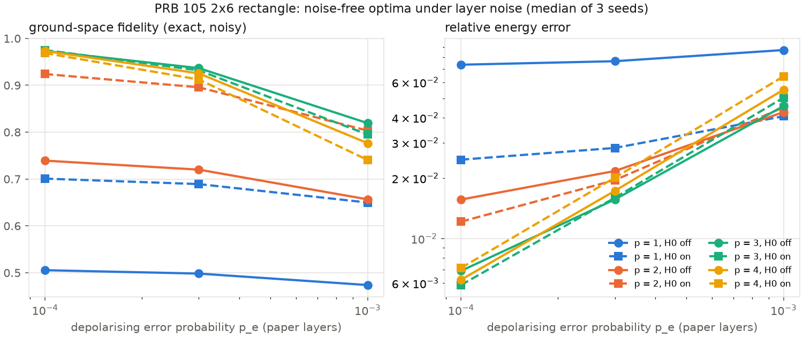

# Kagome VQE with the graph HVA: research overview (group meeting, November 2026)

Status (2026-11-21), branch `research/group-meeting-2026-11`. This document puts the
`graph_hva` studies into one line of argument:

**Kagome geometry → HVA → optimiser → noise → error mitigation → PIDN → limitations and future work.**

The studies were run in that order, but each one was planned after the previous one finished.
They therefore inherited choices (lattice, depth, H0 off) that were never re-examined. This
document separates what the data establish from what is a single test. It records where
every number comes from (Sec. 7) and lists the experiments still missing (Sec. 8). Every
number is quoted from the linked write-up. Three things were computed for this overview: the
geometry table (Sec. 1), the HVA design study (Sec. 2.2) and the replay check (Sec. 7.3).

Evidence labels used below:

* **Established**: exact (no sampling), or at least three seeds with an effect larger than the
  seed spread, on the system stated.
* **Limited**: one seed, one configuration, or an effect within the spread.
* **Gap**: not tested.

Everything is on small open clusters (10-12 qubits) in simulation. Nothing here has been run
on hardware.

## 0. Summary

| stage | question | answer on the PRB 105 2x6 rectangle | evidence | source |
|---|---|---|---|---|
| geometry | which cluster? | the 2x6 rectangle was taken as PRB 105's benchmark and because it fits square-grid and heavy-hex devices; it is boundary-dominated (3 of 12 sites fully coordinated) with a large gap (3.85 %) | geometry exact; physical representativeness a gap | Sec. 1 |
| HVA | depth, H0? | `p = 2`, H0 off (used in every noisy study) has the lowest fidelity of all `p ≥ 2` ansatzes under layer noise; H0 at `p = 2` gives F 0.80 vs 0.66 at `p_e = 1e-3` (≈ `p = 3`), but unmitigated energy does not improve (4.50 vs 4.26 %) because the extra layers add bias | established (exact, 3 seeds); mitigated ranking: gap | Sec. 2 |
| optimiser | which one? | without noise L-BFGS-B is best; under shots and layer noise, SPSA with a step cap ≈ ADAM + SPSA; at equal shots under compiled noise (2x5), plain parameter-shift GD is not beaten | limited (3 seeds, one budget each) | Sec. 3 |
| noise | what does noise do? | PRB 106 layer noise: `F ≈ (1 - p_e)^(nd) F0` holds; the bias is almost parameter-independent, so the gradient direction is kept (cos ≥ 0.997). Compiled device noise does turn the gradient (cos 0.17-0.98, device-dependent) | established (exact) | Sec. 4 |
| mitigation | what does QEM fix? | readout + symmetry removes the layer-noise bias at no cost (`p_e = 1e-3`); + twin up to `1e-2`. Mitigation fixes the **reported energy**, not **where the optimiser goes** | established (fixed parameters, exact limits); optimisation: limited | Sec. 5 |
| PIDN | does the surrogate help? | no: Stage I labels are shot-noise dominated, and even exact labels give only a 5-step horizon before closed-loop drift; no variant beats GD at equal cost | established for this system and noise | Sec. 6 |

The headline is negative for PIDN, but it is specific to the HVA design, lattice and noise used.
The HVA design study (Sec. 2.2, run for this overview) shows the ansatz carried through every
noisy study was not the best choice under noise. The open items are the ansatz choice after
mitigation (Sec. 2.4) and the geometry (Sec. 1.3), not PIDN itself.

## 1. Kagome geometry

### 1.1 What was used and why

All `graph_hva` studies use the **PRB 105 2x6 rectangle** (`kagome_bm_rectangle(2, 6)`, Bosse and
Montanaro, PRB 105, 094409 (2022)): 12 sites, 16 bonds, open boundaries,
`H = sum_bonds (XX + YY + ZZ)` (`= 4 sum S.S`), `E0 = -19.910298`. It was chosen because:

* it is a benchmark of a published HVA study, with a known exchange-gate schedule (`prb105`);
* it embeds in a square grid (FakeNighthawk with the paper's mapping) and in a heavy-hex ring
  (Kingston, Guadalupe) without SWAPs;
* 12 qubits allow **exact density matrices**. Every "exact" noisy number below depends on that.

Test C (Sec. 3, 6) used the **2x5** rectangle (10 sites, 14 bonds), so that density-matrix
optimisation runs fit the budget. Its numbers are not comparable with 2x6 numbers.

### 1.2 How representative is it? (computed for this overview)

`benchmarks/geometry_survey.py` (Lanczos on the full Hilbert space;
data [`experiments/data/geometry_survey.csv`](experiments/data/geometry_survey.csv)). Energies
in the Pauli convention; `E0/site (S.S)` divides by 4. "Gap" is the gap to the next distinct
level among the lowest eight (not resolved by total spin).

| cluster | sites | bonds | boundary | bonds/site | sites with 4 bonds | triangles | `E0` | `E0/site` (S.S) | gap | gap / \|E0\| |
|---|---|---|---|---|---|---|---|---|---|---|
| star (IBM 2022 unit cell) | 12 | 18 | open | 1.50 | 6 | 6 | -18.000 | -0.375 | 1.039 | 5.8 % |
| PRB 105 2x5 rectangle | 10 | 14 | open | 1.40 | 3 | 4 | -15.611 | -0.390 | 0.156 | 1.0 % |
| **PRB 105 2x6 rectangle** | 12 | 16 | open | 1.33 | 3 | 4 | -19.910 | -0.415 | 0.766 | 3.85 % |
| PRB 106 KVQE 20-site patch | 20 | 30 | open | 1.50 | 5 | 7 | -35.372 | -0.442 | 0.232 | 0.66 % |
| 2x2 torus | 12 | 24 | periodic | 2.00 | 12 | 8 | -21.780 | -0.454 | 0.466 | 2.1 % |
| 2x3 torus | 18 | 36 | periodic | 2.00 | 18 | 12 | -32.193 | -0.447 | 0.134 | 0.42 % |

The bulk kagome lattice has 2 bonds per site, every site in two triangles, and
`E0/site ≈ -0.438` in S.S units (DMRG; Yan, Huse and White, Science 332, 1173 (2011)).

What the table shows:

* The 2x6 rectangle is **boundary-dominated**: 9 of its 12 sites have fewer than 4 bonds, and
  it has 4 triangles, linked in a strip. It is a legitimate kagome cluster, but closer to a
  frustrated ladder than to the 2D lattice.
* Its relative gap (3.85 %) is the **largest of the non-trivial clusters**: about 6x the 20-site
  patch and 9x the 18-site torus. A large gap makes the ground state easier to reach and to
  separate from the first excited state. Energy-error thresholds (e.g. "1 %") mean different
  things on different clusters.
* The star is a correctness check: its ground state is the HVA reference state.
* The periodic 12-site torus is far harder for the same ansatz: F ≤ 0.59 at `p = 4`
  (baseline, Sec. 2).

### 1.3 Status

* **Established:** geometry and exact spectra above. The bond count is 16 (an old "20 bonds"
  in the documentation was a typo; the code always used 16, and no result changes).
* **Gap:** no VQE result on a cluster that represents the bulk. The PRB 106 20-site patch is
  implemented (`kagome_kvqe20`) but only used for exact diagonalisation. The 2x3 torus (18 sites,
  every site fully coordinated, relative gap 0.42 %) is the smallest bulk-like candidate.
  Both are beyond exact density matrices, so noisy studies there need the trajectory
  estimator (Sec. 8, item 3). The 2x6 rectangle stays as the PRB 105 benchmark; no earlier
  result is withdrawn.

## 2. HVA design

### 2.1 Ansatz

`graph_hva`: singlets on a dimer covering, then `p` cycles of exchange gates
`G(theta) = exp(-i theta/2 (XX + YY + ZZ))`, one parameter per gate (OPG). The optional H0 block is one exchange gate on every dimer per cycle, sharing one
parameter. On the 2x6 rectangle the schedule has 5 layers. Details:
[`graph_hva.md`](graph_hva.md).

### 2.2 Depth and H0: measured (HVA design study, 2026-11-21)

Stage 1, `configs/studies/graph_hva_design_reference.toml`: noise-free L-BFGS-B optima, 3 seeds,
equal budget of 10,000 statevector evaluations, parameters saved. Every `p ≥ 3` run and every H0
run at `p ≥ 2` used the whole budget, so those errors are upper bounds.

Stage 2, `configs/noise/graph_hva_design_fixed_noise.toml`: each optimum evaluated (not
re-optimised) under PRB 106 depolarising layer noise, exact density matrices.

Data: [`experiments/data/graph_hva_design_reference_runs.csv`](experiments/data/graph_hva_design_reference_runs.csv),
[`experiments/data/graph_hva_design_fixed_noise_points.csv`](experiments/data/graph_hva_design_fixed_noise_points.csv).

Medians over seeds. Cost columns:
* exchange gates per circuit;
* CX = 3 per exchange gate + 6 for the singlets (the minimum for this gate, before routing);
* `d` = noise layers per qubit in the PRB 106 model (`n d` locations with `n = 12`).

| `p` | H0 | parameters | exchange gates | CX (min) | `d` | noise-free error | `F0` | noisy `F` at `p_e` = 1e-4 / 3e-4 / 1e-3 | noisy energy error at `p_e` = 1e-4 / 3e-4 / 1e-3 |
|---|---|---|---|---|---|---|---|---|---|
| 1 | off | 16 | 16 | 54 | 6 | 7.19 % | 0.509 | 0.505 / 0.498 / 0.474 | 7.34 / 7.64 / 8.68 % |
| 1 | on | 17 | 22 | 72 | 7 | 2.29 % | 0.707 | 0.701 / 0.689 / 0.650 | 2.47 / 2.83 / **4.06 %** |
| 2 | **off (used so far)** | 32 | 32 | 102 | 11 | 1.26 % | 0.749 | 0.739 / 0.720 / 0.657 | 1.56 / 2.17 / 4.26 % |
| 2 | on | 34 | 44 | 138 | 13 | 0.84 % | 0.939 | 0.924 / 0.896 / 0.803 | 1.21 / 1.95 / 4.50 % |
| 3 | off | 48 | 48 | 150 | 16 | 0.25 % | 0.992 | 0.973 / **0.937** / **0.819** | 0.69 / **1.57** / 4.57 % |
| 3 | on | 51 | 66 | 204 | 19 | 0.084 % | 0.998 | **0.975** / 0.932 / 0.795 | **0.59** / 1.60 / 5.03 % |
| 4 | off | 64 | 64 | 198 | 21 | 0.073 % | 0.998 | 0.973 / 0.925 / 0.777 | 0.62 / 1.73 / 5.51 % |
| 4 | on | 68 | 88 | 270 | 25 | 0.060 % | 0.998 | 0.969 / 0.912 / 0.741 | 0.71 / 2.01 / 6.42 % |

(Seed spread: `p = 2` with H0 has `F0` 0.938 / 0.938 / 0.978; every other cell spreads by
≤ 0.01 in `F0`, apart from one `p = 4` H0 seed. Eq. 9 holds again: exact over estimated
infidelity is 0.995-1.000 in all 72 points, and the exact fidelity lies inside the trajectory
estimator's 95 % interval in 66 of them. First excited level: 3.85 % above `E0`.)

What the data show:

* **Without noise:**
  * H0 at `p = 2` lowers the error from 1.26 % to 0.84 % and raises `F0` from 0.75 to 0.94.
  * `p ≥ 3` is near exact with or without H0.
* **Fidelity under noise:** `p = 2` with H0 off, the ansatz carried through every noisy study,
  has the lowest fidelity of all `p ≥ 2` ansatzes at every noise level.
  * At `p_e = 1e-3`: H0 on at `p = 2` gives 0.80 against 0.66, the same level as `p = 3` with
    H0 off (0.82).
  * The earlier Eq. 9 estimate (0.84) used the best baseline seed. The measured seeds give
    0.80-0.84.
* **Unmitigated energy ranks differently**, because each extra noise location adds bias.
  * At `1e-4` deeper is better (best: `p = 3` with H0, 0.59 %).
  * At `1e-3` every `p ≥ 2` ansatz is at 4.3-6.4 %, and `p = 2` with H0 (4.50 %) is slightly
    *worse* than without (4.26 %). The best is the shallow `p = 1` with H0 (4.06 %).
  * At `1e-3` no ansatz gets below the first excited level (3.85 %).
* **The best depth falls with noise:** `p = 3` (with or without H0) at `1e-4`, `p = 3` with
  H0 off at `3e-4`, and at `1e-3` `p = 2` with H0 or `p = 3` by fidelity, `p ≤ 2` by
  unmitigated energy.

Interpretation (not yet tested): at `1e-3` the energy ranking is set by the noise bias, which
readout + symmetry removes almost completely on this model (Sec. 5). After mitigation the
energy ranking should therefore move towards the fidelity ranking, favouring `p = 2` with H0 or
`p = 3` with H0 off over the `p = 2`, H0-off ansatz used so far. `p = 2` with H0 is the cheaper of
the two:
* 34 vs 48 parameters;
* 88 vs 96 energies per parameter-shift gradient;
* 138 vs 150 CX.

Per-layer sharing (10 parameters at `p = 2`, PIDN-next test B) costs expressibility:
noise-free optimum 2.27 % (`p = 2`), 1.69 % (`p = 3`), 1.42 % (`p = 4`).

### 2.3 Why `p = 2`, H0 off was used throughout (reconstructed from the record)

1. The optimiser study switched H0 off "so that every optimiser optimises the identical
   circuit". H0 on was planned as a secondary arm of a full profile that was never run.
2. `p = 2` was the cheapest depth at which optimisers can differ: at `p = 1` every optimiser
   ends at the ansatz limit (7.2 %).
3. Each later study reused the previous study's optima or trajectories at `p = 2`, H0 off:
   noise reused the optimiser study's optima, ZNE-GD followed, and PIDN trained on the ZNE-GD
   trajectories. The setting was carried forward for continuity. **It was never chosen as the
   best ansatz under noise.**
4. The noise study supported `p ≤ 2` at `p_e = 1e-3` by unmitigated energy, among H0-off
   ansatzes only. By fidelity, `p = 2` with H0 off is the worst `p ≥ 2` choice (Sec. 2.2).

### 2.4 Status

* **Established** (exact noisy values, 3 seeds, equal budget): `p = 2` with H0 off is
  dominated by fidelity; H0 at `p = 2` reaches `p = 3`'s fidelity at `p_e = 1e-3` with fewer
  parameters and gates. The noise-free optima at `p ≥ 3` and with H0 are budget-limited.
* **Gap:**
  * the *mitigated* energy ranking of these optima (readout + symmetry, Sec. 8 item 1), which
    decides between `p = 2` with H0 and `p = 3`;
  * the same comparison under compiled noise;
  * optimisation under noise with the new ansatz.

## 3. Optimiser

### 3.1 Which optimisers entered when, and why

| optimiser | first used | why it was added |
|---|---|---|
| L-BFGS-B (finite differences) | baseline, optimiser study | strong noise-free reference |
| calibrated SPSA | legacy M1; optimiser study | 2 energies per step, standard for VQE |
| ADAM with the SPSA gradient | **legacy M1** (October 2026, commit `1a27c28`); optimiser study | stable normalised steps under shot noise. It predates the graph HVA; it was not added late |
| SPSA with a step cap 0.2 | noisy optimiser study | removes calibrated SPSA's early excursion (peak error 0.3-0.8) |
| parameter-shift GD (exchange rule, 2 energies per gate) | mitigation study | exact gradients needed for ZNE-GD and for PIDN's training data |
| GD with momentum; model gradient descent (MGD); noise-aware PIDN | PIDN-next test C | candidate noise-aware methods at equal shots |

The optimiser set changed between studies because each study asked a different question.
Rows from different studies are therefore not one ranking.

### 3.2 Findings

* **Noise-free, 3000 evaluations, `p = 2` (limited, 3 seeds):** L-BFGS-B 1.28 %, capped SPSA
  1.48 %, calibrated SPSA 2.40 %, ADAM + SPSA 3.07 %
  ([`experiments/graph_hva_noisy_optimizers.md`](experiments/graph_hva_noisy_optimizers.md), Sec. 4;
  [`experiments/graph_hva_optimizers.md`](experiments/graph_hva_optimizers.md), Sec. 7).
* **Shots and layer noise, 4.6 M shots (limited, 3 seeds):** capped SPSA best or joint best
  everywhere (2.3-2.8 %). ADAM + SPSA is level at depolarising `1e-3` and behind under bit
  flip. Calibrated SPSA without a cap is worst (excursion).
* **Equal shots under compiled FakeKingston noise, 2x5, readout + symmetry (limited, 3 seeds):**
  after 10,263 circuits the median noise-free error is GD 0.84 %, momentum 0.87 %, MGD 1.00 %,
  SPSA 1.29 %, noise-aware PIDN 0.70 % (within the seed spread). GD without noise or shots gets
  0.73 %. The step budget, not the noise, limits the descent (PIDN-next, Sec. 5).
* **Optimising under noise does not beat transferring noise-free optima** at the same budget
  (layer noise `p_e ≤ 1e-3`, 3 seeds; noisy optimiser study, Sec. 5).

### 3.3 Status

* **Limited:** 3 seeds, one budget per study, hyperparameters from a single pilot seed (101).
* **Gap:** an equal-budget optimiser comparison at the ansatz chosen in Sec. 2.4. `p = 3`
  (where the 1 % success threshold can discriminate) was never compared.

## 4. Noise

Two noise modes are kept strictly apart:

* **PRB 106 paper-layer noise:** Pauli channel `p_e` on every qubit after each layer, no
  routing. `p_e` is a model parameter, not a device error rate.
* **Compiled hardware noise:** the fake backend's noise model on the routed native circuit.

Findings:

* **Eq. 9 holds** on the 2x6 rectangle: simulated over estimated infidelity is 0.99-1.00 for
  `p_e ≤ 1e-3`, and depolarising and bit flip act alike. Established, exact, 56 points
  ([`experiments/graph_hva_noise.md`](experiments/graph_hva_noise.md)).
* **On the layer model the bias barely depends on the parameters:** +0.54 to +0.63 (mean +0.57)
  at `p_e = 1e-3` over 48-66 parameter sets. The noisy landscape is the noise-free one shifted
  and contracted, and the gradient direction is kept (cosine ≥ 0.997 at GD iterates). Established.
* **Compiled noise turns the gradient.** Exact cosine between the noisy and the noise-free
  gradient at GD iterates 10-60:
  * FakeNighthawk with the PRB 105 mapping: 0.95-0.98;
  * FakeKingston, best hexagon: 0.92-0.97;
  * FakeKingston, median hexagon: 0.62-0.84;
  * FakeGuadalupeV2: 0.17-0.61.

  Established for these points and models; exact, 3 seeds at iteration 10, one seed along the
  path (PIDN-next, Sec. 3).
* FakeGuadalupeV2 loses about half the energy at the `p = 2` optimum: 144 CX after routing,
  energy -9.8 instead of -19.7. One point; limited.

**Gap:** compiled-noise studies at H0 on or `p = 3`; noise on any other cluster.

## 5. Error mitigation

* **ZNE on layer noise:** the noisy energy decays almost exponentially in the noise scale. An
  exponential fit leaves 0.3 % of the bias at `p_e = 1e-3`; the price is 1.3-1.6x the standard
  error and 3x the circuits. Established, exact
  ([`experiments/graph_hva_mitigation.md`](experiments/graph_hva_mitigation.md), Sec. 2).
* **ZNE inside gradient descent is worse at equal cost** (2.65 % vs 2.29 %): it buys 3x fewer
  iterations without a better direction. It makes the reported energy correct (+0.002 against
  +0.575). Limited, 3 seeds.
* **M2 stacks** ([`experiments/graph_hva_m2_mitigation.md`](experiments/graph_hva_m2_mitigation.md);
  depolarising + readout error 0.02):
  * readout correction then symmetry filtering: bias +0.4 % at `p_e = 1e-3`, at no extra
    circuits or variance;
  * readout + symmetry + twin: within 1 % up to `1e-2`;
  * symmetry with ZNE over-corrects (-10.6 % at `1e-2`).

  Established: fixed parameters, 16 repeats, each sampled cell checked against its
  infinite-shot limit.
* **Mitigation changes what a run reports, not where the optimiser goes:** noise-free errors with
  and without the stacks agree within the seed scatter, for GD and for SPSA. Limited, 3 seeds.
* On compiled noise, readout + symmetry restores most of the gradient direction: Kingston best
  0.92 → 0.98, median 0.62 → 0.89. Exact quadratic ZNE recovers the rest on the moderate
  models (0.99-0.997), but not on Guadalupe (0.24). Established for the points tested.

**Gap:** a mitigated optimisation on compiled noise at 2x6. Only fixed-point gradients (A) and the
2x5 test C exist.

## 6. PIDN

PIDN (Liu and Wang, arXiv:2605.02066) trains a network on `T_init` iterations of ZNE gradient
descent (Stage I) and then follows the network's gradient (Stage III). The four candidate
causes of its failure, separated:

| cause | test | result | status |
|---|---|---|---|
| **noisy gradient labels** | open loop (predict recorded later gradients) with ZNE labels vs exact labels; emulated shot scaling 1x-4096x; network sizes 1k-21k weights | ZNE labels: cosine 0.14 one to five steps ahead (the measured gradient itself: 0.48). Exact labels: 0.97. 512x shots: 0.87. Every network size memorises the noise; smaller ones extrapolate worse | established (3 seeds) |
| **trajectory distribution shift** | exact labels on a noisy Stage I path; open-loop horizon with exact labels | exact targets on a noisy path still fail. With exact labels on a clean path the cosine falls 0.97 → 0.72 → 0.44 at 1-5 / 6-20 / > 20 steps | established |
| **closed-loop drift** | closed loop from noise-free Stage I | improves for 10-15 surrogate steps, then drifts uphill: 9 % final error against 2.1 % for GD | established |
| **ansatz design** | per-layer sharing (32 → 10 angles) | SNR 2.6x, open-loop cosine 0.14 → 0.31 (0.8 needed for a closed loop); costs expressibility (Sec. 2.2) | limited; H0 on and other `p`: gap |

Sources: [`experiments/graph_hva_pidn.md`](experiments/graph_hva_pidn.md) (Sec. 5),
[`experiments/graph_hva_pidn_m2.md`](experiments/graph_hva_pidn_m2.md) (Secs. 3.2-3.6),
[`experiments/graph_hva_pidn_next.md`](experiments/graph_hva_pidn_next.md) (Secs. 4-5).

Fair comparison (same Hamiltonian, ansatz, noise model and total shots):

* On the 2x6 rectangle with layer noise, PIDN was charged its Stage I and Stage III circuits
  (6,000-8,925) and compared with GD at 11,700. It ended worse with fewer circuits, so no budget
  shift could reverse the result. Anchoring every 5 steps equals GD with the same number of
  measured gradients.
* The only **equal-shot** comparison is test C, on the 2x5 rectangle with compiled Kingston
  noise: noise-aware PIDN 0.70 % against GD 0.84 % (medians; seeds 0.69 / 0.93 / 0.70 against
  0.70 / 0.84 / 0.89). That is within the spread, and the surrogate gradients are uncorrelated
  with the measured ones (cosine -0.02 to -0.11).

Conclusion for this system: PIDN's limit is the signal-to-noise and the coverage of its Stage I
data, not mitigation and not network size. A niche would need a problem where GD is
noise-limited rather than step-limited and the mitigated gradient is still accurate.

## 7. Consistency and reproducibility

### 7.1 Branches

`research/group-meeting-2026-11` = `feature/graph-hva-pidn-next` (5abd923) + the IBM Runtime audit
from `ibm-hardware-results` (`docs/ibm_runtime_audit.md`) + this reorganisation. `main` and
every feature branch are kept unchanged.

| branch | head | in this branch? | adds |
|---|---|---|---|
| `main` | 273c8e6 | yes | legacy package, M0-M2 on the star, report and deck |
| `feature/general-kagome-hva` | ead3993 | yes | `graph_hva`, lattices, hardware mappings |
| `feature/graph-hva-optimizer-study` | f07ca2f | yes (its docs fix 20 → 16 bonds was made independently in de11d88) | persistence, studies, optimiser study |
| `feature/graph-hva-noise-study` | de11d88 | yes | PRB 106 noise, noisy optimiser study |
| `feature/graph-hva-mitigation` | 1d21256 | yes | ZNE, exchange-gate shift rule, GD |
| `feature/graph-hva-m2-mitigation` | 623ab6a | yes | M2 stacks, exact limits |
| `feature/graph-hva-pidn` | 5030c28 | yes | PIDN |
| `feature/graph-hva-pidn-m2` | 440ca93 | yes | PIDN with M2, shots, capacity, smoothing |
| `feature/graph-hva-pidn-next` | 5abd923 | yes (base) | noise direction, per-layer sharing, MGD, test C |
| `ibm-hardware-results` | f588e6d | cherry-picked | IBM Runtime audit (docs only) |

Dependabot branches on `origin` (dependency bumps) are not merged.

### 7.2 Provenance of every result

All results directories are local (`results/` is not in git). Their summary tables are copied
to `docs/experiments/data/`.

**Every run was made from an uncommitted working tree.** Each run's `environment.json`
records the parent commit with `dirty = true`; the code that produced it was committed
afterwards, together with its write-up. The last column gives that commit. Scripts in
`benchmarks/` do not write `environment.json` at all.

| experiment (write-up, section) | config / script | lattice | `p`, H0 | noise | shots / basis | budget per run | seeds | results directory | recorded → code commit |
|---|---|---|---|---|---|---|---|---|---|
| baseline (baseline) | `studies/graph_hva_baseline.toml` (original: `benchmarks/graph_hva_vqe_sweep.py`) | star, 2x6, 2x2 torus | 1-4, off/on | none | - | maxfun 15,000 | 1, 2 | JSONL only: `docs/experiments/data/graph_hva_baseline_2026-11-10.jsonl` (no parameters) | pre-persistence, ead3993 |
| optimiser pilot and comparison (optimizers 5, 7) | `studies/graph_hva_optimizer_{pilot,representative}.toml` | 2x6 | 1, 2, off | none / shots | 1024 | 3000 evaluations / 4.608 M shots | 101 / 1-3 | `20261111T131836Z-graph_hva_opt_pilot`, `20261111T132627Z-graph_hva_opt_repr` | ead3993 dirty → 33277b9 |
| PRB 106 fixed parameters (noise 5) | `noise/graph_hva_noise_fixed_prb106.toml` | 2x6 | 1, 2 (3 seeds), 3 (1 seed), off | layer dep / bf `1e-5`-`1e-2`, exact | 1024 (measured column) | - | 1-3 | `20261112T045452Z-graph_hva_noise_fixed_prb106` | 33277b9 dirty → de11d88 |
| noisy optimisers and transfer (noisy_optimizers 3-5) | `studies/graph_hva_noise_opt_{pilot,representative}.toml`, `noise/graph_hva_noise_transfer.toml` | 2x6 | 2, off | shots; layer dep `3e-4`, `1e-3`; bf `1e-3` | 1024 | 3000 / 4.608 M shots | 1-3 | `20261112T035114Z-graph_hva_noise_repr`, `20261112T050824Z-graph_hva_noise_transfer` | 33277b9 dirty → de11d88 |
| compiled-noise example (noise 6) | `noise/graph_hva_noise_hardware_example.toml` | 2x6 | 2, off | FakeGuadalupeV2, SABRE | 4096 | - | 1 | `20261112T051926Z-graph_hva_noise_hardware_example` | 33277b9 dirty → de11d88 |
| ZNE fixed parameters (mitigation 2) | `mitigation/graph_hva_zne_fixed{,_bitflip}.toml` | 2x6 | 1-3, off | layer `1e-3`-`1e-2`, exact | SE at 1024 | - | 1-3 | `20261116T155508Z-…_zne_fixed`, `20261116T155437Z-…_bitflip` | de11d88 dirty → 1d21256 |
| ZNE gradient descent (mitigation 3) | `studies/graph_hva_zne_gd_representative.toml` | 2x6 | 2, off | none, shots, dep `1e-3` ± ZNE | 1024 | 11.98 M shots | 1-3 | `20261116T161135Z-graph_hva_zne_gd` | de11d88 dirty → 1d21256 |
| M2 table, strong noise, exact limits (m2 2-5) | `mitigation/graph_hva_m2_fixed{,_strong}.toml`, `benchmarks/m2_exact_limits.py` | 2x6 | 2, off | dep `1e-3`/`3e-3`/`1e-2` + readout 0.02 | 1024 | 16 repeats | optimum of seed 1, point 0.3 | `20261116T181808Z`, `20261117T015141Z` + `030218Z`, `20261117T024920Z` | 1d21256 / a8e5037 dirty → a8e5037 / 623ab6a |
| M2 optimisations (m2 6) | `studies/graph_hva_m2_{gd,spsa}.toml` | 2x6 | 2, off | dep `1e-3` + readout 0.02 | 1024 | **GD 12.0 M, SPSA 4.65 M shots** | 1-3 | `20261116T194536Z-graph_hva_m2_gd` (run from the PIDN branch's tree), `20261117T015513Z-graph_hva_m2_spsa` | 8a7b2e9 / a8e5037 dirty → 623ab6a |
| PIDN (pidn 5) | `pidn/graph_hva_pidn_{representative,clean_limit}.toml` | 2x6 | 2, off | dep `1e-3`, ZNE Stage I | 1024 | Stage I 10 ZNE iterations | 1-3 | `20261116T165446Z-graph_hva_pidn{,_clean}` | 222f1b9 dirty → 5030c28 |
| PIDN with M2, shots, capacity, smoothing (pidn_m2 3) | `pidn/graph_hva_pidn_m2*.toml`, `…_shot_scaling`, `…_capacity`, `benchmarks/pidn_*` | 2x6 | 2, off | dep `1e-3` + readout 0.02 | 1024 (×1-4096 emulated) | see write-up | 1-3 | `20261116T183018Z` … `20261117T024148Z` | 8a7b2e9 / bf7797d dirty → bf7797d / 440ca93 |
| A: gradient direction (pidn_next 3) | `benchmarks/noise_direction.py` | 2x6 | 1-3 optima, 2 GD points, off | layer `1e-3`; Nighthawk, Kingston, Guadalupe | exact | - | 1-3 | `20261117T124800Z-noise_direction` | not recorded → 5abd923 |
| B: per-layer sharing (pidn_next 4) | `studies/graph_hva_per_layer_{reference,gd}.toml`, `benchmarks/pidn_per_layer_openloop.py` | 2x6 | 2-4 per layer, off | none; dep `1e-3` + readout 0.02, readout + symmetry | 1024 | 10,000 evaluations; 60 iterations | 1-3 | `20261117T064315Z-…_per_layer_{reference,gd}`, `20261117T081646Z-…_openloop` | 440ca93 dirty → 5abd923 |
| C: equal-shot optimisers (pidn_next 5) | `benchmarks/pidn_next_optimizers.py` | **2x5** | 2, off | FakeKingston best hexagon, readout + symmetry | 1024 | 10,263 circuits | 1-3 | `20261117T124800Z-graph_hva_pidn_next_c` | not recorded → 5abd923 |
| HVA design study (this document, Sec. 2.2) | `studies/graph_hva_design_reference.toml`, `noise/graph_hva_design_fixed_noise.toml`, `benchmarks/hva_design_report.py` | 2x6 | 1-4, off/on | none; layer dep `1e-4`, `3e-4`, `1e-3`, exact | - | 10,000 evaluations | 1-3 | `20261121T132255Z-graph_hva_design_reference`, `20261121T135414Z-graph_hva_design_fixed_noise` | 0dc1c37 (dirty only in the user's uncommitted `pyproject.toml` / `uv.lock`, which add an unused optional `torch` dependency) |
| geometry survey (this document, Sec. 1) | `benchmarks/geometry_survey.py` | six clusters | - | none | - | - | - | `results/geometry_survey_20261121/` | this branch |

### 7.3 Replay check

`kagome-vqe replay` re-runs a saved run from its `config.toml` with the code of this branch:

| run | type | original final energy | replay (2026-11-21) |
|---|---|---|---|
| `graph_hva_opt_repr` `p2-noh0-sv-lbfgsb-s1` | noise-free L-BFGS-B, 3000 evaluations | -19.65610121 | identical |
| `graph_hva_noise_reference` `p3-noh0-sv-lbfgsb-s1` | noise-free L-BFGS-B, 10,000 evaluations | -19.86052334 | identical |
| `graph_hva_noise_repr` `p2-noh0-dep0.001-spsa_cap0.2-s1` | layer noise `1e-3`, 4.6 M sampled shots | -18.83581543 (noise-free -19.41413805) | identical, bit for bit (same final, measured and noise-free energies, 1499 evaluations) |

So the dirty-tree runs are reproducible with the committed code, for one run of each of the two
oldest milestones. This is one run per type, not a check of every study.

### 7.4 Comparability rules

Do not compare numbers across these lines without saying so:

* **Different lattices:** test C is on the 2x5 rectangle (`E0 = -15.611`, gap 1.0 %); everything
  else is on 2x6. "0.84 % (C)" is not better than "2.07 % (M2 GD)".
* **Different budgets:** 3000 exact energies (noise-free studies), 4.6 M shots (optimiser and
  noisy-optimiser studies, M2 SPSA), 12 M shots (ZNE-GD, M2 GD), 10,263 circuits (C). In the M2
  optimisation table, GD had 12.0 M shots and SPSA 4.65 M shots.
* **Different noise-free references:** the baseline (2 seeds, capped at 15,000 evaluations, no
  saved parameters) and the HVA design study (3 seeds, 10,000 evaluations) differ in budget;
  e.g. `p = 3`: 0.165 % (baseline best) vs 0.25 % (design study, median). Use the design study
  for `(p, H0)` comparisons.
* **Different metrics:** the noise-free error of the returned parameters (the parameter quality
  used everywhere) is not the measured energy (which includes noise bias and shot noise).
* **Different noise modes:** paper-layer `p_e` and compiled device models answer different
  questions; their numbers are never mixed.
* **Per-gate vs per-layer:** 32 vs 10 parameters at `p = 2`.

## 8. Limitations and future work

Limitations common to all studies:

* one non-trivial cluster (12 sites, boundary-dominated, large gap);
* one ansatz setting carried through the noisy studies (`p = 2`, H0 off);
* three seeds;
* hyperparameters from single pilot seeds;
* simulation only.

Planned next steps, in order.

1. **Choose the ansatz after mitigation (highest priority; cheap).** The HVA design study is
   done (Sec. 2.2). Next, evaluate its optima with readout + symmetry (and readout + symmetry
   + twin) in the infinite-shot limit (`benchmarks/m2_exact_limits.py` method) at
   `p_e = 1e-3` + readout 0.02. Then choose between `p = 2` with H0 and `p = 3` with H0 off, and
   rerun the key noisy results (optimiser comparison, M2 optimisation) at that ansatz. Optimise
   the H0 optima further (they used the full 10,000 evaluations).
2. **Optimiser comparison at the chosen ansatz:** equal shots, five seeds, GD, capped SPSA,
   ADAM + SPSA, under one layer-noise level and one compiled model.
3. **Geometry:** VQE noise-free on the 2x3 torus and the 20-site patch (statevector), the
   depth needed and the boundary effect. Noise there only with the trajectory estimator.
4. **PIDN:** revisit only if items 1-3 produce a setting where GD is noise-limited and the
   mitigated gradient is accurate (Sec. 6). Otherwise report the negative result as it stands.
5. **Reproducibility:**
   * commit before running;
   * write `environment.json` from the benchmark scripts too;
   * keep a copy of `results/` off this machine.

## Write-ups

Per stage, in order:

* [`experiments/graph_hva_baseline.md`](experiments/graph_hva_baseline.md)
* [`experiments/graph_hva_optimizers.md`](experiments/graph_hva_optimizers.md)
* [`experiments/graph_hva_noise.md`](experiments/graph_hva_noise.md)
* [`experiments/graph_hva_noisy_optimizers.md`](experiments/graph_hva_noisy_optimizers.md)
* [`experiments/graph_hva_mitigation.md`](experiments/graph_hva_mitigation.md)
* [`experiments/graph_hva_m2_mitigation.md`](experiments/graph_hva_m2_mitigation.md)
* [`experiments/graph_hva_pidn.md`](experiments/graph_hva_pidn.md)
* [`experiments/graph_hva_pidn_m2.md`](experiments/graph_hva_pidn_m2.md)
* [`experiments/graph_hva_pidn_next.md`](experiments/graph_hva_pidn_next.md)

Prehistory: [`experiments/legacy_m0_m1_m2.md`](experiments/legacy_m0_m1_m2.md) (ring ansatzes
on the 12-site star) and [`ibm_runtime_audit.md`](ibm_runtime_audit.md).
